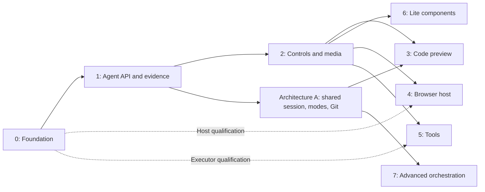

# Design mode: architecture, implementation, and roadmap

**Status: shared-session HTML/CSS v1 and Design directory Pages implemented;
later feature phases remain planned. Updated 2026-10-18.** This is the single
Design engineering reference: current product behavior, source formats,
ownership, compatibility, resource limits, qualification, and the remaining
roadmap. Code, schemas, and
tests are authoritative when prose and behavior disagree. Implementation is not
proof that a feature is released or qualified on every provider and host.

Keep current contracts here after v1 ships. Update the relevant section when its
code changes; retire completed roadmap tasks into those sections. Other guides
link here for Design-specific behavior instead of maintaining a second plan.

- [Status and architecture decisions](#0-status-and-architecture-decisions)
- [Implemented behavior and code owners](#1-implemented-design-mode)
- [Future architecture and host requirements](#2-target-architecture)
- [Product decisions](#3-decisions)
- [Phases and dependency gates](#4-phases-and-dependency-gates)
- [Verification and qualification](#5-verification-and-qualification)
- [Non-goals](#6-non-goals-for-this-roadmap)

## 0. Status and architecture decisions

Use one workspace, branch, index, conversation, provider binding, and context
for Code and Design. Composer mode expresses authoring intent; opening a tab
never changes it. The **+ → Design** menu adds a removable tag. The Design tab
hosts the existing canvas and offers **Create design directory** when empty.
User-selected or user-authorized agent switches preserve the session and inject
fresh instructions. There is no Code Restriction toggle, designer-only workspace,
separate Design provider, or mode-selected sandbox in v1.

Local Code and Design contexts author HTML, CSS, assets and `meta/canvas.json`
with ordinary provider Read/Write/Edit/patch/shell tools. No API
apply/import/publish step is required. Optional API inspection and semantic
editing, and human visual edits, operate on those same files. Cloud worker
execution policy is separate: its
Design authoring uses the API and cannot fall back to native Design writes.

`meta/design.toml` v3 registers the Design root and stable directory ID;
`meta/canvas.json` v2 owns its page catalog and stable frame IDs. Each page has
one folder under that root; tokens, components, assets and rules stay shared.
Root v1/v2 registrations and canvas v1 remain readable. Registration and
generated `rules.md` remain lifecycle-managed. Explicit Design authoring migrates
legacy storage recoverably; inspection does not rewrite the branch. Native edits
are ordinary file saves, not semantic transaction receipts or automatic Git
commits.

The private authored-store/publication system and separate Design-session
admission were removed. Keep checkout-backed `DesignDraftStore`: it supplies
checked transactions for visual/API edits, not another authored copy. Private
journals, retry receipts and immutable evidence remain useful local state.
Experimental private-store ownership markers remain protected for recovery;
never delete them to bypass admission or silently discard unpublished work.

| Area                                                                                 | Current status                                                            |
| ------------------------------------------------------------------------------------ | ------------------------------------------------------------------------- |
| Shared workbench, directory lifecycle, selection and bounded retained canvases       | Implemented                                                               |
| Composer tag, persisted mode/revision, continuation instructions and API mode checks | Implemented                                                               |
| Local native HTML/CSS authoring, `meta/canvas.json`, migration and watcher refresh   | Implemented                                                               |
| Page lifecycle, inspector picker, per-page views and page-aware frame writes          | Implemented; framework Code page routes remain Phase 3                    |
| Foundation, visual editing, semantic transactions, history and sandboxed previews    | Implemented                                                               |
| Scoped inspection, semantic helpers, request receipts and optional capture           | Implemented; capture requires a qualified host                            |
| Shared Files/Changes/Review and mixed managed Git                                     | Implemented; Design checkpoint compatibility retained internally         |
| Proposal/result storage and existing human review compatibility                      | Retained internally; not exposed through the v1 conversation tool catalog |
| Frame-context routes, composer source/image attachments and HTTP preview              | Implemented; native capture requires a qualified host                                   |
| Conflict detection, paused canvas, Retry/Cancel                                      | Implemented; semantic Design conflict resolution deferred                 |
| Cloud Design continuity and native cloud agent authoring                            | Deferred; cloud v2 advertises no Design capability                         |
| Controls/media, code/web/tool surfaces, lite components and advanced orchestration   | Phases 2–8; not implemented by the native-authoring enhancement           |

Do not infer delivery from old branch notes or test counts. The current source
supports authored HTML/text frames. It does not execute TSX or authored scripts,
provide framework adapters, implement a general surface plugin system, or promise
that every generated design completes within a particular time.

## 1. Implemented Design mode

Current contracts: [source and registration](#source-metadata-and-personal-state),
[migration](#migration-and-git), [canvas format](#canvas-format),
[page operations](#page-operations-and-agent-targeting),
[composer and sessions](#composer-and-shared-agent-lifecycle),
[authoring and tools](#native-authoring-and-optional-tools),
[visual editor](#renderer-and-editor-contract),
[receipts and evidence](#review-receipts-and-evidence),
[limits](#performance-and-safety-ceilings), [Git](#git-and-concurrency),
and [compatibility](#identity-and-compatibility-reference).

### Code ownership

| Owner                                                                            | Responsibility                                                                                     |
| -------------------------------------------------------------------------------- | -------------------------------------------------------------------------------------------------- |
| `packages/protocol/src/composer-mode.ts`                                         | Authoring policy and native/API instruction variants                                               |
| `engine/db/chats.ts`, `design/conversation-mode.ts`                              | Persisted conversation mode and revision                                                           |
| `engine/agents/session-tools.ts`, `agents/gateway.ts`                            | Product tool admission/disposal and prompt/steer preparation in the existing execution             |
| `engine/design/code-tool-admission.ts`, `conversation-tools.ts`, `code-tools.ts` | Workspace/directory ownership, mode checks, native context and scoped API tools                    |
| `engine/design/manifest.ts`, `canvas-file.ts`, `metadata.ts`, `directory.ts`     | Registration, scene formats, discovery and recoverable migration                                   |
| `engine/design/layout.ts`, `pages-migration.ts`, `page-lifecycle.ts`, `page-selection.ts` | Layout resolution, per-directory migration, page operations and prompt hints                  |
| `packages/design-core`, `packages/design-web`                                    | Foundation schemas/history and HTML/CSS parsing, provenance, semantic edits and headless rendering |
| `engine/design/document.ts` and its storage/transaction/lifecycle/render modules | Compatible public facade over checkout-backed source and transactions                              |
| `engine/design/routes.ts`, `workspace/service.ts`                                | Design routes behind workspace policy, directory leases and mutation coordination                  |
| `renderer/features/design-workspace/`                                            | Workbench, canvas, camera, frames, Layers, inspector, review and exact-owner caches                |
| `packages/protocol/src/design-runtime.ts`                                        | Versioned private iframe messages and source generations                                           |
| `electron/design-protocol.ts`, Design capture/export modules                     | Scoped native resources, bounded capture and PNG export                                            |

Paths beginning `engine/` or `renderer/` above are relative to
`apps/desktop/src/`; `electron/` is relative to `apps/desktop/`. Preserve public
exports, IPC names, serialized keys and compatibility aliases when moving code.
The canvas remains substantial: extend existing owners rather than accumulating
new hosts, storage and provider policy in its interaction component.

### Product and workspace model

A Zeros workspace has one managed Git worktree, one checked-out branch, and one
Git index. Code and Design are concurrent views of that checkout; they are not
separate worktrees, branches, copies, projections, or execution backends.

```text
Shared native agent + Design mode ─► HTML/CSS/assets/meta/canvas.json in the checkout
                                               ▲
Human canvas + optional Design API ─► DesignDraftStore (checked transactions)
                                               │
                                  workspace watcher → canvas refresh
```

The active Design directory comes from the private `[design] directory_id`
selection and the `meta/design.toml` manifests in this checkout (legacy root
`design.toml` remains readable). Legacy `[design] directory` paths remain
readable. `Zeros Design/` is the unconfigured pointer default; the explicit
Create Design directory action creates `<repo name> -
Design/` when no Design folder exists. Opening the tab alone does not create
files. A single discovered folder is reused. The Design directory menu selects
a workspace-local stable ID. Repository settings no longer expose Design mode,
Directory or Preferences tabs. Their former management links are removed;
directory management UI may be added inside the Design tab in a future change.
Existing private defaults, registrations and lifecycle operations remain
compatible. Source remains materialized and readable from both surfaces.

#### Shared workbench navigation

The permanent Design tab sits beside Files, Changes, Review and Context in the
existing workbench. The same conversation column stays present. Inside Design
a full-width secondary toolbar sits above the canvas, and the properties
panel attaches to its right edge
(`design-workspace.tsx`, `design-directory-pill.tsx`,
`design-floating-panel.tsx`):

- **Secondary toolbar**: a far-left Layers + Inspector toggle followed by the
  Design directory switcher. It uses the shared workbench toolbar slot below
  the main tabs and above status banners. ⌘\ / Ctrl+\ also toggles the panel
  while focus is in Design, its toolbar, or nowhere.
- **Tool rail** (left, vertically centred): Move, Frame, Text, Themes and
  Motion in one vertical toolbar. It centres in the canvas above an open
  Motion timeline, with an 8px edge inset.
- **Layers + Inspector panel** (right, full content height): attached without
  outer gaps, corner rounding or shadow. Layers sits on top at a
  draggable height (`Resize Layers panel`: pointer, arrows, Home/End,
  double-click resets), the inspector below. The panel's left edge resizes
  its width. Hovering either border shows the resize cursor without a grip
  or tooltip; keyboard focus still has an outline. Its title folds the Layers
  tree down to its header so the inspector can take the panel.
- **Page picker** (inspector, above Background): with no frame/node selected,
  the File-icon header shows the active page title and a chevron. Its shared
  radio menu lists pages, New page, Rename page… and Delete page…. With a
  selection, the inspector keeps its frame/node header.
- **Motion timeline**: floats along the bottom and ends beside the panel, so
  keyframes and the inspector fields they animate stay usable together.

The chrome is not canvas. Wheel input over any island scrolls that island (or
nothing) and never pans or zooms the canvas; pointer input on it never
marquees or deselects. The secondary toolbar and panel sit outside the canvas viewport and
its keyboard scope; the tool rail and timeline stay inside it, so tool
shortcuts and the Space-drag hand keep working from them. When the canvas is
too short for both, the tool rail stays above the timeline so every tool is
reachable. Hiding the panel keeps it mounted and inert, so the inspector's
document shortcuts (save, undo, redo) keep working and focus inside it returns
to the canvas. Separators resize from, and report, the size actually on screen,
and a width drag moves the neighbouring chrome with it.
Panel seams retain the pointer's grab offset and ignore other pointers. Escape,
pointer cancellation, window blur, hiding the panel or leaving Design restores
the starting size without saving; a drag back to its starting position is also
a no-op. Width and Layers-height preferences update retained workspaces and
other windows before their separators measure the visible size.
An inactive Design surface hides and inerts its portaled Theme window (it
returns in place with its drafts) and stops Motion playback. Selecting a tab
changes no agent mode.

`workspace.kind`/`viewMode` and `workspace.setMode` remain serialized legacy
contracts, including existing creation flows. On first use, a legacy Design
selection opens Design once; subsequent choices survive reload without forcing
Design again. These fields do not authorize human Design editing. The implemented
composer modes and provider tool gating use separate conversation-owned state.

Each workspace binds one Design directory. `activePageId` and a bounded `byPage`
map retain 32 recent page views: camera, frame/node selection and
canvas background. The existing flat fields remain the active projection under
`zeros:design-workspace-ui-v1`. Legacy `codeView` flags are ignored on load and
omitted from subsequent saves; the Source toggle and overlay have been removed.
A switch saves/restores that projection in one synchronous store update, with
no bridge read or await on the click path. Legacy
flat fields lift into the first confirmed page once; reload restores the active
page and its views. Only a settled matching catalog can prune remembered pages
or selections; a removed page falls back to the first page. Panel visibility
remains workspace-wide and layer disclosure uses page-qualified frame files.
A stable directory ID survives rename; replacing it resets the old page views,
selection/camera and runtime foundations. Switching back to an
older directory starts a fresh document view; it does not restore a second
per-directory editor history. The serialized view keeps its field names:
`inspectorVisible` is the properties panel's visibility and `layersVisible`
whether its Layers tree is unfolded. App-wide sizes stay in their existing
keys — the panel width is the Style width (`zeros.design.style.width`) and the
Layers split has its own `zeros.design.layers.height` (96px minimum, leaving
the inspector at least 200px); both are boot CSS variables. Layers height
commits synchronize retained canvases and other windows. The retired Layers
width key stays readable. At most two visited Design canvases are retained.
Inactive tabs/owners and a collapsed workbench are inert, hidden and inactive,
with stable iframe DOM order. Pages do not add retained canvases. A memoized
projection shows only the active page's frames in Canvas and Layers and keeps
unchanged frame references stable; tokens, assets and lint remain directory-wide.

Mutation callers capture workspace, directory, page and frame at submission.
Late selection, camera and presentation replies cannot affect another visible
owner. Page switching cancels gestures, hover/marquee state, inline editors and
frame-anchored menus; an inspector blur still commits to its captured original
page. Background edits update that page's private view memory. Directory-level
undo/redo reveals the affected frame's page and restores its selection while
the submitting owner is still current. Page deletion prunes undo/redo entries
and API sessions for that folder, including previously deleted frames. Permanent
missing-page history errors drop the entry so older history remains usable;
history cannot recreate a removed page's source.

`design.initialize` is an explicit managed-workspace operation. It creates
or adopts metadata without changing workspace kind, HEAD or the index. Directory
selection waits for pending edits, changes only the workspace-local pointer and
invalidates exact-owner reads. Mutations carrying an old directory ID are
rejected, and queued local edits retain the directory identity they started in.
Missing, ambiguous, conflicted or unsupported manifests show recovery
feedback instead of silently creating a replacement document. Repository Settings
rename remains an explicit main-checkout rename commit: live checkouts keep their
own paths through a compatible stable ID; legacy/incompatible pointers block it.

Cloud v2 does not expose the Design directory lifecycle or document API.
These operations currently belong to Local.

#### Source, metadata and personal state

```text
<repo>/
  Product - Design/
    meta/
      design.toml       manifest v3, registration and stable directory ID
      canvas.json       canvas v2, pages, frame IDs, sources and geometry
    rules.md            short native-authoring and compatibility instructions
    tokens.css          shared tokens
    components/         shared components
    assets/             images and other assets
    page-1/
      home.html         authored frame on Page 1
    checkout/
      home.html         another page may use the same basename
  .zeros/               ignored private settings and local state
```

Local Code and Design contexts use normal provider tools to author HTML, CSS,
assets and `meta/canvas.json` when requested. The Design tag chooses the default
editing target; a selected frame in Code context is normally an application
implementation reference. Explicit instructions override that default. Shared
Files editing, partial staging, discard and restore support Design source,
including repair of existing malformed or conflicted metadata. Creation of
registration remains lifecycle-managed. Cloud/remote authoring retains its
existing policy. Mode instructions do not provide a filesystem sandbox.

Commit the folder, `meta/design.toml`, `meta/canvas.json`, `rules.md`, page folders
and referenced source together. New directories have one generated stable page
ID, title "Page 1", folder `page-1`, root rules/tokens and no frames. The empty
folder is created without `.gitkeep`; a fresh clone may omit it, and its first
frame write recreates it. Uncommitted work is local to the checkout. Registration
and generated rules are managed by Zeros lifecycle operations.

Directory discovery scans the checkout, including untracked Zeros manifests.
The Design workbench still lists and selects registered directories. The former
repository settings UI for rename, adoption and removal is retired; the engine's
explicit lifecycle operations remain available for compatibility. Rename
preserves the selected directory when another row is renamed.

The registration-removal operation preserves the directory and all authored
source/assets, removes only its
`meta/design.toml` registration (or its legacy root manifest), legacy registry
entry/document metadata, and unmodified generated rules,
and forgets this checkout's remembered registration. Custom rules are preserved.
The preserved source becomes ordinary Code, including a folder named `Zeros
Design`; the legacy default read path alone does not establish Design ownership.
Tracked metadata removal is committed separately from staged source changes so
HEAD/index discovery cannot immediately restore the removed registration. All
open workspaces for this repository must be archived before removal; every
workspace may now be editing Design, regardless of its legacy kind. The operation is local-only
and uses the engine's Design-owner handoff and workspace mutation lane. Other
worktrees retain their own committed copies until updated through normal Git.
`meta/canvas.json` is preserved, matching legacy root `canvas.json` behavior;
unregistered files in `meta/` and page folders are also kept. Choosing the
folder again preserves that canvas; old metadata can also be
recovered from Git. Source-only rebuilding is the explicit fallback.

The current registration-only manifest is at `<Design root>/meta/design.toml`:

```toml
format = "zeros-design"
version = 3
id = "design_example"
canvas = "canvas.json"
```

`canvas = "canvas.json"` resolves beside the manifest, to `meta/canvas.json`.
V3 is valid only in a folder named exactly `meta`; its parent is the registered
Design root, never `meta/` itself. A pure layout resolver is shared by worktree,
index, HEAD and checkpoint readers. Root `design.toml` v2 with canvas v1 and
legacy v1 inline document v3/null-pointer encoding remain readable and migrate
on explicit authoring. Newer/unsupported formats fail closed; older clients
reject v3 rather than rewriting it as v2.

Canvas v2 stores pages, stable frame IDs, page-qualified HTML sources, geometry,
titles and Foundation metadata. It contains no node tree or duplicate HTML.
Supported extensions round-trip; camera state, grants, journals and caches stay
private. The scene example and bounds follow below.

Discovery validates `format = "zeros-design"`; a file named `design.toml` alone
does not make a folder Design territory. Working-tree discovery is bounded,
skips private storage, dependencies and nested repositories, and refreshes on
Design entry, directory-menu reads and watcher recognition changes. Exact Git index
and HEAD manifests also preserve ownership of old paths during moves. A moved
folder retains its ID. Duplicated IDs, overlapping folders, unsafe paths,
symlinks, hard links, malformed metadata and competing copies pause writes.

The Files tab receives validated Design roots alongside its file listing through
both the native and engine bridge paths. Root-level Design folders appear in the
separate **Design files** section, including uncommitted portable manifests and
legacy registrations, with `meta/`, page folders, `rules.md` and `tokens.css`
visible inside the root. Nested folders keep their existing place in the tree.
The listing and ownership share one cached snapshot per checkout, so refreshing
metadata without changing filenames still updates the split. An unrelated
`design.toml` never establishes ownership. Older engines that omit the ownership
field retain the legacy canvas-marker fallback.

The retained directory-adoption lifecycle operation explicitly adopts a source
folder inside the repository. The preview first uses existing metadata, then looks for
saved metadata in the index and HEAD (including older formats). Without saved
metadata it creates the v3 layout and rebuilds frame information from source;
registered frame HTML moves into its page folder with reference rebasing.
Other authored files stay in place. Existing unrelated `meta/` contents are
preserved; conflicting registration/canvas files pause adoption. Canvas positions
and other metadata-only values cannot be recovered from source alone. The preview
identifies that case before confirmation and is
checked again before writing. If selecting it would invalidate a live worktree,
the folder is registered while existing selections stay active. Commit it and
update those worktrees before using the normal folder selector. Deleting
`.zeros/` loses private preferences but
leaves per-folder identity and shared metadata intact; folders are rediscovered
without a central registry.

#### Migration and Git

Read-only access remains compatible with `.zeros/design-dir.toml`,
`.zeros/design/design-dir.toml`, `.zeros/design/design.toml`, each central
`<id>/document.json` or `metadata.json`, and source `.zeros-canvas.json` markers.
Read-only inspection, navigation and reading older branches never migrate or
heal authored metadata. Explicit Design prompt entry or a Design write first
uses the existing legacy → v2-root upgrade unchanged; its central-registry
all-entries invariant still applies. The authored directory then upgrades from
root `design.toml` v2 + root canvas v1 to the v3 meta layout independently.
Other v2 directories remain unchanged until authored.

The existing page retains its ID/title; absent `pages` becomes "Page 1". Its
folder is `page-1`, made unique against root entries. Only registered frame HTML
moves. Frame IDs, titles, geometry, per-page z, Foundation data and supported
extensions survive. Shared CSS/assets/components and unregistered HTML stay in
place. Root `rules.md` upgrades only recognized generated text, preserving
appended project guidance and custom rules.

A per-directory private journal records paths, before/after hashes, phases and
private payload-file names; it embeds no HTML payloads. Durable phases are
prepared → sources → metadata → deleted → invalidated → complete. Preflight
checks destinations, links, ignores and pending journals. Sources and metadata
are atomically written and verified before predecessors are removed. Recovery
recognizes only journal-owned intermediate manifests and resumes each write or
delete idempotently; repeating a completed migration is a no-op. Competing root
and meta manifests outside such a journal pause writes. Changed inputs or
successors pause recovery with an actionable error. Migration never changes
the Git index, even with staged or dirty source.

Reference edits use parser offsets and URL tokens, preserving unrelated bytes
rather than reserializing documents. Moved HTML rebases relative
`href`, `src`, `srcset`, `poster`, inline/style-block CSS `url(...)` and
`@import` against its old/new locations. Decoded paths identify moved-frame
targets, which follow their new relative paths. Every other relative URL gains
the directory-depth prefix (`../` for root → page), stripping one leading `./`
and preserving percent escapes, HTML character references, raw spaces, dot
segments and query/hash bytes. For example, `assets/Hero%20Image.png` becomes
`../assets/Hero%20Image.png`, and `../outside/logo.png` becomes
`../../outside/logo.png`. Invalid percent escapes also retain their spelling
with the prefix. Absolute/scheme URLs, protocol-relative URLs and fragments
stay unchanged, as do backslash/control references and ambiguous encoded
separators or whole `.`/`..` segments. Malformed inline/style-block CSS uses
the URL-token fallback. Render containment still rejects outside-root resources.

Stationary Design-root HTML/CSS, including components, is parsed only when a
case-insensitive moved-basename prefilter matches, including decoded spellings.
Only references resolving to moved frames are rewritten; every other reference
stays byte-identical and cannot refuse migration. Unrelated malformed CSS is
skipped. Component HTML retains its established Design-root URL origin. Ambiguous
moved-file case/NFC aliases and applicable `<base href>` semantics fail preflight.
Nothing outside the Design root is edited. Ordinary rendering resolves
assets/stylesheets relative to their containing source, rebases component
expansion URL origins, and accepts only contained `../` paths.

Filename-keyed private caches and visual history for that directory are
invalidated after migration. Old flat frame/context/evidence references become
missing/stale; they never resolve by basename to a frame on another page.

Design Stage, Unstage and Commit include the selected source folder and its
manifest. During migration, projection of shared legacy registry entries keeps
other folders' staged and committed states independent. Directory renaming moves
source and manifest together in one scoped commit; the private selection retains
the same ID. Shared workspace Git can include recognized Design roots and legacy
metadata. Local file-editor and explicit discard routes use that same checkout;
remote and cloud file-editor writes to Design paths keep their existing guard.
Archives finish recoverable writes before capturing source and metadata.

Design writes maintain an idempotent block in the root `.gitignore`: ignore
`/.zeros/` and keep `meta/design.toml`, `meta/canvas.json` and root `rules.md`
visible, along with legacy manifests/canvases. The previous
`.zeros/design/` exception is removed. Existing exclusions for other files,
including private files inside a chosen folder, are preserved.
A higher-priority ignore rule that still hides Design metadata pauses the write
and identifies the conflicting paths. This changes ordinary working files;
it does not stage, commit or push. Review and commit the `.gitignore` change as
repository configuration. Files already tracked under `.zeros` remain tracked
until their migration deletions are committed; Git ignore rules cannot untrack
existing commits.

Surfaces that can enter Design ask the engine first (`design.listDirectories`
returns the entry `target` and whether it exists). The empty Design tab offers
"Create design directory". The composer Design tag changes authoring intent;
it does not create a directory or change the selected workbench tab.

Legacy `workspaces.view_mode` selects the initial surface. `kind` remains a synchronized
compatibility mirror for older clients. Switching views does not run checkout,
stash, sparse-checkout, stage, commit, merge, rebase, pull, or process migration.
The retained legacy workspace mode endpoint publishes the row and initial
Design snapshot together; a refused transition keeps the original selection.
It is separate from the current composer tag and workbench tab selection.

The legacy workspace transition may initialize a missing foundation as ordinary
uncommitted files. Exiting leaves the working tree and index unchanged. A durable transition
marker lets startup finish an interrupted database/surface transition without
rewriting the checkout. The generic Working Directories feature may use
user-selected sparse-checkout, but it is unrelated to Design containment and is
unavailable while the Design surface is active so it cannot hide an open
document.

The existing conversation is shared by Code and Design. The composer + menu
adds a removable Design tag; the separate Design tab does not change mode.
`agentRole: "design"` session requests remain rejected before provider admission.
Provider permission/Plan modes are independent of composer authoring intent.

#### Canvas format

A canvas v2 index at `<Design root>/meta/canvas.json` can contain:

```json
{
  "version": 2,
  "id": "main",
  "title": "Product",
  "pages": [
    {
      "id": "page_home",
      "title": "Page 1",
      "folder": "page-1",
      "frames": ["home"]
    },
    {
      "id": "page_checkout",
      "title": "Checkout",
      "folder": "checkout",
      "frames": ["checkout_home"]
    }
  ],
  "frames": {
    "home": {
      "kind": "html",
      "source": "page-1/home.html",
      "title": "Home",
      "x": 0,
      "y": 0,
      "width": 1440,
      "height": 900,
      "z": 0
    },
    "checkout_home": {
      "kind": "html",
      "source": "checkout/home.html",
      "title": "Checkout",
      "x": 0,
      "y": 0,
      "width": 1440,
      "height": 900,
      "z": 0
    }
  }
}
```

Frame IDs identify canvas entries independently of source filenames. Rename the
source and change its `source` reference while preserving the ID. Add/remove
the corresponding page membership when adding/removing a frame. IDs start with
a letter, contain letters/digits/underscores/hyphens, and are at most 128
characters. The supported kinds are `html` and the existing canvas `text`
frame. Sources are Design-root-relative `<page.folder>/<name>.html` paths with
exactly one folder segment, unique globally under NFC/case folding. Each frame
must appear exactly once in its page's `frames` array and point inside that
page's folder. Unregistered HTML remains source, not an implicit frame.

The format admits 1–64 pages and at most 256 frames directory-wide. Page folders
match `^[A-Za-z0-9][A-Za-z0-9._-]{0,63}$`, cannot end in `.`, cannot be
dot-prefixed, and exclude `meta`, `assets` and `components` case-insensitively.
Folders and page IDs are unique; folder comparisons use case folding. Generated
names are lowercase slugs, unique against all root entries, and stay fixed after
creation. Page titles are authored; rename trims to 1–120 characters without
control characters. Missing empty page folders are valid.

Legacy canvas v1 decodes as one root page with flat sources and re-encodes
byte-compatibly; the resolved layout chooses output version. Unsupported
versions/kinds, duplicate references and unsafe paths produce errors instead of
being rewritten. Read-only snapshots keep missing/unrenderable registered
membership in the page catalog and report lint while omitting those renders;
direct frame reads and authoring validation still reject missing source.
Geometry remains dimensions 1–16384 and positions within ±1,000,000.
`frame.set-geometry` rejects geometry outside those bounds (and a `z` outside
0–256) with a plain reason before any journal is admitted, so storage never
normalizes a committed revision. Canvas move/resize, a newly drawn
top-level frame and Resize to fit stop at the limits, frame W/H/X/Y fields
settle inside them, and automatic placement widens its three-column grid
rather than placing a frame past ±1,000,000.

Canvas/page titles and existing Foundation metadata are portable authored
content. Membership order and optional `z` determine stacking within each page;
z is independent between pages. New-frame placement considers that page only.
Unknown supported canvas/page/frame extension fields survive engine writes.
Legacy geometry extensions use `geometryMetadata` to
avoid colliding with frame extensions. Camera, credentials, grants, recovery
journals, captures and caches do not belong in this file. No DOM/node tree or
copy of the HTML is stored here.

#### Page operations and agent targeting

Page lifecycle uses the existing workspace policy → directory lease → mutation
lane → write-authority path and returns a confirmed directory snapshot/catalog:

- `design.page.create { title? }` creates a stable ID and lowercase slug folder.
  Without a title it scans from `pages.length + 1` for the first unused "Page N"
  title whose unsuffixed `page-n` folder is also free. The 64-page ceiling applies.
- `design.page.rename { pageId, title }` changes the title only; folder/path
  identity remains fixed.
- `design.page.delete { pageId, expectedFrameIds }` refuses the last page and
  changed membership. Its journal removes the page and registered HTML only,
  tolerates already-missing sources, preserves all other files and removes the
  folder only if empty, never recursively. It uses confirmed membership rather
  than a whole-canvas revision CAS.

These are explicit authoring operations and migrate a v2-root directory first.
Cloud lifecycle calls require edit authority. Page create/rename/delete are not
Cmd-Z history in v1. The picker selects a confirmed created page, prevents
duplicate pending submissions, renames inline with Enter/blur save and Escape
cancel, and disables last-page deletion. A nonempty page requires confirmation
with its displayed frame IDs; an empty page deletes immediately. Deletion selects
a neighbor. Engine failures use the existing Design feedback/toast path.

Frame/text creation, duplicate, paste and detach-to-new-frame submit explicit
page IDs from the renderer. API/agent create/duplicate accepts optional `pageId`:
one page supplies the default; several pages require it with a clear error.
The UI hint never selects a mutation target. Seeds in page folders link
`../tokens.css`; restore points retain the page and fail safely if it was removed.
Undo/redo replies expose the affected frame for page reveal.

`design.page.select { directoryId, pageId }` is a read-class, best-effort hint
stored in engine memory per workspace. It validates the directory owner, waits
for neither a lease nor the write lane, writes no authored state and is sent
without waiting on bind/switch/create. Prompt/API context validates it against
the current catalog and names the viewed page/folder. Without a valid hint,
context uses the sole page or lists several pages and defaults guidance to the
first. Explicit target errors remain visible. No prompt/control-plane fields,
protocol bump or `design_page_*` agent tools are added. Native agents add a page
record `{ "id", "title", "folder", "frames": [] }` to `meta/canvas.json` and
create its folder, following the same portable folder rule.

Unreadable or conflicted canvas metadata and competing manifests make the page
catalog unavailable in capabilities/prompt context, with an error message.
Mode revision and available authority/tool metadata remain inspectable so an
agent can switch modes and help repair the existing source. Workspace ownership
and cancellation checks still apply; write-target errors are never suppressed.

Folder rename, moving frames between pages, page reorder, authored backgrounds,
nested page folders and page-level undo remain follow-ups. Background is private
per-page renderer state in this version.

### Native verification and selected-frame context

The composer follows the exact workspace's canvas selection in Local Personal,
organization-local workspaces. One target shows its frame path; several
unique targets show one counted selection chip. Shift-click toggles frame or
element membership. An outer marquee selects intersecting scene frames up to
the existing 32-target bound. An inner marquee queries its gesture-owning frame
before spending the remaining budget on other scene frames, even when that
owner is later in catalog order. Exceeding the collection budget or reaching a
bounded element-query result shows a limit notice; only highlighted membership
appears in the chip and submitted payload. Clearing selection removes the live
chip. Removing the chip retires pending selection reads even when a restored
pin has no linked current targets, without clearing unrelated targets or
publishing a new explicit-selection event. Editor focus remains intact, and a
subsequent explicit click can attach the same target again.
Deleting one frame retains surviving references and their primary inspector;
fallback activation is used only when no references survive. Background
refreshes and pruning are not explicit selection events.

Send freezes every individual workspace, directory, page, frame ID/file, optional
node, source revision and editing intent. Each target becomes an ordinary persisted
source attachment; grouping never reduces the payload to its primary target.
The existing `designFrame` draft key still accepts a legacy single target or null;
multi-target drafts use an array. A parked reconnect retains its frozen group,
including explicit removal. Send/clear never consume a newer explicit selection.
Valid legacy/grouped reference-only drafts count as payload for transcript
parking, prepared sends, cold auto-send recovery, live restoration, draft
indicators and destructive-close guards. Null, empty and invalid references do
not arm sends; explicit null pins still survive persistence and quota fallback.
Newer source or replaced identity produces an actionable stale-context error.
The adjacent image toggle adds on-demand PNGs through the existing attachment
path; changed-during-capture results are rejected.
No selection changes an in-flight task's target or provider binding.

`DesignWorkspaceViewState.selectedTargets` is the primary-first, unique,
workspace/directory/page-owned collection of readonly `{ frame, nodeId? }`
references. `selectedFrame`, `frameSelected`, `selectedNodeId` and
`selectedNodeIds` remain the primary-frame inspector projection. Page memory
persists the collection under the existing bounded workspace UI key; old records
derive it from those primary fields. `selectionEvent` is a runtime-only explicit
intent epoch, and `captureDesignPageOwner` includes a runtime-only revision that
retires away-and-back page/directory replies. Neither epoch is persisted.
`design-selected-targets.ts` exports target identity and the separate
`designSelectionMutationTargets` projection: selected ancestors suppress their
descendants only for mutations, and a selected scene frame dominates its node
targets only in that projection. Reference payloads retain all explicit targets.

Missing nodes prove deletion only in an exact-source tree below the producer's
node/depth bounds, with an unsaturated warning buffer and no truncation warning.
The runtime retains its existing `layer-tree-limit` warning ahead of audit
warnings when truncating. Older producers can omit that warning under
saturation, so its absence alone is not a completeness certificate. No new
wire format or runtime geometry field is introduced.

The existing engine CLI now implements:

```sh
<engine-command> design list --url <verification-url>
<engine-command> design validate --url <verification-url> --frame page-1/phone.html
<engine-command> design capture --url <verification-url> --frame page-1/phone.html --output /tmp/phone.png [--theme light]
<engine-command> design preview --url <verification-url> --frame page-1/phone.html [--theme light]
```

Prompt/frame context supplies the actual executable command and local URL. The
Node and Bun source engines retain their entry file and runtime loader arguments;
the compiled sidecar runs directly. Both Design verification and the Local CLI
use the shared runtime invocation resolver, with loader paths resolved against
the engine installation so commands work from a task's checkout. Command tests
execute the emitted shell prefix, including paths with spaces and quotes.
Optional
`--revision` requires an exact render revision; omit it after an edit to validate
and capture current source. Validation reports existing file/line diagnostics
without healing source and exits nonzero for errors. Capture writes an ordinary
PNG and reports revision, dimensions, capture time and reduced-motion behavior.
Fractional frame dimensions round up to whole CSS viewport pixels. Frames above
2048 pixels retain that layout viewport (up to the canvas's 16384-pixel bound)
while the complete PNG scales proportionally into 2048 × 2048, with at least one
pixel per axis. Capture reports both PNG dimensions and the layout viewport and
scale; the existing PNG byte and render-time limits still apply.
Optional `--theme <name>` captures or previews a theme the canvas Themes
control offers: one tokens.css declares or an imported style source maps. The
service sets `data-zd-theme` on the frame's `<html>` element, replacing an
authored value, exactly as the frame runtime's theme setter does on the canvas.
The revision is unchanged because a theme is a view of the same source; the
capture response names its theme in `X-Design-Theme`, and the CLI rejects a
response for another theme. An unknown theme fails with the available names
instead of silently capturing the base theme. `list` and `validate` refuse the
flag.
Capture and HTTP preview disable authored animations/transitions to show the
canvas's default still state. Both capture hosts also hold SVG SMIL timelines
at their start and stop marquees and media (`DESIGN_STATIC_RENDER_SCRIPT`), the
same still state a live canvas frame shows. Capture uses light/reduced-motion
media emulation; the browser preview retains its browser's media preferences.
The capture host is the existing qualified native renderer; no browser agent or
Design MCP is required. Capturing a still image is not visual inspection or an
application behavior test. CSS animation phase selection is not implemented.

The Inspector's **Open preview** opens the same HTTP frame preview supplied to
agents. A pending open belongs to that view, workspace, directory and frame;
changing its owner or unmounting the view discards the late response.
Local workspaces open it through the OS browser, including signed-out Local
and existing organization-owned local workspaces. Cloud v2 does not expose
Design previews or a Browser tab.

`verification-service.ts` uses existing composition/sanitization and
inlines the same local CSS/assets. The only script belongs to a trusted wrapper;
authored content lives in a separate iframe with scripts, network, forms and
navigation capabilities denied by sandbox/CSP and trusted link interception.
The wrapper invalidates readiness on any unexpected iframe document load.
`window.__ZEROS_FRAME_PREVIEW__`
reports current reference, dimensions and readiness after fonts/images settle.
A preview renders once even when a native browser opens it offscreen. After
that, only visible pages check for edits, one request at a time. Fetch and
resource-readiness waits are bounded; late results cannot mark a replaced
document ready. Generation changes replace the frame only for its bound identity.

The read-only service binds loopback and checks Host/origin. A random capability
names one registered directory, lasts 30 minutes after explicit context/preview
creation, and grants no general filesystem, process, engine or capture-host
credential access. Admission is bounded to 32 directory leases and four requests;
the existing capture host retains its single-capture limit. Workspace retirement
revokes access and engine shutdown drains the service. The shared listener starts
outside its caller's directory read lease; each HTTP request obtains the lease
for its own registered directory. No authored files,
screenshot caches, capture windows or background browser sessions are created by
opening context. A missing capture host leaves validation and HTTP preview usable.
Native provider browser discovery and URL policy remain separate concerns; use
an available provider browser, never assume `iab` or use a `file://` workaround.

### Actor and execution contract

| Actor                    | Code/repository authority              | Design authority                                                      | Execution                          |
| ------------------------ | -------------------------------------- | --------------------------------------------------------------------- | ---------------------------------- |
| Human Code workflow      | Normal native files and Git            | Shared source editing and explicit Git operations                      | Native host                        |
| Shared Code/Design agent | Normal provider tools and permissions  | Native file tools and optional API in either local context | Native host process lifecycle      |
| Human Design surface     | Read-only Code context                 | Semantic Design API transactions                                      | Trusted application process        |
| External terminal/editor | Normal same-user authority             | Normal same-user authority                                            | Outside the Zeros actor guarantee  |

Native Code deliberately has no per-agent sandbox, VM, OrbStack machine, local container,
Zeros ACL, Design sparse shape, alternate checkout, or Code-to-sandbox fallback.
`HostExecutionBoundary` adds owned process-group lifecycle, bounded identity,
graceful/forced teardown, and stale-process recovery while preserving normal
provider and host behavior.

Agents receive recognized roots and default task intent. Local native tools and
the shared Files editor can edit Code and Design in either context; explicit
requests override the default intent. Managed Git includes both. Cloud workers
author natively in their VM checkout as well. Provider permissions and same-user host
authority remain independent of the composer tag.

View identity never selects execution posture. Local Design directory changes
suspend and revoke document grants while preserving the provider and MCP
connection; fresh capability discovery binds the current directory. Composer
mode does not select a sandbox or make Code files read-only.

### Composer and shared agent lifecycle

One workspace, branch, conversation, and provider binding handle Code and
Design. The existing Design tab stays beside the other workbench tabs. Without
a directory, its primary action is **Create design directory**.
New project opens confirm Git initialization when needed, then create a managed worktree. For a
previously saved plain-folder session without Git, the recovery tab shows a Folder icon,
**Initialize Git**, and “Initialize Git to create a workspace for Design.”
Initialization uses the explicit local initial-commit flow; it neither publishes
to GitHub nor moves existing chats. The canvas still requires a managed workspace.

In the composer's **+** menu, **Design — Create and edit designs** selects
Design mode. A removable Design tag appears beside +, before the other composer
controls. Removing it selects Code. Authorized agent switches update the same
conversation state and tag. Selecting a tab, inspecting Design, or reading
repository instructions never grants permission to edit it.

There are no frame/node context pills, mode-switch progress indicators, special
streaming cards, new proposal review, new mixed Git workflow, or new conflict
resolver. Existing errors, editor controls, Git operations and conflict guards
remain. Mode selection does not change provider Plan/permission settings or
make Code files read-only.

#### Runtime ownership

- `chats.composer_mode` and `composer_mode_revision` are engine-owned SQLite
  fields (migration 39). Legacy chats default to Code. Ordinary sidebar upserts
  cannot overwrite them.
- `chats.setComposerMode` owns manual selection. It validates conversation/folder
  identity and remote visibility. A never-persisted chat can be seeded from its
  current sidebar metadata; a deleted chat cannot be resurrected by this route.
- `design_mode_set` owns agent selection. Its required `expectedRevision` comes
  from the current prompt or `design_capabilities`; a late switch cannot overwrite a newer manual
  selection, including an away-and-back transition.
- User intent is instruction policy. Switching the tag changes the default
  target; an explicit local Design edit or mixed request needs no mode switch.
  Neither a tool schema nor a model assertion proves natural-language consent.
- User selections are serialized per conversation. Prompt and steer submission
  wait for pending selections. Engine mode instructions precede each submitted
  prompt/steer; an agent switch returns the new instructions in its tool result
  before the next model continuation. No second provider session is created.
- The native MCP registration retains the compatible `design-draft` name and
  `ZEROS_DESIGN_AGENT_CAPABILITY` credential channel. Its schema catalog stays
  stable across mode changes, including within a native turn. Tool-name
  discovery is not write authority: workspace/directory ownership and generation
  still gate every helper. Local helpers can author in either context. Native
  tools follow user intent and
  provider permissions; they
  are not intercepted or protected by an OS sandbox.
  This avoids refreshing a shared Cursor executor or relying on provider-specific
  mid-turn tool-catalog reloads.
- `ConversationDesignTools` lazily binds the active registered directory. A
  missing directory can be created and then used through the same MCP connection.
  Local directory transitions suspend and revoke document grants, then permit
  a fresh capability read; they preserve the provider and MCP endpoint. A
  managed workspace's archive, delete, restore or recover suspends only that
  workspace's grants; registry-wide owner changes suspend every workspace's.
  Prompt and steer preparation waits for suspended grants to resume instead of
  failing; Stop and disposal still end the wait.
- API writes retain the existing owner/directory checks, document CAS,
  durable request receipts, journal recovery, and actor-local undo. An
  execution configured for API-only authoring (none is, today) cannot apply a
  cached or queued Design write in Code mode. Already-admitted journals finish or
  recover consistently even if Stop or a mode change arrives during commit.
- Stop cancels pending Design work. A subsequent prompt starts a new tool turn;
  late prompt preparation and steering cannot clear Stop. Session disposal
  revokes the endpoint, including an admission still in flight.
- A first Code prompt may precede sidebar persistence; its optional Design API
  helpers remain read-only until the conversation exists. Local provider file
  tools follow their normal permissions. Deleted/archived owners are rejected.
  Invalid workspace ownership blocks Design prompts. At the 16-execution MCP
  capacity limit, native file authoring remains usable with validated directory
  Local context; optional helpers require a free connection.
  No credential or provider permission is broadened.

Cloud v2 runs ordinary provider tools in the VM checkout, but it does not
advertise a Design session or the optional Design API.

The engine supplies the active directory, its workspace and mode revision with
each prompt/steer. Agent switches use that revision, return fresh instructions,
and preserve the conversation/provider. Missing or ambiguous directories require
Create design directory or an explicit selection; the agent must not guess.
Optional MCP helper capacity does not gate native file authoring in a valid
local workspace. Design discovery failures, including unresolved manifest index
conflicts, leave Code prompts available to help repair the workspace. Malformed
registration and legacy recovery blockers still stop dependent Design work;
ownership changes and cancellation always stop the affected execution.

### Native authoring and optional tools

In local workspaces, the provider uses its normal Read/Write/Edit/patch/shell tools to author files
in the selected Design directory. Saves are ordinary branch changes and refresh
the existing canvas through the workspace watcher. No API save/publish step or
per-node creation sequence is needed. Native tool rows keep their provider's
normal presentation. No permanent private authored store is involved.

Optional MCP helpers use the checkout-backed Design API. `DesignDraftStore`
remains the journaled transaction repository for those helpers and visual edits.
These calls retain the existing compact Design icon and labels:

| API operation                                                                                                    | Ordinary transcript label         |
| ---------------------------------------------------------------------------------------------------------------- | --------------------------------- |
| `design_capabilities`                                                                                            | Inspect                           |
| `design_document_list`, `design_request_list`                                                                    | List                              |
| `design_document_open`, `design_source_read`, `design_projection_read`, `design_render`, `design_request_status` | Inspect                           |
| `design_foundation_read`, `design_provenance_read`                                                               | Inspect Styles                    |
| `design_transaction_apply`                                                                                       | Edit                              |
| `design_frame_create`, `design_frame_rename`, `design_frame_duplicate`, `design_frame_delete`                    | Create, Rename, Duplicate, Delete |
| `design_lint`                                                                                                    | Validate                          |
| `design_capture`                                                                                                 | Capture                           |
| `design_history_undo`, `design_history_redo`                                                                     | Undo, Redo                        |
| `design_mode_set`                                                                                                | Switch mode                       |

These use the existing compact expandable tool row with the Design pen icon.
Expanded details use the normal source/text/JSON surface. Native MCP identity,
not a Design-looking unqualified name, selects this presentation. Ordinary Code
and third-party MCP tools keep their existing rendering. Capture uses native
MCP image content plus metadata, rather than dumping base64 into code details;
only hosts with a configured capture renderer advertise it.

Proposal and result-bundle tools are not advertised or callable through this v1
conversation endpoint. Existing internal proposal/evidence data and human
review compatibility remain; direct edits need no proposal.

A local task runs as follows:

1. Select Design, or make a request authorizing the agent to switch. A switch
   uses the revision supplied in the current prompt. Provider permissions apply.
2. Prompt preparation resolves the selected directory and migrates legacy
   metadata if necessary. If absent, use Create design directory in Design.
3. Read `rules.md` and `meta/canvas.json`, then only the relevant source files.
4. Write a complete HTML frame and add its stable ID/source/bounds to the canvas
   index and that page's membership, or patch an existing file. Use the viewed
   page unless instructed otherwise. No required capabilities/apply/save call.
5. Saved files appear in the existing canvas. Inspect/validate/capture only as
   needed. Visual changes edit those same files; stale edits must re-read.
6. Continue authorized Code work in the same conversation. Git operations retain
   their existing requested scope; saving does not stage or commit.

Native changes are not semantic API transactions or durable API receipts.
External edits invalidate semantic undo; native undo uses provider edit history
or authorized Git workflows. API lost replies still require checking the
original receipt before replay. On a stale revision, re-read and prepare a new
edit. `meta/design.toml` and generated `rules.md` stay under engine lifecycle
ownership.
The source formats and migration rules above apply to all authoring paths.

#### Native edit and refresh behavior

Read rules and canvas metadata once, then relevant source. For a new frame,
write a complete HTML document and its canvas entry; for a revision, patch the
existing files. Ordinary worktree events invalidate the exact workspace cache.
The renderer retains its last confirmed canvas while revalidating, including
through temporary invalid JSON or missing files during a multi-file save. The
next valid save recovers through the same event path. Native multi-file saves
are not atomic Design API transactions.

Preview and inspection derive selection IDs for plain HTML without rewriting
it. A visual or semantic edit persists the needed IDs as part of that explicit
edit. Source offsets still reference original bytes. Render generations include
raw source, rendered dependencies and viewport size; outdated visual requests
must refresh. Engine visual writes compare original source and metadata before
their journaled commit. Native tools follow their normal concurrency behavior:
re-read changes and avoid blind whole-file replacement. There is no cross-process
locking promise for arbitrary shells or external editors.

Optional API List/Inspect/Inspect Styles/Validate/Capture calls and existing
semantic edits remain available. Native edits invalidate incompatible semantic
undo history; they do not gain API receipts merely because a watcher saw them.
Semantic undo remains exact-revision, session-local and tip-only. Native undo
uses normal provider history or explicitly authorized Git operations.

Measured on macOS (2026-10-17, engine fixtures and the browser harness): the
worktree watcher reports a save after ~120 ms in development (native events,
75 ms trailing debounce, 30 ms write settle) but ~0.9–1.6 s in packaged builds,
whose compiled engine must stat-poll at 1.5 s. A small directory's aggregate
snapshot reads in 10–20 ms, and a refreshed live frame paints its new
generation 80–190 ms later without a blank buffer. Every case was observed:
a new frame plus its registration, an in-place patch, an edited page-folder or
root stylesheet, a new page folder with a frame inside it, and `canvas.json`
replaced in place or by rename.

These Local mechanisms keep an agent's progress visible
(`engine/design/agent-drafts.ts`; cloud workers construct none of them):

- **Saved steps.** When any provider reports an `edit`/`delete`/`move` tool call
  completed for a path inside the session workspace's active Design directory,
  the engine fences snapshot reads for that checkout and broadcasts
  `DB_CHANGED { kinds: ["designStyles"] }` at once (completions within 20 ms
  coalesce). `designStyles` is the Design-only revalidation kind: Files and
  Changes still follow the watcher. Paths come from tool locations, diff
  content and `file_path`/`path`/`changes` inputs, never from titles.
- **Prompt refresh for other writes.** Packaged engines poll, per Design tab,
  the Design directory it shows (`engine/design/change-poller.ts`): while
  style-build presence says a tab shows a checkout, the directory its canvas
  last read is signed every 300 ms (each regular file's path, size, mtime and
  inode; dotfiles and `*.zeros-tmp` ignored; at most 2,000 files and 8
  checkouts), and a changed signature refreshes that canvas like a saved
  step. Any other completed tool that may write files (a shell command, a
  script; reads and searches excluded) asks for an immediate check. Edits made
  in a person's own editor, Git checkouts and agents' scripts therefore appear
  within about 0.3 s instead of the worktree watcher's 1.5 s poll. The poller
  only stats: Bun's compiled runtime deadlocks once a native FSEvents watcher
  is armed. Development engines skip it (native events arrive in ~120 ms).
- **Read fences.** A shared in-flight snapshot read is joined only within the
  fence epoch it started in (`engine/design/snapshot-epoch.ts`). The watcher
  fences a checkout when it observes a raw change, before its debounce, and
  style-build outputs and font downloads fence before their `designStyles`
  broadcast, so a request made after a save never receives an older read. In
  the renderer, a frame-ready audit reconcile reads the aggregate directly; it
  never publishes over a newer invalidation or publication.
- **Drafts.** While a Claude `Write`, `Edit` or `MultiEdit` that targets the
  directory is still streaming its arguments (`input_json_delta`, observed
  through the translator's optional `onToolInput`; nothing is persisted and the
  transcript keeps its complete-input contract), the engine reads the
  arguments so far (`partial-json.ts`; a path counts only once its closing
  quote arrives, and an Edit applies only once its search text is complete and
  found in the saved source). At most every 250 ms it renders the frame through
  `prepareFrameRenderSource` — the saved form's stylesheets, imported sources,
  components and sanitizer — with a script-free CSP and no runtime, then sends
  `DESIGN_AGENT_DRAFT` to trusted local desktop clients only
  (`router.broadcastLocal`; never journaled, replayed or relayed). Phases are
  `writing`, `saving` (input complete, tool running or awaiting permission),
  `saved` and `discarded` (failure, refusal, Stop or turn end while unsaved).
  Measured: 10–55 ms per render for a 14 KB frame, with or without Tailwind.
  - Other providers draft from the session stream. Codex reports a whole
    patch at `item/started`, before approval and before writing (it streams
    no patch text): an added file previews its content and an update applies
    its unified diff hunks to the saved source; deletions and moves are not
    drafted. A provider reporting complete Write/Edit input or standard diff
    content previews it the same way. Cursor's SDK (1.0.37) drops edit
    content until after the write and reports only `{ path }`, so its frames
    show status only. A Claude call that streams is never drafted twice.
  - A Design stylesheet (`tokens.css`, a page stylesheet) sends its CSS,
    processed exactly as linked sheets are (`prepareDesignStylesheetPreview`:
    references rebased, local assets inlined; 4 MiB bound). While a Write
    streams, the preview is the saved file followed by the new text's
    complete top-level rules (`agent-draft-css.ts`), so a rule being written
    never applies and rules not reached yet keep their saved form; finished
    input is the new file alone. An Edit applies once its replacement is
    whole. Live frames that link the file apply it in place through the
    runtime's opt-in `previewStylesheet` (no reload, no incoming buffer); a
    newly loaded generation applies unsaved text before it is revealed. A
    discarded draft restores the generation's own text. A saved draft stays
    only in a document that predates that draft; it never replays into a new
    generation while its activity chip lingers. If a generation inherited an
    unsaved preview before the tool's success event, success restores that
    generation's own CSS. Draft identity distinguishes successive edits of the
    same file. Raster (non-live) frames update when the file saves.
  - A canvas document (`meta/canvas.json`, legacy root `canvas.json`) sends
    the frames it registers so far (`agent-draft-canvas.ts`): a frame counts
    once its source path and all four numbers have fully arrived; an Edit is
    read once its replacement is whole, because a partial one splices into
    the saved tail and can cut a number. A ghost then starts at its
    registered position, size and title instead of right of the page's
    frames, so it never jumps when the registration saves.
  The renderer store (`state/design-agent-drafts.ts`) keeps the newest revision
  per draft, 6 drafts per workspace, 8 workspaces and 24 MiB of preview text.
  Status metadata excludes preview payloads; the budget owns the only retained
  HTML/CSS fields, so eviction releases their text across phase updates. It
  ignores `cloud://` keys, and drops a draft whose engine goes quiet for 2
  minutes or whose save is not handed off within a minute. The canvas shows a
  draft over its registered frame, or as a dashed ghost right of the active
  page's frames while the file is not in `meta/canvas.json`, in a scriptless
  `sandbox=""` iframe double-buffered like live frames (a revision paints in
  15–25 ms). A screen-sized badge reads Agent writing, Saving or Saved. A
  drafted frame ranks with the selection for one of the 12 live runtimes. After
  `saved`, the draft stays until that frame's displayed buffer has painted a
  newer generation (or the frame first appeared after the save), then one more
  frame, with a 6 s bound, so the hand-off never shows the old version or a
  blank buffer. A saved ghost whose turn ends unregistered leaves after 3 s.
  Inactive retained canvases render no drafts.
- **Activity chip.** Bottom centre of the canvas (above an open Motion
  timeline), a chip names what the agent is writing: the newest draft's
  frame title, ghost title, file name or "Canvas layout", with a menu listing
  every drafted file and its status. Show reveals a frame like a Layers
  selection (switching pages first when it is registered on another page),
  fits a stylesheet's page frames or the canvas document's placed frames,
  and is disabled for files with no place on the canvas. Follow (in memory,
  per workspace) reveals each new draft once without selecting it; the camera
  stays the person's between drafts. Saved drafts nothing on the canvas hands
  off (stylesheets, other files, frames on other pages) leave 1.5 s after
  their save; a canvas document stays until the saved canvas registers every
  frame it placed, at most 6 s.

New `tokens.css` defaults preserve normal inline and flex behavior and never
select every `data-oid` to change its layout. Existing authored stylesheets are
not replaced. A legacy folder can therefore retain its old broad layout reset
after metadata migration. Read shared styles before importing them into a new
frame; use scoped overrides or independent styles instead of rewriting shared
CSS that existing frames rely on. Manually adding `data-oid` to every new element
is unnecessary; the preview derives selection identities for ordinary HTML.
Rendering retains its sandbox, sanitization, local-asset policy
and byte/runtime limits. JavaScript/TSX execution, framework builds and new
surface kinds are not implemented here.

#### Imported style sources

A Design directory can use stylesheets from elsewhere in its repository
without copying them. `meta/canvas.json` declares them in a top-level `styles`
list, which older engines preserve and ignore because canvas, page and frame
records pass unknown fields through:

```json
"styles": [
  { "id": "app", "title": "App tokens", "kind": "css", "path": "styles/app.css",
    "themes": { "light": "[data-theme=\"light\"]" } }
]
```

- `meta/design.toml` is not used: its strict v2/v3 schema would make every
  older engine reject the directory.
- `engine/design/style-sources.ts` owns the contract. A source path is
  repository-relative, a regular file outside `.git` and `.zeros`, read
  through the symlink-safe reader rooted at the workspace checkout, and at most
  32 MiB; a directory declares at most 16 sources. Kinds are `css`, `tailwind`,
  `sass` and `build`. Nothing in the repository executes, except a `build`
  source's declared command.
- Nothing syncs automatically. A new directory's `tokens.css` holds only a
  reset (no placeholder tokens), and the person's agent declares sources,
  themes and fonts from the `zeros-design` skill when asked ("Create and ask
  agent to sync styles" in the Design menu, or "Ask agent to sync" in the
  theme editor, opens a new chat with the default agent). There is no write
  API; `zeros-engine design styles` (`/styles` on the verification service)
  is the read-only check. The theme editor's **Update** (`design.styles.refresh`)
  forgets this checkout's cached results, reruns its builds and retries failed
  font downloads; a source whose own message has `action: "agent"` shows
  **Ask agent to fix**, and `action: "update"` messages (a package setup has
  not installed, a failed download) point to Update. Status wording follows the
  workspace's setup state: a missing package is "waiting" while setup runs.
- `kind: "css"` imports the file as plain CSS. Import skips `@import` and build-tool
  directives (`@tailwind`, `@source`, `@plugin`, `@config`, `@apply`, …),
  lifts Tailwind `@theme` custom properties into `:root`, drops comments, and
  rewrites each `themes` selector to `[data-zd-theme="<name>"]` so the canvas
  Themes control applies it. A `themes` value of `@media (prefers-color-scheme:
  dark|light)` instead rewrites those media blocks to rules scoped by
  `:where([data-zd-theme="<name>"])`, which keeps specificity; Tailwind's
  nested default dark variant becomes `:where(…) &`. Any other `@media` mapping
  is a catalog error.
- `meta/canvas.json` `themes` (`engine/design/themes.ts`) names theme ids and
  marks one default (`"base": true`): `[{ "id": "dark", "label": "Dark",
  "base": true }, { "id": "light", "label": "Light" }]`. The default's values
  are `:root`, frames also carry `data-zd-theme="<id>"` for it, and capture and
  preview without `--theme` show it. The snapshot's `themes` merges the list
  with every theme `tokens.css` and the sources use; the theme editor renames
  and adds themes through `design.themes.update` (one upsert, lifecycle- and
  role-gated like other document edits).
- `@font-face` rules are kept. Each `src` URL resolves against the source
  file, must stay inside the repository (outside `.git` and `.zeros`) and name
  a `.woff2`, `.woff`, `.ttf` or `.otf` file, and is embedded as a `data:` URL,
  at most 16 MiB of fonts per source. Earlier URLs in a `src` list claim the
  budget first. References that cannot be embedded (remote, missing, other
  types, over budget) are kept and reported as a warning; the status names the
  embedded size. A package stylesheet such as
  `node_modules/@fontsource-variable/geist/index.css` resolves through pnpm's
  directory links because the reader follows parent links whose canonical
  target stays inside the checkout. Zeros' own Design directory declares the
  Geist and Geist Mono packages this way.
- CSS image URLs (`.avif`, `.gif`, `.jpeg`, `.jpg`, `.png`, `.webp`) are also
  embedded relative to the stylesheet that declares them, including Tailwind
  imports and build output. They stay inside the repository, outside `.git`
  and `.zeros`; build outputs may reference assets in `.zeros/design-styles/`.
  These exclusions apply to the opened file's canonical path as well as the
  authored URL. Each image is at most 10 MiB, with 12 MiB per source; the
  frame's 15 MiB document limit still applies. Unavailable images are reported
  as warnings, and existing `data:` URLs and fragment references are preserved.
- A result is cached by the source file's size and modification time and by
  the signature of every asset it tried to embed, including `missing`, so an
  installed or edited asset refreshes its frames. Every style cache (resolved
  sources, Tailwind and Sass generations, per-frame Tailwind builds, App fonts)
  shares one size-weighted least-recently-used budget of 64 MiB
  (`engine/design/style-cache.ts`); the newest entry always stays, so a source
  larger than the budget is still read once per change.
- Large stylesheets are imported 512 KB at a time: `splitDesignCss` cuts after
  top-level statements (never inside strings, comments or parentheses), each
  piece is parsed, mapped, embedded and indexed, and the piece indexes are
  joined. Measured on macOS with a 30 MB synthetic design system: 3.5 s to
  resolve once, a 231 MB transient heap (1.3 GB parsed whole), and about 31 MB
  of heap plus 64 MB of typed arrays retained.
- **Each frame receives only what it uses** (`engine/design/style-prune.ts`).
  A source is indexed once per revision while it is stringified: every
  top-level statement, and every statement inside `@media`, `@supports`,
  `@layer`, `@container`, `@scope` and `@starting-style`, becomes a unit with
  offsets. Rules are kept when one selector's classes, ids and element names
  all occur in the frame's expanded HTML; attribute selectors, pseudo-classes
  and their arguments never prune, so theme selectors and states such as
  `[open]` keep working. Other statements are always kept; a pruned named
  layer leaves `@layer name;` so the layer order holds. Across all of a
  frame's sources, `@font-face` rules are kept for families the kept CSS, the
  frame's markup or its own stylesheets name, directly or through the custom
  properties they read, and only when their `unicode-range` covers printable
  ASCII or a character the frame shows (an unknown named entity keeps every
  range); `@keyframes` are kept when named. Features and custom property names
  are 32-bit hashes in typed arrays, so a collision only keeps extra CSS. A
  frame's sheet revision hashes the source revisions and the frame's feature
  signature, so identity and document agree; identity measures pruned sizes
  (cached by that signature) so an oversized frame still fails from its
  identity, while an uncompiled Tailwind source counts as 0. The 30 MB source
  gives frames 0.1–0.2 MB in 9–16 ms (0.5 ms for a cached identity), and
  Zeros' own frame drops from 173 KB to 98 KB (six Geist faces to the two
  Latin ones it uses).
- Every frame receives every source in declaration order unless its frame
  record lists `styles` (an ordered list of IDs, or `[]` for none). Imported
  `<style data-zeros-style-source>` blocks are inserted at the start of `head`
  by `prepareFrameRenderSource`, so the frame's own stylesheets override them.
  They are preceded by `<style data-zeros-layer-order>@layer reset;</style>`:
  the seeded `tokens.css` puts its reset in `@layer reset`, and a cascade
  layer declared after an imported source's layers (Tailwind's `theme, base,
  components, utilities`) would outrank them, zeroing heading margins and
  replacing utility type on form controls. Naming `reset` first keeps it the
  weakest layer for directories created before and after this ordering,
  without rewriting their `tokens.css`. Frames that receive no source are
  unchanged.
  The render generation hashes the result, so an edit to a source file gives
  its frames new generations through the ordinary worktree event.
- Lint's `unknown-token` warning counts a frame's `var(--name)` as known when
  `tokens.css`, Design-folder CSS, the frame's own styles or any source the
  frame receives (its `styles` list, App fonts included) declares it. A
  source's tokens are the custom properties its own files declare, Tailwind
  `@theme` included; Tailwind's stock theme and package defaults are not the
  application's tokens and still warn (`document.ts`, `designKnownTokens`).
- The workspace snapshot adds optional `styleSources` (status, messages,
  themes and tokens, without CSS) and `styleSourceErrors`. The theme editor
  lists Manual (`tokens.css`, editable) and each source with its status; an
  imported source is read-only there. Older engines omit both fields.
- `kind: "tailwind"` compiles the application's Tailwind v4 entry with the
  engine's own bundled Tailwind (`tailwindcss` is a production dependency; the
  stylesheets behind `@import "tailwindcss"` are generated into
  `engine/design/generated/tailwind-stylesheets.ts` by
  `scripts/codegen-design-tailwind.mjs`, which a test keeps current, because
  the compiled sidecar has no `node_modules`). `engine/design/style-tailwind.ts`
  resolves `@import` to CSS files inside the repository only: relative files,
  then packages through the nearest `node_modules` (`exports` with the `style`
  or `default` condition, `style`, a CSS `main`, or `index.css`), at most 1,024
  imports and 64 MiB of CSS. Each skipped import is classified (`missing`,
  `not-installed`, `outside`, `link`, `remote`, `absolute`, `alias`, `not-css`,
  `too-large`) and worded by setup state. `@plugin "@tailwindcss/typography"`,
  `"@tailwindcss/forms"` and `"tailwindcss-animate"` run Zeros' own bundled
  copies (versions from codegen, named in the status); other `@plugin`s and
  `@config` receive empty modules, so no repository JavaScript runs and the
  rest still compiles; `@source` is ignored. Assets in every imported file are
  embedded as for `css` sources.
- One compile of the entry records every file it read (CSS, package manifests
  and assets, with `missing` for each lookup that found nothing) and is reused
  while all of their signatures hold. Tailwind's builds are cumulative, so each
  frame gets its own compile from the recorded contents and a build of its
  candidates: `class` tokens in the expanded frame, components included, and
  the custom properties it reads with `var()` in HTML or linked CSS, so
  Tailwind emits those theme variables. Linked-sheet references are extracted
  once per prepared stylesheet revision, including supplied snapshot CSS.
  A frame's sheet revision hashes the generation and its candidates,
  so identity needs no compile; documents build on demand, cached by that
  revision in the shared budget, and are then pruned like every other source.
  A frame's pruned Tailwind CSS is limited to 8 MiB. Plain CSS an entry
  imports is still compiled into each frame's build before pruning; moving it
  out of the per-frame compile is a follow-up.
- `kind: "sass"` compiles a `.scss` or `.sass` entry with the bundled Dart
  Sass (`engine/design/style-sass.ts`, loaded on first use). One importer
  resolves `@use`, `@forward` and `@import` through a private `zrepo:` scheme to
  partials inside the repository and to packages in `node_modules` (`pkg:`,
  bare names and `~name`; `exports` with the `sass`, `style` or `default`
  condition, then `sass`, `style` or a stylesheet `main`), at most 1,024 files.
  Sass's own filesystem loading is never used. A generation records every
  file it read, including misses, and its CSS is then imported as plain CSS.
  Evaluation runs in the product's dedicated Node subprocess, with no project
  JavaScript, provider environment or Node startup hooks. At most two compiles
  run at once; the queue holds at most 16, with a 10-second wait budget. Each
  compile has a 10-second execution budget, a 192 MiB V8 heap setting, bounded
  importer traffic and 2 MiB of returned CSS. Cancellation or timeout kills the
  child and retains its slot until exit. The heap setting is not a total RSS
  guarantee or a new security sandbox; descriptor-safe imports and process
  lifetime bounds remain separate controls.
- **App fonts** (`engine/design/style-fonts.ts`) is a source the engine adds
  first, as `@fonts`, when `meta/canvas.json` `fonts` declares fonts or any
  source imports Google Fonts: `{ "family", "provider": "google", "variable",
  "weights", "italic", "subsets", "fallback" }` or `{ "family", "provider":
  "local", "path", "weight", "style", "variable" }`. A `variable` sets the
  custom property the application's `next/font` sets. Google stylesheets
  (declared fonts as CSS2 URLs, latin by default, and sources' `@import url(
  fonts.googleapis.com/…)`, which no longer warn) download in the background
  from `fonts.googleapis.com` and `fonts.gstatic.com` only, with no redirects,
  20 s, 512 KiB of CSS, 4 MiB per file and 16 MiB per stylesheet. The embedded
  CSS is written once to `<channel data>/design-fonts/<hash>.css`, shared by
  every Local workspace on the machine; memory keeps
  only each URL's state. Rendering never waits: frames show the fallback until
  the download lands, then the engine broadcasts `designStyles` for the waiting
  workspaces. Failures are remembered until Update. Local fonts are read from
  the checkout.
  Measured on macOS, compiling Zeros' own entry (`styles/zeros-tokens.css`,
  with tw-animate and both Geist packages) takes 12–20 ms warm per frame.
- `kind: "build"` imports the CSS file a command writes, as a `css` source,
  for stylesheets only the project's own tool can produce. Its `path` may sit
  in `.zeros/design-styles/`, the one `.zeros` location a source may name;
  before a build writes there the engine adds `/.zeros/design-styles/` to
  Git's local exclude file (`git rev-parse --git-path info/exclude`, shared by
  every linked worktree) through `ensureLocalSettingsIgnored` and verifies it
  with `git check-ignore`, so outputs never appear in `git status`.
- The build comes from the source declaration (`command`, `watch`, `inputs`,
  `timeoutSeconds`), so every worktree and teammate builds it
  without setup. A person's own `[[design.style_builds]]` entry for the same
  output (user, repo-local or workspace-local layer; `settings/schema.ts`
  refuses the legacy shared, team and managed layers for these entries)
  replaces the declared command for them, and `design.repository_style_builds
  = false` (any layer, so a managed policy can enforce it) turns declared
  builds off while their own entries still run. Opening Design on a
  repository therefore runs its declared style build, with the same trust as
  running its dev scripts; the theme editor says whether a command came from
  `meta/canvas.json` or the person's settings. The agent writes the
  declaration when asked to sync styles (the `zeros-design` skill).
- A build waits for its workspace's setup script (`SetupManager.whenSettled`)
  so a new worktree builds after dependencies install, with the status
  "Waiting for the workspace setup to finish before building".
- Builds are live while a Design tab shows the checkout. The renderer reports
  `design.styleBuilds.presence` when the tab activates and every 30 s while it
  stays visible, and reports leaving when the tab hides, the window hides or
  the view unmounts; a renderer silent for 90 s counts as gone. Leaving starts
  a 5-minute idle timer (`DESIGN_STYLE_BUILD_IDLE_MS`); returning before it
  fires finds every build still running. `engine/design/style-builds.ts` keeps
  one session per checkout and one build per output: a `watch` command runs
  until stopped (restarted after an exit at 1 s, 5 s and 30 s, then reported
  as failed until Design reopens); a one-shot command runs when Design opens
  and again 150 ms after a change under its `inputs` (chokidar, ignoring
  `node_modules`, `.git` and the output, reported by the engine's worktree
  watcher through `onWorktreeContentChange`, so a one-shot build holds no
  watcher of its own), coalescing changes made during a run, and refreshes the
  canvas only when a run changed the output or the build's state.
  A failed one-shot command also retries when Design reopens; presence
  heartbeats alone do not retry it.
  Commands run through `runContainedInlineScript` with the setup script
  environment, in the checkout, inside the engine's repository task boundary
  and its start gate (`assertWorkspaceProcessStartAllowed`); one-shot runs keep
  the 1–600 s timeout and 16 MiB output limit, while a watcher has no total
  output cap and keeps its last stderr lines for the status. Measured on macOS
  with the host boundary, a watch command is running 85–190 ms after presence.
- A watcher on each output file announces a rebuilt output 50 ms after it
  settles, as `DB_CHANGED { kinds: ["designStyles"] }` for the workspace; the
  renderer revalidates only that workspace's Design snapshot, never the Files
  or Changes caches. Frames and identities read only the current output, so
  rendering and status reads never start a build.
- Presence follows the existing remote write restrictions. A running build
  counts as repository code authority, and archive stops the builds its workspace
  owns (by the archive's ownership predicate, sparing nested workspaces) and
  includes their boundary stop proof. Failed proof retains the original
  boundary and repository authority through repeated archive attempts,
  settings removal/replacement and session eviction. It blocks replacement
  commands; a later stop retries that same boundary before releasing it.
  Follow-ups: hot-swapping a frame's
  imported stylesheet without reloading it, warming on pointer intent,
  in-process Less, and taking plain CSS out of per-frame Tailwind compiles.

#### Fonts in Design CSS

CSS in the Design directory (`tokens.css`, page stylesheets, frame `<style>`
blocks and `style` attributes) inlines local `.woff2`, `.woff`, `.ttf` and
`.otf` files from `url()` the way it inlines raster images, through the shared
stylesheet cache and within the 12 MiB per-frame inline budget. HTML `src`,
`srcset` and `poster` attributes stay limited to raster images, and the Assets
panel and uploads list images only. Every frame CSP already allows `data:`
fonts, and the canvas runtime, HTTP preview and native capture all wait for
`document.fonts.ready`. Fonts are delivered inline for the same reason
stylesheets are: a font loaded from `zeros-design:` by an opaque-origin frame
would need a CORS-enabled protocol response.

A frame's identity applies the same 15 MiB document limit as its document,
from the skeleton, the byte length of each linked sheet and the pruned length
of each imported source it would splice (an uncompiled Tailwind source counts
as 0), so a frame whose imported sources are too large fails in snapshots and
lint as well as on render.

#### Shared stylesheet preparation

`render-preparation.ts` prepares each linked stylesheet once per file
revision and page folder (references rebased to that folder, local raster
assets inlined) and keeps it in engine memory, bounded to 64 entries and
32 MiB. An entry is reused while the stylesheet and every asset it inlined
keep the size and modification time recorded before each was read.

A frame's render generation hashes a skeleton in which every linked or
imported stylesheet is an empty `<style data-zeros-sheet="…">` placeholder
carrying its content hash. Snapshots, render-identity reads and mutation
preconditions use that skeleton (`identityOnly`) and never build a full
document; documents splice the cached CSS into the placeholders. Measured on
macOS, a snapshot of 100 frames sharing a 246 KB stylesheet fell from about
20 s to 0.5 s warm, and 256 frames take about 1 s. Generations changed once
for every frame when this format was introduced.

Frames still receive inline `<style>` text. The sandboxed runtime reads
`cssRules` for matched declarations, previews and motion, and an
opaque-origin frame cannot read a `zeros-design:` stylesheet it linked. Linked
delivery would need a reviewed CORS change to the Design protocol.

Agent context names the packaged Zeros Design skill
(`apps/desktop/resources/zeros-design-skill/`, shipped as
`Contents/Resources/zeros-design-skill/`). `engine/design/design-skill.ts`
finds it beside a compiled engine or in a source engine's own checkout, never
in the served workspace.

### Canonical Design foundation

Web frames remain portable HTML and CSS in the Git worktree. The browser DOM is
a sandboxed render, measurement, and hit-test projection; it is not a second
persisted document model. Derived trees and snapshots may be cached only as
bounded, exact-version projections.

```text
Authored HTML/CSS
      │
      ▼
source adapter ── identity, spans, diagnostics, provenance
      │
      ▼
transaction kernel ── revision, validation, inverse, history, receipt
      │
      ▼
versioned Design API
      ├── desktop workbench
      ├── headless/CI callers
      └── scoped shared-session tools
      │
      ▼
renderer adapters ── sandboxed DOM iframe first
```

The shared Foundation core is pure TypeScript. It cannot import React,
Electron, Node filesystem APIs, or browser globals. Filesystem authorization,
atomic writes, render preparation, and sandbox lifecycle stay in their engine
or renderer owners.

#### Stable identity and source

- Selectable authored elements use stable `DesignNodeId` values, currently
  serialized as `data-oid`. Identity never depends on DOM `id`, CSS classes,
  source offsets, array position, iframe lifetime, or instance order.
- Plain HTML inspection derives missing/duplicate markers without writing source.
  An explicit visual or semantic edit persists required identity repairs with
  minimal source changes. A source offset is location metadata, never identity.
- Layers follow the rendered (flat) tree. Content of a declarative shadow root
  (`<template shadowrootmode>`, common in markup serialized from web
  components) renders as its host's layers, so the engine walk
  (`elementRecords`/`isDesignNodeElement`), design-web (`designElements`) and
  the runtime (`composedChildrenOf`, `deepElementsFromPoint`) all treat it as
  design nodes with derived identities, in the same document order; inert
  templates stay opaque source. The runtime marks such layers `shadow: true`,
  hit tests through open shadow roots, and reads each element's cascade,
  provenance and tokens from its own tree's stylesheets (tokens inherit across
  the boundary). Style, text and attribute edits splice the element's span in
  the template; delete, duplicate and move refuse shadow content with a plain
  reason because the runtime's structural previews and relocation planner are
  light-DOM only. Closed shadow roots stay opaque to the runtime.
- Component internals use definition-local identity. A nested instance address
  combines its root instance with a bounded ordered path of component and
  definition-node IDs.
- The source adapter parses HTML with source locations and CSS with source
  nodes. Normal edits preserve unrelated bytes, comments, declaration order,
  quoting, and reasonable local formatting; full-document serialization is not
  the normal mutation path.
- Authored, matched, computed, inherited, preview, token-bound, component,
  responsive, and state-specific values remain distinguishable. The inspector
  must not present a computed value as authored source or invent cascade
  certainty.
- Each winning declaration names its `selector` and a `scope`: `inline`, `element`
  (the matching complex selector's last compound names the element by class,
  id or attribute) or `base` (universal or type selectors: resets and imported
  preflight). Node details list `baseStyleProperties`, which reach the layer
  only through base selectors, classified across every declaring rule even
  when the winner is ambiguous. The Style tab's Advanced section lists every
  other authored declaration that no dedicated control shows as an editable
  name/value row (value as written, selector in its tooltip), shows the
  layer's classes, and adds any property by name; it omits an imported
  source's own custom properties such as Tailwind's `--tw-*`. Removal is
  offered only for inline winners.
- Runtime authored-style provenance is optional evidence. Inline `var()`
  shorthands compete even when CSSOM cannot expand their longhands. Nested
  declarations and element-dependent container queries make affected winners
  uncertain; omit that provenance and keep the browser's computed value in the
  inspector. Unaffected declarations retain provenance. An uncertain custom
  property override also prevents attribution to an ancestor's token source.
- Base responsive/default interaction state is the only generally authorable
  context in Foundation v1. Breakpoint and pseudo-state writes fail closed
  until an adapter can identify their exact at-rule and selector target.

#### Transactions, revisions, and history

Visual/API source, style, text, geometry, component, parameter, variant, and
keyframe edits use validated, versioned semantic transactions. Native provider
file edits do not enter that transaction history. Temporary previews and
frame-catalog lifecycle commands are not document transactions.

A transaction includes a schema version, stable transaction and document IDs,
an exact base revision, actor identity and kind, intent, typed operations, and
optional coalescing metadata. A batch is atomic to its caller. Reusing an
idempotency key with identical canonical content returns the prior receipt;
reusing it for different content fails.

The authored revision is a deterministic, locale-independent 96-bit SHA-256
prefix over textual document files, the Foundation manifest, and frame
geometry. It is a conflict key, not the render generation. Fully composed
output and binary assets are covered by the separate `sourceVersion` used by
iframe, screenshot, and cache protocols.

An exact-base mismatch is a conflict, never permission to overwrite a newer
draft. External edits publish a new revision, reconcile identities that still
survive, clear unsafe redo state, and retain the last valid render when the new
source is invalid.

Undo and redo send inverse/original semantic operations through the same source
adapter. Pointer gestures coalesce to one history entry; rendered documents and
screenshots are never copied into each entry. History is bounded and belongs to
the opened document session. A shared-resource edit remains undoable only from
the frame session that initiated it until a future workspace transaction can
represent multi-frame history atomically.
Cloud canvas history requests carry the confirmed render generations for the
current frame catalog. The engine checks the generation of the history entry's
frame, which may differ from the focused frame, before applying its semantic
revision and actor checks. A stale or missing generation fails without consuming
the history entry. Direct API callers may still supply `expectedRevision`.

Frame create, rename, duplicate, and delete are atomic workspace lifecycle
commands outside document undo. Subtree duplication assigns fresh stable IDs;
subtree deletion targets one authored subtree; `keyframes.set` surgically
creates or replaces one named animation. All document operations retain CAS,
receipt, and byte-exact inverse guarantees.

Components, parameters, bindings, and variants have stable schemas even where
the complete management UI is deferred. Parameters have typed values, bounds,
options, units, bindings, and visibility metadata. An executable v1 parameter
is unbound or bound to one document; binding creation atomically synchronizes
its value into source. Variants store validated deltas instead of document
copies.

#### Durable store and Design API

`DesignDraftStore` adapts the journaled document implementation for both the
trusted human surface and scoped callers. It provides:

- exact-revision compare-and-swap;
- atomic filesystem commits and crash recovery;
- idempotent receipts and bounded session-local, tip-only, actor-checked undo/redo;
- bounded source, projection, foundation, provenance, and diagnostic reads;
- immediate publication of the confirmed draft revision.

The active draft is durable repository content, but durability is not a Git
commit. `design.save` validates the live draft only. Stage and commit remain
separate, explicit actions.

Confirmed edits are written to `<workspace>/<selected Design folder>` by the
engine; agents may also author files directly in Design mode. HTML, CSS, assets,
`meta/canvas.json`, `meta/design.toml`, and root `rules.md` are ordinary
versioned source. A gesture previews locally until release; typed fields publish
on their editor's commit boundary (usually Enter/blur). An unsubmitted field is
not yet a durable edit. Cmd/Ctrl+S publishes the focused field and waits behind
pending edits before validating the draft; it does **not** stage any files.
Private journals, view state, review receipts and result bundles live under
`<Zeros app data>/design-storage/<workspace-path hash>/`; quarantined recovery
records use the adjacent `design-transaction-recovery/` directory. The stable
macOS app-data default is `~/Library/Application Support/com.zeros/`, with
separate beta/dev/instance directories and a `ZEROS_DATA_DIR` override for
tests and explicit Local instances. Repository `.zeros/` holds private settings and compatibility state;
it is not the authored autosave store. Undo/redo history is bounded in memory.
Cloud image upload and cloud document-journal delivery were part of the retired
engine. Cloud v2 exposes no Design upload surface. Local image insertion and
private journal recovery remain Local engine concerns.

The shared Files, Changes and Review tabs include Code and Design. Staging is
an explicit action in Changes; include a new Design folder's registration,
canvas, rules and referenced source together. Later edits can leave the same
file both staged and unstaged. Ordinary workspace commits record the staged
snapshot, and push publishes the branch's commits. A proposal awaiting
acceptance has not changed authored source; its request/evidence records are
private. The legacy Design-scoped Git routes remain compatibility consumers
of the same index, with no separate canvas review/commit dialog.

Desktop, headless, CI, and shared-session tools use the same Design API
schemas. MCP is a transport adapter, not the core model. A headless caller can
open an exact revision, query bounded projections/provenance, apply or dry-run
transactions, render frames, capture artifacts, and receive diagnostics without
Electron or React.

### Renderer and editor contract

Authored frames contain HTML, CSS and supported local assets. Agents receive
this format contract in their composer instructions and generated directory
rules. Use CSS `@keyframes` for motion and CSS transitions for visual states;
authored scripts, inline handlers, JSX/TSX and application logic do not execute
in a frame. Ordinary shell tools may generate or validate frame source. A
frame used as reference for application implementation does not constrain the
application's own runtime. Live components remain the separate Phase 3 Code
surface contract. Existing lint reports unsupported authored content with a
source location and suggested correction, without rewriting saved source.
Lifecycle updates replace recognized generated rules while preserving appended
project guidance; independently authored rules remain intact.

The DOM renderer runs in an opaque `allow-scripts` sandbox. Authored scripts,
active URLs, forms, nested frames, workers, and network access remain blocked.
Zeros injects the only runtime and connects through a private `MessagePort`.
Protocol messages carry an explicit version and exact source generation, use
bounded arguments/results, support cancellation and timeouts, and reject
pending work while teardown stops observers and timers.

Pointer handling uses Pointer Events and capture. High-frequency input is
sampled at animation-frame cadence; layout reads are batched before writes.
One pointer gesture publishes one semantic transaction on release. Cancel or
Escape restores the exact baseline. The owning pointer's release position is
included, in the preview as well as the commit: a release that lands while the
previous sample's preview is unanswered sends its own sample to the runtime
before the save, and only that sample's answer repaints the outline. Unrelated
pointers cannot move or finish the gesture. Lost capture,
window blur and surface retirement cancel it. Moving or resizing back to the
original unsnapped geometry writes nothing and preserves authored sizing.

#### Interaction rules

- **Selection:** selection outlines follow the element's untransformed border
  box plus accumulated rotation. Handles, strokes, labels, constraint guides,
  and hit regions retain screen size at every supported zoom. Normal click
  first selects the outer frame from its body, including empty space. Once a
  child is selected, normal clicks preserve useful nesting depth. Double-click
  descends once and selects the child without skipping containers to edit a
  deeper text node. A further double-click on the selected text layer enters
  editing; empty frame layers remain frames. The platform modifier deep-selects,
  and Enter/Escape traverse the same visible child/parent hierarchy as Layers.
  Document wrappers and the explicit frame root share the outer frame's identity;
  unmarked authored roots remain real children, even when they fill the viewport.
  Frame bodies and labels
  use the ordinary selection cursor; label dragging and resize handles retain
  their gestures. Clicking a restored root-layer overlay also selects its frame.
  Modifier-clicks pass through padding and gap controls to deep-select beneath
  them; spacing drags retain their editing behavior. Outside-canvas clicks
  deselect. Fallback descent starts from the frame owner when the deepest hit
  is absent from a bounded tree. Text editing starts from confirmed local
  selection without waiting for engine selection persistence. Body hit tests
  share the selection generation with Layers and labels so delayed reads cannot
  replace a newer selection or apply another frame's nesting depth.
- **Multi-selection:** Shift-click and marquee publish a bounded primary-first
  group. Ancestor/descendant overlap reduces to top-level owners before
  transform or delete so no subtree is mutated twice. A marquee claims its
  selection generation before hit testing; a newer click, directory, source,
  inactive surface or replacement runtime retires the delayed result.
- **Camera:** pinch follows Chromium's synthesized pinch scale, Cmd-wheel uses
  the flatter scroll curve, ordinary wheel pans, and every zoom preserves its
  focal point. Imperative camera state updates the world transform and inverse
  scale together, then settles one bounded store update.
  Hand panning takes over that exact painted camera and retires the pending
  wheel settlement. Escape restores the camera at the start of the hand drag.
  Replacing the directory cancels the hand without restoring the retired
  directory's camera or selection into the replacement view.
  On the first visit to a page without a remembered view, when no frame is
  at least 4 screen px in view, the canvas fits them all. Remembered page cameras
  survive switching and reload, including intentionally off-screen views.
  Legacy root canvases retain their first-display fit. Selecting a frame nobody
  can see (from
  Layers, keyboard or history) centers it at the current zoom, or fits it when it
  would be unreadable there; a frame with any visible part never moves.
  "In view" and every fit, reveal and menu/keyboard zoom centre use the
  canvas the chrome leaves uncovered (tool rail, panel, open
  timeline), measured when the camera moves on purpose; a covered axis that
  would leave less than 160px uses the whole viewport. Pointer-to-world
  conversion, authored geometry and live-runtime ranking keep the full
  viewport. A new canvas opens at 25% below the secondary toolbar.
- **Creation:** `F`/`A` creates frames and `T` creates text from one inverse
  pan/zoom transform. Click uses the documented default geometry; drag uses the
  exact world-space rectangle. A host-side draft paints synchronously and one
  transaction commits the result. Drawing inside a frame creates a child in
  its nearest containing frame; drawing on the canvas creates a new document.
  New children start with None and participate in their parent's Stack/Grid
  when enabled. Runtime child coordinate maps account for transformed ancestors,
  reflections, borders, and scroll. Parent positioning and insertion share one
  undoable transaction. A capable runtime (opt-in `previewInsert`) appends the
  drawn child on release, built from validated fields rather than parsed
  markup, so the child, its Layers row and its inspector values appear before
  the write confirms; the transaction's reply adopts the saved generation in
  place (`commitStyles` patch `inserts`, only when every append matches its
  structured twin), keeping the same element, and Undo/Redo restore it in
  place. A pending preview survives earlier queued commits and retires only
  through its own commit, a scoped `clearPreviewInserts`, or a same-id
  replacement; a failed write removes it and restores the previous selection.
  Older runtimes keep the document reload. A new canvas frame keeps the drawn
  rectangle until its exact ready document or pixels take over (bounded to
  2 s), boots its editor at once and is selected when that runtime reports
  (bounded to 1 s) unless the person selected something else meanwhile, so the
  inspector moves straight to its full properties.
- **Inline text:** one uncontrolled plaintext editor owns caret, selection,
  composition, and the draft. Latest-wins runtime previews mutate the exact
  text node without broad React publication. Paste strips markup but preserves
  line breaks; blur or Cmd/Ctrl+Enter commits once; Escape restores the exact
  text. Blur during IME composition waits for `compositionend`.
- **Layers:** frames fold independently in one virtualized row list (13px
  names, 14px type glyphs, 16px indent per level). Keyboard, visibility,
  hover, and selection are frame-keyed. Uncached hover reads
  coalesce to active plus latest instead of forming a queue.
  Frame rows show the authored frame title; element rows show their authored
  `data-name` or readable runtime name, with a type label as the unnamed
  fallback. Type icons and editing capabilities remain independent of names.
  Double-click or F2 renames any row inline. Enter or blur saves once, Escape
  cancels, and empty names leave the confirmed name intact. Element names are
  `node.set-attribute` transactions on `data-name` (80 characters, undoable);
  frame names use the existing title lifecycle (120 characters). Neither
  changes stable IDs, source paths, text, or accessibility labels. The optional
  runtime `layerName` distinguishes an explicit name matching an HTML tag from
  an inferred fallback; older runtime snapshots remain valid.
  Agents use the same `data-name` source attribute and frame title metadata.
  Hidden trees, removed rows and workspace/directory/page changes discard
  unfinished rename drafts; failed writes retain the last confirmed name.
  Only a sole direct child explicitly marked `data-zeros-frame-root` by frame
  creation shares the canvas row. Existing unmarked `main`/`div` roots remain
  real child layers, even when they fill the viewport or have no descendants.
  Until a frame's runtime reports its tree, its disclosure follows the engine's
  `layerCount` (the same rule, so a new frame shows no chevron); older engines
  send only `nodeCount`. A frame with no layers never shows a loading row, even
  when a reveal opens it. While a frame revalidates its source, its row and the
  inspector present its last confirmed generation (`designPresentedFrame`);
  writes made from it stay engine-checked and retry once on a stale generation.
  A selection made for the user — a canvas click, marquee, keyboard travel,
  the hit-stack menu, a frame label, a new or moved layer — opens its frame
  and every container above it in the same update and brings its row into
  view (`requestDesignLayerReveal`). Only the Layers viewport scrolls, never an
  ancestor: a row already in view stays put, one peeking at an edge moves the
  least distance, and one out of sight lands centred (virtualized rows mount
  in the same commit). Clicking the same layer again after scrolling away asks
  again. Selecting a frame, or the root that shares its row, scrolls to the
  frame row without unfolding it. A layer the tree does not hold yet (just
  authored, runtime still loading) opens once a tree contains it; a restored
  selection, or one whose layer moved to another parent, opens once for that
  place. Paths are compared per selected node: reordering siblings preserves
  folds, while moving selected nodes between parents reveals their new paths
  even if the group still has the same ancestor union.
  Background runtime refreshes never reopen a container the user folded
  or pull the list away from where it was scrolled, and a user fold (frame or
  container) or Collapse all cancels a path still waiting for its tree; so
  does replacing the Design directory, which starts its Layers folded. A
  folded Layers tree or hidden panel scrolls to the selection when it is shown
  again. Keyboard travel focuses its row only while focus is still in the tree.
  Their canvas frame targets `body` independently. The document-scoped API ID
  `::zeros-document-body` supports body styles and appending top-level content;
  it is never added as a `data-oid`, selectable layer, or source identity. Generic
  delete/replace/text operations do not accept that document target. Missing
  body tags are materialized only by an explicit mutation. Original trees and
  authored IDs remain intact; viewing existing sources adds no root markers.
  Automatic body style edits stay local to that frame; editing a shared body
  stylesheet declaration requires explicit rule scope.
- **Style inspector:** typed values remain local drafts until Enter/blur;
  Escape restores the focus-time value. Scrubs, sliders, and color gestures
  preview live and commit once. Numeric label scrubs require 3px of movement;
  clicking or returning to the starting value preserves Hug/Fill and authored
  units. Escape, lost pointer capture, window blur or deactivation cancels the
  scrub and restores its baseline without writing. Effect arrow steps remain
  local until commit. Preview cancellation retains the originating workspace,
  directory, frame and selected nodes; retired callbacks and color samples
  cannot follow a replacement selection. Color and opacity drafts preserve
  refreshed, untouched channels, and an untouched focused field adopts the
  confirmed value on blur. Authored-versus-computed state, shorthands, logical
  properties, priority, and source target remain explicit; an unauthored
  (computed) value renders one text tier quieter than an authored one.
- **Tokens and provenance:** the frame runtime reports, for each authored
  property, the cascade's winning declaration as written, where it lives and
  the tokens it reads (optional `DesignRuntimeNodeDetails.authoredStyles`;
  older runtimes omit it, so `DESIGN_RUNTIME_VERSION` stays 2). The winner is
  chosen by importance, then the `style` attribute, then cascade layers
  (reversed for `!important`; unlayered styles follow their parent's
  sublayers), then Selectors 4 specificity (`:where()` adds none; `:is()`,
  `:not()`, `:has()` add their most specific argument), then order. A
  shorthand is reported only while none of its longhands has another winner,
  and a longhand set by a var()-based shorthand is not reported. Origins are
  `source` (an imported style source id), `linked` (a Design stylesheet such
  as `tokens.css`), `frame` and `inline`; each token carries its resolved
  value and the winning declaration on the nearest element that sets it.
  Bounds: 128 properties, 1,024-character values, 32 KiB per node, 8 tokens per
  value, 256-character token values; one rule scan per element and generation,
  reset with the existing authored-property cache. The renderer drops a
  malformed field at the frame boundary rather than failing the details. The
  CSS panel shows the written value (`background-color:
  var(--primary-button-bg)`) and, after the line, the computed value when it
  differs and the source of an imported or linked winner ("rgb(44, 40, 38) ·
  App styles"), drawn with CSS so it is never editable or copied. Fill, text
  color and stroke colors, and generic value fields such as type size, line
  height and letter spacing (not the weight and font menus), show a token's
  name in place of the value while unfocused and
  unedited (`var(--a, var(--b))` shows the first token that resolves); the
  title and accessible description add the source — the style source's title,
  "Manual" for `tokens.css`, "Frame styles" or "Inline style" — and the
  resolved value. Focusing a field edits its value exactly as before. A token
  picker is a follow-up.
- **Inspector UI:** one geometry for every Design surface — 28px fields on
  quiet `bg2` fills, 36px section headers, 13px values, 12px in-field labels,
  14px glyphs (`design-workspace-ui.css`, "Design UI standard v1", and
  `design-inspector-kit.tsx`). The header toggles **Style | CSS**; there is no
  footer. Sections (Layout, Appearance, Fill, Stroke, Effects, Typography,
  Transform, Transition, Motion, Export) never collapse: one with nothing
  authored is its header plus an add action. Fill, Stroke and shadow colors
  are one swatch · hex · opacity row; the picker's value field follows its
  notation (Hex is bare, opacity separate), and typed text is authored only
  when it reads as a color. Stroke maps Figma positions onto CSS —
  **Inside** is the border (per-side widths in Stroke settings), **Outside**
  the outline (offset in settings) — and moving between them rewrites the
  stroke in one transaction. Effects list every shadow (drop/inner on the
  box; on a text layer the drop shadow is `text-shadow`), a single-`blur()`
  filter as Layer blur and backdrop filter as Background blur; shadows or
  filters the rows cannot round-trip stay raw CSS rows. Long-tail type
  properties live in the Type settings popover. Property popovers open beside
  the inspector, level with their row, never over it; Escape in a popover
  field reverts that field before a second Escape dismisses the popover.
  Collapsing independent padding changes only the view (unequal sides show
  Mixed). Export captures the selected layer (or frame) at 0.5×/1×/2×.
  Routine success toasts are not shown; failed writes still toast.
- **Layout:** padding, gap, grid, constraints, and distance tooling use
  browser-rendered child geometry. Guides paint synchronously, remain
  screen-sized, and perform bounded readback once per gesture rather than per
  raw pointer event.
- **Canvas layout tools:** one selected auto-layout owner (flex or grid) — a
  single layer, or a selected canvas frame's root (`data-zeros-frame-root` or
  the document body) — shows padding and gap tools; a multi-selection shows
  none. Geometry lives in the owner's own turned/scaled box
  (`design-layout-tools.ts`): padding bands start inside the border at their
  full depth, flex gaps follow line membership, grid gutters follow the used
  track sizes and distribution, and gap handles edit the `row-gap` /
  `column-gap` longhand of their axis. Hovering the box reveals the ticks;
  hovering a band or gutter shows its solid shade and whole-pixel readout. A drag
  starts after 3 screen px along the local axis: Shift is the 10px nudge,
  Option sets the opposite side, Shift+Option all four sides (1px steps), and
  modifier changes apply while the pointer rests. A click, Enter, or
  Option/Shift+Option click opens an in-place value entry; arrow keys on a
  focused tick step the value. An Auto (distributed) gap reads `Auto · N` and
  converts to a fixed gap from the rendered space (less child margins) on its
  first real edit. A drag that ends where it began writes nothing; typed text
  that is not a non-negative length stays open and invalid. A gap's target is
  its real space plus one tick that slides along its strip away from padding
  ticks; gap targets take precedence where they overlap. Padding ticks keep
  their targets clear of the resize strip, Space-drag pans over all of them,
  wheel and pinch wait until a spacing drag ends, and the tools step aside on
  boxes smaller than 48 screen px. After a layout-affecting commit or history
  restore, only re-measured boxes (always including the selection) are
  promoted; other cached details are read again rather than relabelled. A
  history restore measures the selection inside the runtime's own
  `restoreGeneration` round trip (`measure`), so Undo adds no extra requests.
  The selection badge names Hug/Fill (`600 × 300 Hug`); double-clicking an
  edge hugs that axis (Option: Fill).
  Resizing a Hug canvas frame by hand makes each changed axis Fixed (the root
  follows the frame at `100%` / `100vh`) in the same transaction as the new
  geometry, previewed during the drag, so a later layout edit never re-hugs it.
  A content-box root with padding or borders on a fixed axis subtracts them on
  that axis alone (`calc(100vh - 40px)`), leaving its box model and other axis
  as authored; Zeros-seeded roots are border-box. Successive resize previews
  of one root share one ordered lane, so a cancelled drag's restore cannot land
  after the next.
  Constraint runs appear only for absolute/fixed boxes positioned in their
  parent, measured from its padding edge, with a dotted parent outline and a
  short marker on a Center axis; flow children and top-level frames have none.
- **Theme:** the Base/named-mode token editor is persistent, draggable, and
  non-modal. It neither traps focus nor blocks canvas, Layers, or inspector.
  Theme state belongs to the workspace, not an element. A mode override resets
  to Base in place; a new variable name that is invalid or already taken keeps
  Create disabled with the reason in its tooltip.
- **Layout inspector:** the fixed Layout section presents whole-pixel parent-local
  positions and border-box dimensions, clockwise quarter turns, independent flips,
  alignment, constraint pins, and Clip content. Viewing or cancelling a rounded
  value never rewrites authored CSS. New frames start with normal block flow,
  an opaque white fill, and explicit dimensions. Opacity is displayed as a
  percentage. Text layers keep text semantics: Fill edits `color`, and the
  inspector does not offer conversion into a layout container or a background.
  Numeric fields settle on what can be stored instead of failing on commit:
  frame W/H stay within 1–16,384 and X/Y within ±1,000,000, and a negative
  size, padding, gap, radius, border width, font size or duration becomes 0
  (the engine writes declarations verbatim, so `padding-top:-10px` would
  persist a declaration the browser ignores); each component of a shorthand
  settles on its own (`-5px 10px` → `0px 10px`). Margins, insets, letter
  spacing, offsets and delays keep negative values. Frame W/H edits are built
  in the mutation lane from the confirmed frame, so W then H typed before the
  first save replies keep both. A value saved elsewhere while a field is
  focused but untouched is adopted when the field settles, never written back
  over.
  The CSS editor continues to accept the full supported CSS vocabulary.
  Layout exposes None, vertical/horizontal flex, and Grid. Padding, gap, and
  the child-alignment pad appear only on automatic layouts. Free-layout
  containers retain their arrangement and constraint controls. Margins and raw
  flex factors belong in CSS, not the designer controls.
  Automatic layouts and their in-flow children expose per-axis Fixed, Hug
  contents, and optional min/max fields. Only in-flow children of flex/grid
  parents expose Fill container. Hug uses intrinsic CSS sizing; Fill uses flex
  growth on the parent's main axis and self-alignment stretch on its cross axis
  or a grid cell. Switching to Fixed releases growth and preserves the measured
  border box. Switching parent flow preserves child resizing intent. Enabling
  layout brings drawn children in a free layout into flow. A CSS composition
  with existing flow content keeps its absolute overlays and responsive child
  sizes; fixed layers and backgrounds pinned on all four edges stay outside
  flow. Removing layout freezes participating children in one undoable
  transaction, using the existing direct-only `--zeros-layout-origin-flow`
  marker so re-enabling layout never absorbs original overlays. If preparing
  a free container would reanchor an overlay positioned by a further ancestor,
  None restores natural block flow instead. Enabling or switching layout never
  creates a new positioning anchor. Selecting the current layout writes nothing,
  and nested selections apply container setup before child placement.
  Paired horizontal/vertical padding can expand to independent sides. Grid
  track counts author equal fractional tracks only on an explicit edit; custom
  authored tracks remain untouched when viewing the inspector.
  Optional `layout.widthValue`, `heightValue`, and parent alignment/direction
  fields retain sizing intent in the exact node snapshot before computed
  geometry resolves it to pixels. Older runtimes can omit these fields.
  Layout edits that change an explicitly Hug-sized canvas root update its
  viewport bounds in the same transaction. Ordinary styles, flow, resizing,
  and history share the inspector's ordered lane; geometry preparation waits
  for runtime adoption, while immediate previews stay responsive.
  Sizing-menu drafts are scoped to workspace, frame, and selected node IDs.
  Geometry uses three columns at normal widths and reflows to two columns in
  narrow inspectors, keeping dimension values and resizing menus readable.
  Pins author standard insets (including `calc()` for center offsets); the directly
  authored `--zeros-layout-x` / `--zeros-layout-y` custom properties retain the
  start/center/end/stretch intent for the editor and canvas gestures. These names
  are serialized compatibility contracts. Optional runtime `layout` context is
  measured with node details and validated at the frame bridge, so the inspector
  does not infer parent coordinates from a transformed screen rectangle.
  Free-layout alignment and constraints appear only for containers with direct
  authored children, including top-level canvas frames. They arrange visible direct
  children; hidden layers and grandchildren are left alone. The optional,
  validated `childrenLayout` aggregate supplies presence, eligible child IDs,
  and shared or mixed pin intent in the existing exact-key runtime readback.
  Distribution equalizes gaps between at least three children. Resize to fit
  encloses visible child bounds with the container's padding; resize to fill
  stretches a nested frame inside its parent. Canvas-frame fitting commits
  viewport geometry and styles together. Preparing a containing block and
  freezing a flow container's measured dimensions happen in the same bounded
  transaction as child edits, preventing collapsed frames or partial history.
  A ready runtime can precede its Foundation projection. Layout actions,
  multi-layer styles, and keyboard nudges preview immediately and resolve the
  exact workspace/frame/source metadata inside the existing mutation lane.
  A cold read is shared with the inspector, keeps the captured edit targets,
  and cannot be overtaken by later writes or Undo. Document read failures and
  transaction conflicts retain their normal error and recovery handling.
- **Frame Play:** each artboard has one Play toggle above its top-right corner,
  at a constant screen size. Its Play glyph stays visible on the blue pressed
  control. One frame at a time plays its authored CSS animations (including
  root and pseudo-element motion, delays and infinite loops), SVG timelines,
  hover transitions and supported native HTML controls. Authored paused and
  reduced-motion styles retain browser behavior. Clicking again or pressing
  Escape restores the saved, still editing document; temporary form, scroll,
  details and contenteditable state never changes source. Starting Play closes
  the Motion timeline and clears editing selection while retaining its drafts.
  Source or engine-capability replacement, editing intent, hidden surfaces, offscreen frames, page,
  directory and workspace changes retire playback. Session tokens and exact
  source versions fence late replies. The playing frame stays in bounded live
  admission, with screenshot tiles, captures and editing overlays disabled.
  The private runtime method is opt-in for v2 compatibility; an older engine
  reports that a restart is needed. Authored scripts, external navigation,
  form submission and network capabilities remain blocked by the existing
  sanitizer, CSP and opaque iframe sandbox. Local Personal and organization
  workspaces share this behavior; cloud still has no Design capability.
- **Motion:** node-local keyframe tracks, timeline playback, and paths exist only
  in explicit Motion mode. Selecting an outer frame targets its authored frame
  root or document body, matching the inspector, for opening, previewing, saving
  and deleting motion. Foundation reads keyframes from CSS files and authored
  HTML `<style>` blocks. Editing an inline animation replaces its existing
  named block in place, preserves surrounding HTML/CSS, and keeps byte-exact
  Undo/Redo; ambiguous names fail without changing source. Draft identity is workspace + directory + frame +
  node, not source revision. Unrelated keyframe refreshes preserve unsaved
  drafts, and a save acknowledges only the draft it wrote. Pending saves and
  deletions retain that exact owner through selection round trips; their late
  replies cannot change another directory or discard newer edits. Failed writes
  preserve the draft and allow retry. Returning to a clean editor during a
  pending deletion does not create unsaved work; success clears that motion
  unless the user has edited it since deletion began. Re-adding a property
  selects its existing track without replacing values; custom properties retain
  their case-sensitive names. Keyframe drags preview from a fixed baseline, so
  crossing a neighbor cannot erase it, and Escape cancels the whole gesture.
  Cancellation and no-op returns account for writes acknowledged during the
  drag, keeping saved motion clean and deleted motion absent.
  Clicks and repeated keyboard retiming retain focus on the selected keyframe.
  Timeline controls retain native Tab, Enter and Space behavior; canvas layer
  shortcuts cannot handle keys while focus belongs to the timeline.
  Timeline fields commit on Enter/blur and revert on Escape; invalid field
  drafts never alter the running preview. Ruler scrubbing settles focused time
  drafts before capturing its cancellation baseline. A keyframe gesture follows
  the same point if that focus change retimes it, and cancellation preserves
  the accepted field edit. Pause remains available
  with an invalid field and honors the action chosen before a field's blur
  commit. Playback retains elapsed loop time through pause/resume and settings
  edits, rescales progress when duration changes, and holds the actual
  fractional endpoint, including alternating direction. Playback updates a
  small scalar owner store rather than the full canvas at 60 Hz. The floating bottom timeline is resizable
  (default 240px, persisted app-wide) and ends beside the Layers + Inspector panel;
  retained timelines restore the current height preference on activation.
  The tool rail re-centres above its live height. In Motion
  mode an inspector field shows its keyframe diamond on hover and an animated
  property's in-field label takes the Motion accent, so values are never
  covered at rest.

#### Continuous rendering and state

An authored value change is not a loading transition. Visual-only writes patch
the mounted runtime and advance its exact generation atomically. Negotiated
`commitStructure` runtimes also adopt subtree duplicate/delete and a copied
root's final placement in place, with exact DOM identity through Undo/Redo.
Other structural and text commits prepare one incoming live iframe while the displayed iframe keeps
painting, then swap after runtime handshake, fonts/layout, theme, selected-node
readback, and compositor frames are ready. Rapid A → B → C replaces only the
unpainted incoming buffer.

`previewStructure` clones only already-sanitized DOM and keeps speculative
pixels separate from confirmed snapshots. A named preview is rewound before a
source generation is adopted, then remaining previews are rebuilt in input
order. Escape, gesture retirement and runtime teardown remove their owned
previews. Structural adoption publishes current ancestry immediately; optional
contrast/style audits remain coalesced readback work. Transactions whose order
cannot be mirrored exactly (for example, styling a source before copying it)
use the source-reload path. Older runtimes retain that fallback too.

Native frame resources, snapshot reads, and Design mutations resolve the same
active directory in an operation-scoped lease. They do not depend on an earlier
mode switch priming the legacy directory name. Human reads and mutations are
independent of workspace presentation. Shared-session API writes separately enforce the conversation mode.
Capability, path, symlink and
source-generation checks remain in force on native resource reads.

Only a successful private runtime handshake publishes a connection for canvas
interaction. An incoming buffer keeps the outgoing ready connection until it
connects. A changed engine capability starts a new frame session using the
current semantic generation, including after an in-place style adoption. A
failed native handshake revalidates the workspace and hydrates that frame through
the bounded, exact-version, sanitized bridge cache. Persistent failures offer
an inline Retry frame action. Recovery timers stop for inactive surfaces and
retired sessions; mutations are never automatically replayed.

Movement waits for the exact prepared source generation, including an incoming
runtime while the outgoing frame still paints. Bounded readiness waits subscribe
to runtime publication/adoption rather than polling; a retained cover never
authorizes a move. Selection shortcuts resolve the current semantic target at
input time and queue in the existing source lane. Repeated commands are not
dropped behind a busy flag. Delete immediately after a pending copy belongs to
that copy, unless a newer explicit selection retires the follow intent; another
Delete cannot fall through to the original. Keyboard copies follow selection
after confirmation, while supported previews paint before the write completes.
A keyboard frame copy paints the source's pixels at once in the grid slot the
engine assigns it (the same rule as `nextFrameGeometry`, counting copies still
saving) and brings that slot into view. The pixels are presentation only: they
stay above the saved copy until it shows its own document or pixels (bounded
to 2 s), and retire on failure, Undo, deletion or an owner change.

Runtime snapshots and hot collection references remain stable. Style writes
retain the existing tree reference where structure permits; display/visibility
or structural changes take the full-tree path. Speculative values are keyed by
workspace, frame, node, and property so settling one operation cannot erase a
newer or sibling preview.

Local authored writes serialize per workspace. A queued operation may rebase a
stale request only across a bounded descendant chain produced by that same
renderer; unrelated external edits still fail CAS. Watcher echoes wait until
the local queue has adopted its final generation.

The two most recently used Design surfaces may remain mounted. An inactive
surface is hidden, `inert`, and passed `surfaceActive=false`; it performs no
polling, capture, shortcut, focus, measurement, or hot effect. See
[UI interaction and performance](ui-interaction-performance.md) for the
repository-wide server-state and retained-surface rules.

Small supported frames lay out in temporary sandboxed HTML documents, with
at most eight concurrent source loads across canvases. After fonts and image
resources settle, the document returns a self-contained SVG containing the
sanitized HTML/CSS in a `foreignObject`. The parent validates the sending window,
source generation and theme, decodes the image, then retires the temporary
browsing context. Camera movement reuses that vector object and URL. It does not
request a new screenshot or change the document's CSS viewport. Editing and
resize candidates retain responsive HTML underneath their editing runtime;
queued loads cancel when their workspace becomes inactive.

The readiness script waits for a nonzero native viewport, settles fonts selected
by that viewport, disables authored motion and forces layout once. A zero-size
child requests one layout delivery from its exact parent; the parent measures
the iframe and replies immediately and after one parent paint. Resize or that
exact-generation reply completes initial viewport delivery without polling or
depending on a hidden child's animation callbacks. Unready source
iframes are transparent rather than visibility-hidden so Chromium can deliver
that initial layout; they remain inert and frame chrome stays hidden. It never
waits for a child animation frame: Chromium can suspend those callbacks while
the parent keeps an incoming document hidden. Image elements load eagerly and
request synchronous decoding at first paint; hidden cross-process images must
not wait on asynchronous `image.decode()` completion to become visible. There
are no passive observers, polling or capture loops. Authored scripts remain
disabled and are stripped from the vector. The Local engine advertises
`design.source-surfaces.v1`; only clients requesting surface costs receive them,
preserving older strict preparation replies. The optional SVG ready field keeps
older HTML-only sources readable. Cloud v2 advertises no Design capability.

Boot snapshots carry no trusted surface costs. Same-source preparation must
publish newly confirmed costs and any later cost change or withdrawal; frame
structural sharing compares those admission fields as well as source identity.
Unchanged costs retain the frame reference and its mounted surface.

Source surfaces have a shared admission limit of 256 frames, 8 MiB of prepared
source, 32,768 elements, and 32 MiB of estimated decoded raster assets. Retained
vector URLs have a separate 16 MiB UTF-8 source budget and a 1 MiB per-image
limit. These are source estimates, not browser/GPU memory quotas. Unknown image
costs, animated raster assets, media, oversized or unrepresentable SVG content,
and failed image decodes use the bounded picture path. Page-background images
whose positioning area differs from the viewport also keep their native preview;
a short root's gradient must not be stretched to fill the vector. The snapshot
preserves authored root sizing and paints a solid page background separately;
forcing a short root to full height would change percentage heights, grid and
positioned descendants. Pixel tests cover those layouts, alpha, background
inheritance, supported gradients, viewport queries and authored SVG container
rules.

A visited vector remains within its budget during camera movement. Offscreen
surfaces are hidden without changing their authored geometry. Leaving the
workspace releases display leases, source reservations, documents and pending
loads. Completed vectors survive navigation in a shared cache, keyed by Local
workspace, checkout path, directory, protocol capability, file, source version,
theme and authored viewport dimensions. The 16 MiB encoded budget includes
active and warm entries, with at most 2,048 entries; unpinned LRU entries yield
under pressure and expire lazily after 24 idle hours. Pending or failed decodes
never become warm cache entries. Confirming a replacement retires older
generations after their displays detach. Authoritative directory/catalog
membership prunes only its own directory; switching directories preserves the
sibling cache. Checkout/capability replacement and workspace removal prune the
old authority and fence late publication.

Returning displays reuse loaded image elements, not just their URLs: creating a
new image from a warm URL can still miss the first paint. Warm vector elements
have a separate 512-element / 32 MiB estimated working-set bound (eight times
encoded SVG bytes plus the declared raster-asset cost). This estimate is not a
decoded-pixel or GPU quota. Evicting a warm element preserves its encoded vector;
foreground picture/capture pressure releases warm elements first. No hidden
HTML document, duplicate raster, timer or capture job is retained by this cache.
Background source validation retains last-confirmed vector presentation while
fencing all live editing and new source loads until preparation confirms it.
Admission retries once after an owner-switch commit before declaring a frame
unavailable, so outgoing layout cleanups can return capacity. Full editing
runtimes remain separately bounded to 12, with selection and open layer trees
taking priority; unprepared metadata does not reserve a prospective editor.
The frame the pointer rests on (its title on the canvas, or pointing at or
focusing its Layers row, after a 120 ms dwell) is one latest intent per
workspace owner, ranked with that explicit demand, so its editor boots before
the click; selecting that frame fulfils it, and leaving the canvas or
deactivating the surface clears it, so an overview with nothing selected keeps
no editor. Passing over a frame's pixels is not intent: it never turns a
passive frame into an editor. While the Layers tree is open, the selected
row's neighbours (or the top of the list) have their details warmed in the
background through one bounded window (at most 12 nodes, one read at a time,
fenced by owner, active runtime and source generation at completion), so a
layer never read before shows its values as soon as it is chosen. Layers rows
are memoized with stable handlers: a hover or selection repaints only the rows
it changes. The canvas, inspector and Layers panel are memo boundaries under
the Design column with stable callbacks, so a publication re-renders only the
panels whose inputs changed; the inspector's page picker receives file and
frame-ID pairs that keep their identity while other frames prepare or move.
A warm
revalidation (a watcher echo after a save, a style build or a tab return)
keeps the confirmed aggregate visible while the frames the surface demands are
prepared through the same bounded lane, then publishes once.

Capable Local engines negotiate `design.mutation-snapshots.v1` for transaction,
create, duplicate, delete, geometry, transfer, style, text, HTML and asset
acknowledgements. Each reply
contains complete validated page/frame metadata and prepared source for at most
16 affected frames; a single-frame edit never re-prepares, lints or reads the
HTML of unrelated frames (token names for its lint are read without usage
counts). A style reply is projected onto the catalog before it keys Undo
prediction. Unchecked same-owner frames remain visible covers until
the active preparation lane validates them; their old source versions are not
editing authority. Every projection advances its preparation epoch to fence
late reads. Legacy layouts, larger affected sets and catalog races retain the
aggregate fallback. Personal and organization-owned Local use the same path;
cloud Design remains unavailable.

A single application-wide incoming generation may overlap steady admission;
both generations' source costs and vector bytes remain charged until removal.
The outgoing surface stays visible until its replacement image loads; HTML
readiness alone cannot commit a vector that may fail to decode. A rejected
replacement retires its pending document and keeps the confirmed outgoing
vector until its exact-generation fallback picture is decoded. A cached older
picture cannot cover already-painted source during the handoff. Navigation has
a bounded 30-second deadline; a loaded passive document has a separate
five-second readiness deadline. The protocol connection queue does not spend
its handshake time before the document arrives.

Only one ready representation paints each frame. Responsive HTML takes over
from its retained vector once ready; an editing document then hides its passive
sibling. Incoming surfaces stay hidden. Transparent frames inherit no opaque
app surface, and iframe elements use a normal color scheme so the app theme
cannot flatten transparent pixels onto white. Compositor tests cover both
directions of the handoff.
Ready document visibility inherits its owner; retained hidden decks also have
zero opacity so a descendant cannot paint through a hidden ancestor at its old
camera. Leaving a canvas during the wheel debounce settles the displayed camera
into its still-current page before retirement. A replaced page or checkout
cannot receive that gesture, and returning clears the gesture-only chrome state.

Canvas zoom is bounded to 800%. Passive and editing HTML retain the ordinary
display density; camera motion changes only the outer transform. A global
iframe `zoom: 8` is forbidden: on a Retina display it produces an effective
DPR of 16 and up to 64 times the backing pixel area, including at overview zoom.
Stable layout is not evidence of bounded GPU allocation. Vector images preserve
text/SVG source through camera movement, but Chromium still rasterizes their
visible paint; native acceptance measures physical GPU footprint during initial
load, zoom, return and owner switching. Authored bitmap assets remain limited
by their source resolution. Legacy cameras above the maximum restore at 8x
with pan rebased to retain the same world origin, including saved pages.

On a cold open, each frame and its chrome become visible together when that
frame has a ready document or loaded picture. There is no batch reveal, fade,
or empty placeholder card. Hidden metadata shells retain their bounds for
Layers navigation and Fit selection; they cannot receive pointer input.
Warm outgoing content stays visible during revalidation. Runtime load errors
remain actionable, and preparation errors use the shared workbench status.

For frames using the picture fallback, the authoritative iframe stays mounted
at deep zoom while a bounded visible crop is rerasterized for device fidelity.
Captures are exact-camera-keyed,
decoded before publication, serialized per frame, latest-wins, and memory-only.
The capture SVG keeps the frame's logical viewport; cropping happens during
the bounded raster draw so media queries and viewport units do not relayout.
A prior decoded crop may stay geometrically pinned until its replacement is
ready; the editor must not flash a blank or stale-position layer.
One application-wide image replacement may temporarily overlap the steady
image budget, using the displayed image's exclusive lease. Both cancellation
and commit return within the same steady limit. A competing crop retries on
capacity release, and a Retina viewport regression verifies repeated camera
moves cannot leave the first sharp crop permanently stale.
Fallback overview pictures are disposable display caches; deep zoom rerenders
the visible crop at device resolution instead of treating a magnified thumbnail
as final detail.
The temporary SVG and foreignObject capture containers lock their own geometry
against authored SVG selectors, including important cascade layers. The captured
HTML retains its logical viewport, inherited colors and root styles. Pixel
checks cover sharp CSS/SVG edges at 200–400× capture scale as well as viewport
units, media queries and root/body alpha; output dimensions alone are not a
fidelity check. CSS boxes retain Chromium's normal pixel-snapping semantics.

#### Layout interaction and visual history

The Layout inspector offers content-aware sizing: Hug requires child layers;
Fill requires an in-flow child of flex/grid. Padding, gap and dimensions present
whole pixels, and Shift scrubbing uses ten-pixel steps. Advisory lint stays in
the diagnostics data rather than the inspector chrome.

A single layer dragged inside flex/grid changes authored sibling order with an
insertion marker. Crossing a container boundary changes its parent and resets
positional pins; a free container uses its local coordinate space. A free
(absolute) layer keeps its free position only within its own parent; dragged
into another flex or grid parent, in its own frame or another, it takes a slot
in that flow, as in a design tool. A static flex or grid destination needs no
positioning to hold it. Moving out
of the document creates a canvas frame, and moving a frame into another transfers
its subtree. As in a design tool, the frame under the pointer is the drop
target, and it is outlined while a frame drag would nest into it; Cmd/Ctrl
moves over frames without nesting. A layer released over another frame joins
it at the pointer, and over empty canvas it becomes a frame. A frame without a
seeded root nests whole: its body's content moves into one new layer at the
frame's size, with its body background. A drop target that was painting a
picture goes live, and release waits up to two seconds for it. A move never
fails because nesting could not: the frame stays where it was dropped and the
reason is shown. Several selected frames drag and arrow-nudge together in one
canvas write and one `geometry` undo step (`design.frames.move`); a selection
that mixes frames with layers of other frames is refused without writing.
Single-frame keyboard movement uses that same checked geometry path. Its
preview and queued saves do not wait for a live iframe or Foundation source
projection. Layer movement still requires exact runtime geometry.

Relocation places a layer by `left`/`top`, which are its X and Y, and keeps
only its pose (rotation, scale, reflection) in a `transform` about its corner
(`transform-origin: 0 0`); an identity pose is `none`. A relocation into a flow
slot writes no position at all: the slot's flow properties, its size and pose.
Older relocations saved the offset as the transform's translate, which painted
at the same place but read as X 0, Y 0 and survived into auto layout as a stray
shift. Such an offset is recognized only by that signature (a plain `matrix()`
about `0 0`, never an authored `translate()` or another origin): X and Y read
where the layer is drawn; typing a position, aligning or pinning moves the
offset into its insets (both pins of a stretched axis together, so its size is
kept); turning on auto layout or joining a flow drops it and keeps the pose.
Typing a position for a stretched layer keeps the size it had on that axis.
A frame is its own document, so nothing it holds is drawn past its edges on the
canvas. Clip content on a frame's own layer (its body, or a root filling the
frame) stays that layer's authored overflow, which matters outside the canvas,
and says that the canvas always clips the frame at its edges.

Relocation carries only the inherited values the layer's own context sets
beyond its frame's base: standard properties unlike the body's and custom
properties unlike the root's. Directory tokens and imported styles reach every
frame on their own. The runtime reports the body's values as `baseStyles`; a
destination frame whose base differs receives those differences, and an
unmeasured destination receives the whole base. Properties that default to
currentColor follow `color` instead of being frozen. A static destination
parent becomes `position: relative` in the same move. Ordinary frame CSS
(contextual selectors, media queries, viewport units, motion, `!important`),
ancestor effects, SVG and scroll state never refuse a move; the cascade
resolves them in the destination as for any layer there. Only a box the
planner cannot place, or a component instance inside the moving layer, is
refused. `node.move` preserves exact source spans and stable identities.
`design.node.transfer` performs the two-document change through the engine's
Design metadata journal, including geometry and exact structural history.
Option-drag preserves the original and copies on actual movement. The
`design.copy-placement.v1` capability admits top-level copy-at-release geometry
and cross-frame copies with fresh subtree identities in one checked history
entry. Unsupported engines reject those requests before sending a move.
Selected sibling layers can copy together; Option-dragging several top-level
frames is explicitly refused. Free-canvas frame copying does not wait for a
live editor, while nesting requires current source/destination measurements.
Pointer coordinates reuse viewport bounds with the live camera transform.
Transfers retain local stylesheet dependencies within the Design directory.
Trusted in-process API history checkpoints preserve edits before and after a
transfer. They reattach only to the exact restored document revision and count
toward the workspace history's 16 MiB bound; they are never transport inputs.
Numeric fields retain their DOM identity when reparenting changes sizing
eligibility, so an arriving layout snapshot cannot discard a focused draft.
Each numeric commit paints immediately and advances its local baseline before
saving. Escape in a new draft leaves the preceding committed preview intact;
unit-menu close and blur cannot register the same edit twice.

A free layer's selection box is painted where the pointer puts it on every
sample and settles on the runtime's measurement once the pointer rests; waiting
for each reply left the box behind during motion, since every reply describes
a sample the pointer has already left. The next preview leaves as soon as the
runtime answers. Outside its frame a layer is drawn from pixels: cached ones for
its exact generation, or a capture made directly for that drag (background
capture is paused during a gesture). An inspector scrub sends its value in the
frame its move is sampled; later values in that frame coalesce into the newest.
Nesting a frame publishes the follow selection with the snapshot that removes
the dragged frame, so page binding never falls back to another frame, and the
canvas moves its camera only for a selection the person made.

`previewLayout` applies a bounded batch before measuring, avoiding a reflow and
round trip for every child. Drag targets are measured once, with a bounded lean
style catalog; pointer handlers use those frozen bounds and one preview in
flight. Inspector previews and committed generations preserve newer pending
values rather than letting an older save repaint them.

Moving a layer out of an iframe retains available exact-generation captured
pixels in one canvas overlay until the destination's displayed document is ready.
The source paint is suppressed without changing authored CSS. A failed or
cancelled transfer restores it; a confirmed transfer never restores the old
position first. Destination selection waits for the new document before reading
the transferred node, and does not replace a selection made during saving.
Whole-frame gestures retain their visible geometry through overlapping save
replies, including React renders triggered by those replies. Frame previews and
root preview queues include the Design directory in their owner identity;
directory replacement retires held gestures and fences late previews,
rollbacks and save replies from reused frame DOM.

Layout preparation and durable writes have separate queues. A second sizing
choice or undo can paint while the first write is saving; persistence remains
ordered. Style-only commits, positional moves with unchanged sibling order, and
their history inverses reuse the retained tree and element index. Clicks racing
an in-place source adoption retry the exact live frame, with a bounded retry.
The runtime port holds subsequent commands through its local version handoff,
so a concurrent layout preview carries the accepted generation. Rejected
adoptions release that lane and cancelled commands remain unsent.

For larger documents, target collection starts only after drag intent, includes
the selected ancestry, treats SVG drawings as atomic layout items, and bounds
context scanning. Sibling order and ancestor membership are indexed once per
gesture. Geometry requests bound inspected children as well as returned children,
so thousands of hidden elements cannot turn an inline-gap drag into a full scan.
The browser tests cover 4,000 SVG paths and 6,000 hidden children.

Optional audits, thumbnails, and high-resolution captures share one background
lane, with at most 32 pending owners and only the latest request for each owner.
Active layout gestures pause that lane; other direct manipulation defers it until
input is quiet. Queued work rechecks the retained surface's active state before
reading or capturing its document. Raster capture carries the generation at
capture start. Cached screenshots have a global 24 MiB budget, accounting for encoded
strings and decoded pixels, while geometry and layer trees remain retained.
The 12-frame live-runtime ceiling is a maximum: unused slots do not load distant
documents. Explicit selection and open Layers trees retain priority.

A frame with neither an admitted passive document nor a live editor paints a saved picture of its source
(`state/design-frame-previews.ts`). The workspace's capture host renders it
through `design.preview`, the same renderer as `design capture`, at the frame's
own canvas size (up to the 16,384 px frame limit; the pixel budget applies to
the raster) and theme, scaled into a thumbnail (128 px), overview (384 px) or detail (1,280 px)
raster by the frame's painted size times device pixel ratio. A changed frame
answers `stale` instead of other pixels; a whole-pixel frame is proven by the
generation the render reports, a fractional one by reading it again. The host
renders one capture at a time: a preview yields a busy slot and asks again
later, while explicit captures (`design_capture`, review evidence) wait for it
with bounded backoff. Pictures are keyed by
owner scope, workspace, directory, frame, source generation, theme and level.
They are held as encoded Blobs (WebP where smaller) behind object URLs within
16 MiB, pinned while shown, and kept in IndexedDB within 48 MiB, one per frame,
theme and level. A reopened page paints every stored picture before anything
renders. One picture renders at a time, visible frames first and then bounded
nearby demand, after camera and pointer input settle. Each picture renders at
most once per session, so a page larger than a budget cannot loop. A live
frame's new generation is pictured only after it stops changing for two
seconds. A frame painted no larger than its overview picture stays a picture
instead of running its document. An older picture holds a changed frame's last
pixels until its new one is ready, so only the selected frame and frames with
no picture also capture themselves in their own document. Archive and removal
forget a workspace's pictures.

An active canvas with only passive HTML still opens the preview metadata index
once and prunes restart leftovers to the disk budget. Empty picture demand
does not read image blobs, allocate decoders, or capture previews. Hidden
canvases do not initiate this maintenance read.

An encoded cache hit is not a displayed cover. A live document retires only
after an exact-owner, source-generation preview has decoded and its display
lease has committed; the outgoing lease stays owned through DOM replacement.
Decoded previews can remain warm after their frame surface is culled, within
32 MiB of the existing shared 64 MiB display budget. They keep their actual
loaded image element and backing lease, moving that element into a returning
surface instead of starting another image load from the same URL. The picture
stays mounted through editor activation, and a ready editor hides it in the
same style pass to preserve authored alpha. Encoded availability is never
treated as readiness. Warm retention favors small covers over optional detail;
an optional refinement tries cached smaller pixels before evicting peer covers.
A returning surface first leases a ready same-owner cover, even when its
preferred sharper image is already encoded but still decoding. That warm-only
lookup starts no decoder and creates no cache pressure; the normal refinement
replaces the cover only after its own decode completes. Older source pixels
remain explicitly stale and never establish current editing authority.
A missing encoded picture is not memory pressure and cannot clear warm peers.
Warm pixels still yield to foreground image admission. Completed fallback
previews survive hidden/app and owner navigation within the same 32 MiB pool,
expiring lazily after 24 idle hours; pending decodes do not warm a departed owner.
Workspace deletion and account cleanup remain explicit invalidation boundaries.
A camera residency change commits its new surfaces and
ready preview leases before the next paint, while membership-stable movement
continues to transform the world without publishing React state.
Text frames participate in preview demand and preserve authored transparency.
The native capture renderer uses a transparent backing canvas while keeping
authored root/body backgrounds. Preview format 2 invalidates disposable format-1
pixels that flattened alpha, without changing source, history or registration.
For frames narrower than 128 screen pixels, inactive frame labels and Play
controls reveal on hover or keyboard focus so they do not cover an overview.
The active, selected, renaming or playing frame retains its controls.

A focused Design surface owns Undo/Redo through one command registry. Native
Edit-menu commands enter the same registry as canvas shortcuts; text inputs,
modal dialogs, unrelated surfaces and focused DevTools keep their native
history. Marked inspector portals share their Design owner. A hidden retained
surface cannot consume a command. Windows Ctrl+Y remains a Redo chord.
Save also requires Design focus, including its editable text drafts. Native
macOS qualification must cover text-field Undo through the menu-to-IPC native
fallback as well as canvas, portal and DevTools focus routing.

The engine owns one ordered Design history per Local workspace: document
transactions, frame lifecycle and geometry, transfers, page create/rename/delete,
and theme catalog changes. Catalog restore points preserve the registration,
tracked metadata and affected sources with the normal write lane, CAS and
rollback. Native edits that conflict with a restore point are not overwritten.
The existing limits remain 100 entries and 16 MiB per workspace, across at most
16 workspaces. Page checkpoint collection stops at the byte cap; an incomplete
restore point is discarded rather than retained as a partial Undo. Private
viewport/navigation state is not part of the authored catalog restore point.

A runtime retains up to 64 reversible layout generations, capped at 4 MiB of
style history. The renderer's separate inverse journal records known generation,
frame-geometry and weak catalog targets against the exact directory session and
workspace snapshot identity. Geometry, Layers, selection and inspector values
share a transient presentation; predicted state never enters the confirmed
snapshot or durable navigation stores. Selection hints yield to a newer explicit
page or selection. The renderer journal is limited to 64 entries per owner,
16 owners and 1 MiB of metadata; transient presentation and pending visual intents
are separately bounded at 1 MiB and 16 owners, with at most eight runtime frames
and 32 details per frame in a presentation. Catalog references are weak, not a
second retained source cache.

The optional runtime `previewHistory` capability keeps a pending inverse
separate from its confirmed baseline: an arriving save adopts against authority,
then reapplies the current inverse in the same task. Clearing it does not measure
a hidden document. Older runtimes defer prediction until earlier edits settle.
Unknown, evicted or externally changed history falls back to authority. All
paths fence directory replacement and Personal/organization Local switching;
cloud v2 has no Design history capability. The browser
regression harness deliberately delays history replies by 500 ms and verifies
that layout inverses paint first without replacing the iframe or element.
It also delays frame movement and transfer by 700 ms, and style saves by
1,500 ms, checking repeated sizing, rapid undo/redo, transfer handoff, rollback,
and consecutive whole-frame drags independently of persistence latency. These
are browser regression bounds, not a hardware-independent speedup claim.

### Review, receipts, and evidence

Existing review and evidence support visual/API edits and compatibility.
The minimal v1 conversation workflow does not require proposals or expose
proposal/result tools to the model.

Design uses the shared All, Uncommitted, Staged and Unstaged comparisons in
Changes and the shared branch Review tab. The duplicate Design review dialog
has been removed. Future visual comparisons belong in Review beside the same
revision's source diff. Existing proposal/evidence APIs and private records
remain compatible: accepting an exact-revision proposal changes source without
staging it, and review authority remains separate from the originating receipt.
Legacy Design-scoped commits pin their reviewed index fingerprint; ordinary
workspace commits can include Code and Design together.

Results preserve source, composed HTML, hashes, revisions, viewport and renderer
identity. Retention is bounded to 16 bundles / 64 MiB per workspace, at most 32
MiB per bundle and seven days. Capture has one browser slot per engine, two
aggregate evidence-preparation/read slots, and a 20-second host deadline. Slow
browser work releases the document write lane; later source edits do not rewrite
saved evidence. Evidence is represented as PNG, never executable authored HTML.

The existing `ZEROS_DESIGN_AGENT_CAPABILITY` environment-header contract carries
the private bearer. Each grant expires after 24 hours and is revoked on execution
retirement, shutdown, or authority change. Reopening/resuming the Code session
mints a new bearer. Authorization is checked again at the journal admission
boundary; a transaction already durably admitted finishes recovery. Cancellation
therefore requires status reconciliation when it races a commit.

Request/proposal records live in engine-managed Design storage, bounded to 512
records and 4 MiB per directory. Resolved receipts are retained for **up to** seven
days within those limits; a persisted timestamp cutoff prevents replay of evicted
requests. Started/indeterminate records are not automatically evicted or replayed.
The store fails closed if unresolved records fill its budget. This is a bounded
local retry contract, not replicated cloud job persistence. Tool discovery
reports the clock, expiry, supported operations, and budgets. The retry and resource contracts below bound these records.

#### Retry and recovery

Every scoped API mutation has a bounded request ID and timestamp; native file
edits do not produce these records. Transactions carry these
as `transactionId`/`createdAt`; frame/history requests use
`requestId`/`createdAt`. Use the clock returned by discovery for new requests.
IDs are scoped to the admitted actor and directory; reusing a retained ID with a
different body is rejected. Clients must preserve both the ID and timestamp on
retry and must never recycle retired IDs with a new timestamp.

Before source mutation, the engine persists `started`. After success, it stores
the receipt. A lost reply can return that receipt after restart, even if a human
has subsequently edited the document. A crash or failed receipt write between
those steps yields **indeterminate**, which must be inspected and reconciled.
The engine never guesses success from matching current content or repeats that
mutation automatically. A known pre-application revision conflict is rejected;
other uncertain errors remain indeterminate.

Resolved receipts have a rolling count/byte budget and maximum age. Eviction
persists a timestamp cutoff; requests at or before that cutoff cannot become
fresh mutations after restart or an A → B → A content change. This also means an
old, delayed request may need a new ID and a freshly read revision. It is not a
guaranteed seven-day deduplication window.

Started/indeterminate entries never automatically expire. Proposals expire after
seven days and can be explicitly rejected before then. When unresolved records
consume the full budget, new mutations fail closed. An operator reconciliation
workflow for accumulated indeterminate entries is still a product follow-up;
deleting the private ledger is not a safe retry strategy.

#### Cancellation and revocation

Pending admission belongs to the execution before any await. Stop/dispose revokes
authority immediately and cleans up a listener that becomes ready late. Grants
also fail after directory replacement, registered-owner changes, archival,
settings changes, or expiry. Expiry/failed authority checks latch revocation.

MCP upload slots and active tool slots are separate. A long-lived connection or
saturated tool lane cannot consume every slot needed to receive cancellation.
An abort is checked again at the synchronous journal admission boundary. Once a
journal is durably admitted, recovery finishes the transaction; cancellation is
not rollback. Engine shutdown revokes product tools before slow cloud/provider
cleanup. No cancellation polling loop was added.

This follows the protocol's cooperative cancellation model, including races
with completion. [MCP cancellation specification](https://modelcontextprotocol.io/specification/2025-11-25/basic/utilities/cancellation)

#### Capture hosts and artifact integrity

Desktop capture runs in a dedicated hidden Electron window with a private,
nonpersistent session, sandbox/context isolation, no Node integration, denied
network/permissions/downloads, sanitization, and a leading script-blocking CSP.
Host readiness waits for fonts, images, and two animation frames. Native Mac
qualification found that disabling JavaScript also disabled the host readiness
evaluation; the final host allows its own evaluation while CSP/sanitization
continue to block authored scripts. Pixel and network regressions verify this.
Theme and reduced-motion media emulation is scoped to that disposable page,
using Electron's private host debugger transport; it does not expose a debugging
port or change the application theme. [Electron debugger API](https://www.electronjs.org/docs/latest/api/debugger),
[Chromium media emulation](https://chromedevtools.github.io/devtools-protocol/tot/Emulation/#method-setEmulatedMedia).

Cloud v2 does not advertise Design or browser capability and has no capture
host. Cloud capture and deployed continuity are deferred; the retired engine's
image, cgroup and runtime-qualification mechanisms are no longer part of this
implementation. See [Cloud workspaces](cloud-workspaces.md).

A result snapshots source, tokens and component inputs inside a short mutation
lane, then renders the frozen composition outside that lane. Human editing can
continue during capture. Finalization reloads the current request ledger rather
than overwriting intervening proposals. Artifact inventory, lengths, hashes,
and canonical base64 are checked on write and read. Directory authority is
rechecked before private persistence; raw captured HTML never executes in the
evidence viewer.

These are local durable artifacts. They do not create a replicated job database,
a process-wide disk quota across all workspaces, or a guarantee that a deleted
cloud workspace can be recovered. Source parsing remains engine work; the
admission limits are not OS CPU/RSS/GPU quotas.

### Negotiated metadata-only catalog reads

`design.catalog.read.v1` is an additive engine capability for the distinct
`design.catalog.read` operation. It is **not** a large-directory admission
capability: production canvas admission and stacking bounds remain 256.
Authored canvas v1/v2, registration, source paths and internal canvas v3 do not
change. Increasing frame count does not by itself require a public canvas v3.

Requests specify `version: 1`, the exact `workspaceId` and `directoryId`, a
nonnegative monotonic `intent`, and optionally `cursor` and `limit` (1–256).
The caller owns the intent: advance it when activating a new semantic owner,
including an away-and-back transition. It is ephemeral within the connection,
not authored state or a new selection store. The bridge helper requires the
advertised capability, verifies the expected owner/intent, and uses only a
connected passive request; it never wakes or reconnects a cloud workspace.
Through the workspace facade, both capability lookup and dispatch use the exact
already-connected owning peer, independent of the Local socket. Replies are
fenced against peer, account, generation and execution-identity replacement;
an absent, retired or incompatible cloud peer never falls back to Local.

Replies use a distinct `kind: "design-catalog"` envelope. Ready replies contain
the exact owner, an opaque root binding, metadata revision, page counts and a
bounded ordered descriptor range. Descriptors contain saved IDs, sources,
titles and geometry; `preparation: "unprepared"` explicitly means they provide
no composed source version, node tree, asset bytes or lint result. Missing HTML
does not erase registered membership. Catalog reads use public registered
canvas v1/v2 metadata only; inline/source-discovered legacy layouts report
`unsupported-layout` rather than silently guessing complete membership.

Each response contains at most 256 descriptors and 256 KiB of encoded JSON,
with headroom for typed cloud identity mapping. `coverage: "complete"` means
this response contains the entire directory. The final fragment of a multi-batch
read still says `partial`, with `nextCursor: null`. Assemble and validate one
revision before pruning selections or authorizing whole-page operations. Never
feed these batches into the complete-snapshot cache, boot mirror or existing
mutation APIs. Existing small-directory full snapshots remain unchanged; their
wire validator refuses pagination/coverage fields.

Authenticated cursors bind the retained revision, connection/account authority,
workspace/root, directory, intent and position. Continuations revalidate current
metadata and root identity. Changed revisions return `stale`; retired, evicted
or expired cursors cannot continue. Reads retain at most 16 sessions, an 8-MiB
encoded-string estimate per snapshot and 32 MiB in total, with at most four
concurrent reads and no wait queue. The 60-second deadline starts at admission
and never extends while paging. These are retained-payload budgets, not RSS
guarantees. Disconnect retires the connection's sessions and held publications.
Retired snapshots remain charged until their last executing read releases them,
including eviction, supersession and expiry. If executing leases prevent freeing
enough bytes, a new read returns `busy` without queuing or freeing producer slots.
Local sign-out and actual owner changes advance a separate account-binding
lifetime, so account A→B→A cannot revive an old cursor or held publication.
Unchanged-account reverification and unavailable claims preserve that lifetime;
unsigned/offline Local reads remain supported.

The read path neither enters the mutation lane nor composes/lints frame source.
Pending metadata, page-layout or semantic journals return `unsettled`; this
read-only API does not recover, migrate or rewrite them. Existing lifecycle
recovery owns settlement. Cloud v2 does not advertise this Design capability.

Negotiated scoped mutation snapshots integrate the current bounded canvas with
the metadata catalog; larger admission remains a separate integration layer. Before
raising admission, update every lifecycle/order/undo/checkpoint guard and reject
unnegotiated prospective-large writes **before** committing. Keep resource
budgets independent: Foundation's 1,024 files/16 MiB bound one entry/dependency
snapshot, semantic journals have a 32-MiB ceiling, metadata lifecycle journals
have a 64-MiB/2,052-path ceiling, and page-layout migration uses an 8-MiB journal
with separate payloads. A 10k metadata-helper fixture does not prove a registered
10k directory, lifecycle recovery, rendered fidelity or pan/zoom performance.

### Performance and safety ceilings

The following Foundation limits are compatibility and denial-of-service
boundaries, not targets to relax casually:

- textual state: 2 MiB per file; one frame document (the frame and the files
  it links) holds at most 1,024 files and 16 MiB. There is no directory-wide
  size budget;
- canvas catalog: 1–64 pages, 256 frames directory-wide; one portable page-folder
  segment, 64 characters maximum, and per-page stacking;
- page view memory: 32 recent pages per workspace, with two retained workspace
  canvases in total; page switching allocates no retained canvas;
- page migration: 8 MiB hash/path journal with private payload files, 20,000
  discovered entries, 2 MiB source files and 16 MiB metadata files;
- transactions: 256 operations and a 4 MiB aggregate input envelope;
- default history: 100 entries/1 MiB operations and 512 receipts/4 MiB;
- recovery journal: 32 MiB with validated paths, revisions, source limits, and
  symlink-safe write parents;
- component composition: 1,024 reachable definitions, 512 KiB each, 16 MiB
  total definition source, depth 8, and 2 MiB expanded output;
- render preparation: 128 linked stylesheets, 12 MiB inline raster assets,
  15 MiB sanitized output, and 16 MiB runtime-enabled output;
- live projection: 20,000 nodes across at most 64 emitted nesting levels and
  5,000 audited elements, with explicit truncation advisories. Markup
  serialized from a real app routinely nests 40 levels deep; the earlier
  32-level bound showed such containers as empty layers. Chromium's message
  channel carries this nesting; Playwright's `evaluate` serializer does not,
  so browser tests summarize deep snapshots inside the page;
- structural previews: 32 pending previews, 256 operations and 4 MiB estimated
  retained subtree cost; copied documents also stay within the live node bound.
  In-place history retains at most 64 generations / 4 MiB estimated changes.
  These estimates are not total browser or GPU memory ceilings;
- keyboard structural commands: 256 pending commands per workspace, with at
  most 32 active workspace lanes and drained lanes removed;
- headless rendering: two concurrent pages by default (four maximum), a
  15-second default deadline (60 seconds maximum), 16,777,216 output pixels,
  and 16 MiB artifacts;
- active canvas: visible frame surfaces plus at most 12 nearby surfaces, with
  240px admission / 480px retention margins; at most 12 live frame runtimes per
  retained canvas. One incoming document replacement is admitted application-wide;
- saved pictures: 16 MiB encoded memory / 48 MiB disposable IndexedDB cache;
  128px thumbnail, 384px overview and 1280px detail levels. Display leases reserve
  a conservative decoded raster plus compositor copy (8 bytes/pixel) within a
  shared 64 MiB steady policy, including old/incoming pictures, at most 32 MiB of warm
  decoded previews, runtime covers and detail tiles. Warm decoders are evictable
  before foreground admission. Runtime cover/tile data strings have a separate
  24 MiB steady display guard. One exclusive old/incoming image pair can overlap
  these limits until DOM replacement or cancellation; both possible outcomes
  must fit the steady guards. Its separately reported overlap is at most 64 MiB
  decoded and 24 MiB encoded (total peaks of 128/48 MiB), with no second
  concurrent overlap. These owned-image estimates are not process-memory quotas;
- engine screenshots: at most 64 entries, 12 million base64 characters per
  image, and 24 MiB aggregate estimated retained strings. These images are not
  decoded in the engine; explicit exports do not depend on cache admission;
- retained desktop state: source-free aggregate reads, at most 16 hydrated
  documents/64 MiB, 32 MiB Foundation projection cache, and a 32 MiB
  per-workspace desktop Design API budget;
- generic Design API: 32 sessions/64 MiB by default; desktop retains at most
  eight workspace API owners.

Exact-key caches may exceed a budget only while their keys are active or
pending, then evict inactive least-recently-used entries. Screenshots bound
dimensions, pixels, bytes, and execution time. Deterministic headless evidence
pins browser, fonts, viewport, scale, locale, timezone, color settings, and
reduced motion; unpinned host pixels are never treated as a stable baseline.

Frame surface discovery uses the spatial index and the currently painted camera
at most once per animation frame, without waiting for the durable wheel-settle
timer. Membership-stable camera movement publishes no React state. Selection,
snapping and multi-frame moves retain metadata for offscreen members; only an
editor, rename or drop target protects additional residency. In-progress geometry
overlays the immutable index. Surface stacking stays in scene order.

Picture demand follows admitted surfaces rather than sweeping the whole page.
Hidden surfaces release display leases and optional high-resolution state;
encoded pictures remain independently cacheable. Replacement pixels reserve
capacity before decoding and retain the outgoing lease until the DOM swap.
Incoming document admission stays occupied until the actual incoming buffer is
removed or promoted.

Local capture demand uses one renderer queue (32 pending requests) with explicit
captures ahead of visible pixels, detail refinement and nearby warming. Optional
work pauses during input and waits for 150 ms of quiet. Electron main shares one
256 MiB estimated temporary reservation across native exports and in-frame
captures. Cancellation retains admission until native window cleanup, runtime
completion or confirmed document disposal. Lost cleanup proof keeps the slot
reserved until its owning WebContents is destroyed or the app restarts.
Native host operations also join their capture WebContents' destruction event:
Electron page-evaluation promises can remain pending after that document is gone,
so promise settlement alone cannot drive cancellation acknowledgement. Identified
preview jobs are connection-, authority-, workspace- and directory-bound; cancelled
jobs remain fenced through their original absolute deadline, even under terminal
history pressure. Legacy peers keep bounded fallback behavior.

Hidden documents have a 10-second warm grace and a global allowance of 12 optional
hidden documents. Budget pressure can retire them earlier. An active editor,
rename, drop or unresolved mutation protects its document; expiry never commits
or discards a draft. Retirement removes live documents, hydrated source and
reconstructible projections while retaining semantic state and bounded cover
pixels. A retired frame also keeps its last confirmed layer tree, root and
eight most recent readbacks for that exact source generation, so Layers and
the inspector paint at once when the frame or its workspace returns; retired
presentation shares an 8 MiB estimate, oldest retirement evicted first, and a
live runtime is never charged. These policies keep the existing active
live-frame limit.

Capable Local engines advertise optional `design.preparation.v1` and
`design.preview.jobs.v1` capabilities. Registered-directory navigation reads the
catalog without reading every frame's HTML or scanning token usage. Requested
sources prepare in batches of at most 16; metadata and retained pixels cannot
authorize editing. Preparation is fenced by directory, connection, epoch, source
and pending mutations. Layers, selection and drop discovery use metadata, then
wait for current prepared source and matching runtime geometry before editing.
Legacy layouts retain aggregate reads. Cloud Design remains unavailable.

The limits above are resource estimates, not a total application RSS/GPU cap.
On-demand `design-renderer-resources.ts` reads anonymous allocation counters,
image reservations, preview storage, source caches and runtime screenshot state;
it adds no polling or product UI. The harness exposes those readings for tests.
`node scripts/design-baseline.mjs --scaling --output .context/design-scaling.json`
records 2/32/128/256-frame component fixtures and twenty hide/reveal cycles. Its
bridge/capture stand-ins and srcDoc lifetime cannot qualify native Electron.

For native work, generate a new disposable checkout with
`pnpm exec tsx scripts/design-performance-fixture.ts --frames 256 --complex --output /private/tmp/zeros-design-performance-256`
(the path must not exist), then open it as a Local workspace in the exact build.
With that isolated Electron instance exposing a loopback debugging endpoint,
`node scripts/design-baseline.mjs --native-cdp http://127.0.0.1:9222 --scenario fixed-view-256 --output .context/design-native-256.json`
checks Electron and the authenticated zeros-design protocol before sampling.
Pass `--engine-pid` to include the fixture's Local engine. Record cold/warm,
overview, editing/capture, hidden and owner-switch scenarios independently on
representative Macs. The native sampler records per-process RSS and physical
footprint where macOS permits; missing footprint is explicit, and RSS is not
summed as private memory. It is an idle/process sampler, not presented-frame,
input-to-present or energy qualification.

#### Scoped tools and evidence limits

| Resource               | Bound and behavior                                                                                                                                                            |
| ---------------------- | ----------------------------------------------------------------------------------------------------------------------------------------------------------------------------- |
| Product tool sessions  | 16 admitted or starting executions per engine. Further sessions retain native authoring with validated Local context.                    |
| Per endpoint           | 8 MCP sessions, 32 connections, 4 concurrent request-body reads, 4 active tools.                                                                                              |
| Requests               | 4 MiB HTTP body, 16 KiB headers, 512 KiB semantic tool input; excess work is rejected.                                                                                        |
| Replies                | 2 MiB serialized tool result; source/projection callers use pages.                                                                                                            |
| Retained API documents | 2 documents / 16 MiB estimated retained state per execution. This is not a process-RSS limit.                                                                                 |
| Request/proposal store | 512 entries / 4 MiB per directory, resolved receipt age up to seven days. Atomic private writes; no background sweeper.                                                       |
| Source pages           | Default 16,384 / maximum 32,768 UTF-16 units; never split a surrogate pair.                                                                                                   |
| Capture                | One active native render per host, sharing Local main's reservation with in-frame captures; 20-second deadline, 2048 × 2048 PNG maximum, DPR 1, 16 MiB HTML, 1 MiB PNG. Larger frame layouts scale into that raster. No waiting browser queue; each browser/window is disposed after capture. |
| Evidence work          | Two admitted composition/read jobs per engine, including direct capture. Reject saturation before claiming a new mutation receipt or allocating another result.               |
| Result store           | 16 results / 64 MiB per workspace, 32 MiB maximum bundle, seven-day retention. Atomic private files, bounded index and orphan scan; no idle sweeper.                          |
| Review reads           | At most 128 rows per page; 512 KiB detail patch; each of the eight Git metadata streams is limited to 1 MiB.                                                                  |
| Renderer review caches | Snapshots: 32 entries / 4 MiB; details: 8 entries / 4 MiB; image evidence: 2 entries / 6 MiB.                                                                                 |
| Asset discovery        | 4,096 examined entries, depth 4, 128 images; unsupported entries count toward work. Existing per-file and preview byte budgets remain.                                        |

Large directories are truncated during iteration before sorting the collected
entries. Ordering below the scan limit remains the existing sorted order; an
oversized directory does not promise a globally alphabetical first page.

Scoped tool/evidence storage adds no idle polling, animation loop, or always-on
browser. Native source refresh uses the ordinary workspace watcher. Cloud startup performs one sandboxed render canary before
advertising capture; ordinary captures launch only on request. Source edits now join chunks once instead of repeatedly copying the
whole document. Tool schemas are prepared once rather than rebuilt per discovery.

These are admission and retained-data bounds, not a hard CPU/RSS/GPU quota. HTML
parsing and existing metadata fsync still run in the engine. The private receipt
file is rewritten atomically per state transition; it is not a high-throughput
replicated job database. Large-document latency and native aggregate memory need
their own qualification before increasing these limits.

### Git and concurrency

Design editing and Git publication are separate:

1. A native file save or semantic transaction updates the uncommitted source.
2. `design.save` validates only; it changes neither index nor `HEAD`.
3. `design.stage` stages exactly the active Design root.
4. `design.commit` commits the already-staged, Design-only lane and accepts no
   arbitrary pathspec or implicit amend.

The managed `git.stage` and `git.unstage` routes accept literal Code and Design
paths. `git.commit` uses workspace authority, capturing the exact staged lane
(or explicit selected files) in a private index before updating HEAD with CAS.
Internal callers with Code-only authority still refuse Design content; Design
review retains its narrower lane. Boundary-crossing Design-only renames remain
rejected. No action silently stages missing metadata companions. A touched
portable Design folder requires regular `meta/design.toml` v3,
`meta/canvas.json` v2, root `rules.md` and each nested registered frame source
from that captured index. The shared layout resolver registers the parent of
`meta/`, not `meta/`. Root v2 + canvas v1, inline v1, full-folder deletion and
recognized legacy metadata remain supported. Empty page folders need no tracked
placeholder. Validation does not read a newer unstaged draft to decide
whether an earlier staged checkpoint is valid.

Pull, merge, rebase, checkout, reset, cherry-pick, revert, and push are
branch-wide operations performed once against the shared checkout. An open
Design surface refreshes from the resulting files; there is no Design-only pull
or hidden convergence branch. A live dirty draft is protected from rewrites,
while independently committed edits use Git's normal three-way merge. Ignored
private settings alone are not a dirty Design draft; an incoming legacy tracked
settings path still receives a collision check. Real
conflicts pause the canvas before metadata parsing; shared Files and normal
source tools remain usable. Continue validates the resolved staged manifest,
canvas and referenced source; Abort restores Git's previous checkout. Neither
operation needs a second Design pull or import.

Continue on a new branch (after a merged PR) carries uncommitted Code and
Design edits onto the fresh branch. Edits the target does not touch move with
the checkout, staging intact. Tracked edits the target also changed are merged
three-way and arrive unstaged; a genuine overlap stays unmerged and pauses the
canvas like any conflict, and the prior edits also stay in the Git stash list.
It refuses, changing nothing, when the target adds a path that already exists
as an untracked file (Git itself overwrites those in sparse checkouts) or would
overwrite an ignored Design draft.

Zeros-owned checkout/index/ref mutations share a re-entrant FIFO lane for the
physical worktree and a repository-global ref/stash lane across linked
worktrees. They revalidate the latest branch tip. Ordinary Code editing,
building, testing, and Design transactions stay concurrent. Raw Git launched by
an unrestricted Code process is outside this coordinator and relies on Git's
own lock files; callers must surface those conflicts instead of redirecting the
command through another backend.

Paths are normalized as repository-relative POSIX paths and validated against
traversal, case aliases, symlinks, hard links, and Git pathspec ambiguity before
Zeros publishes authority. Local Files and explicit discard/restore/partial
staging share Code and Design paths. Broad clean and destructive reset still
protect live Design drafts. Remote authoring retains its existing policy.

Files provides a Design section with editable local source. Workspace Changes
and Review observe the shared checkout. Direct Create PR publishes existing branch
commits, preserving staged, unstaged and untracked Code and Design; if no branch
commits exist it asks the user to review and commit first. The agent PR brief
treats the request as approval of the current code: it reviews and commits Code
and Design changes together before pushing, leaves `.context/` out unless the
user asks, and still stops for conflict markers or an operation in progress.
Push/pull do not implicitly commit local changes. The current Review Changes tab
compares the branch's committed HEAD with its base; it can include unpushed
commits and is not yet a comparison pinned to the published remote PR head.
Richer Design ownership badges/action handoff and remote visual evidence remain
follow-ups listed under [After v1](#after-v1).

#### Conflict status and read-only context

`design.status` reads unmerged paths and the current merge/rebase/cherry-pick/
revert without parsing authored metadata. Any unmerged path pauses the Design
canvas conservatively, including Code-only conflicts. Read/mutation admission
checks this before resolving a potentially conflicted manifest. Retry rechecks
the checkout; Cancel integration explicitly confirms and invokes managed
`git.abort`. A conflict with no abortable operation offers Retry only. Existing
managed integration protects dirty/untracked work before creating conflicts.
Independently committed same-file edits proceed through Git. Source resolution
and Continue/Abort are shared; semantic conflict resolution remains deferred.

`design.context.create` and `design.context.inspect` are read-only routes for
Local workspaces.
The version-1 reference contains workspace ID, stable directory ID, portable
HTML frame, optional node ID and exact semantic revision. Inspection returns
`ready` with source/geometry, `stale` with the current revision, `missing`, or
`wrong-directory`; it rejects a mismatched outer workspace. Reads never heal or
write metadata, and an external source race cannot return newer bytes as the
referenced revision. The renderer bridge delivers removable composer source
context and an optional exact-revision image through ordinary attachments.
Conversation intent and API write gating remain independent of context delivery.

### Scoped API compatibility

The serialized `agentRole: "design"` value remains parseable, but the engine
rejects it before workspace resolution, provider startup, or capability minting.
The test-only activation seam, separate gateway constructor, admission renewal,
and session retirement maps have been removed. There is no alternate Design
provider lifecycle to enable.

`design-agent-capability.ts` and `design-agent-mcp.ts` retain their internal
names as tested API/transport primitives. A scoped grant binds workspace,
document, run identity, revision, action/operation allowlists, and expiry.
Loopback MCP validates Host, Origin, bearer, route, schemas, bounds, and tool
names. Credentials stay out of argv, source, logs, and persisted MCP config.
These primitives do not establish an OS boundary or a second agent session.

The shared-session tool registry is the production integration. The v1
mode gate uses its revocation/write-authority checks; Code-mode API calls cannot
author Design source. Opening Design view
starts neither a provider nor a sandbox.

Experimental private-store ownership markers remain recognized in metadata
recovery. They block checkout writes with a recovery message; this version
cannot activate, publish, or export that retired store. Preserve its app data
and recover through the experimental build before deliberately importing into
the checkout. Never remove the marker to bypass the error. Ordinary workspaces
continue using the checkout-backed store without migration.

### Identity and compatibility reference

| Layer             | Current contract                                                                        | Change rule                                                                                             |
| ----------------- | --------------------------------------------------------------------------------------- | ------------------------------------------------------------------------------------------------------- |
| Directory         | Committed `meta/design.toml` v3 ID; root v1/v2 readable; private active `directory_id` | Replacement IDs revoke grants and old selections; `meta/` never becomes the root                         |
| Scene             | `meta/canvas.json` v2, 1–64 pages, stable frame IDs, `html`/`text`; canvas v1 readable | Preserve source IDs, page membership and supported extensions; legacy output remains byte-compatible    |
| Page              | Stable page ID and fixed portable folder; title-only rename; per-page z              | Delete checks displayed frame membership; lifecycle is outside directory undo                           |
| Renderer view     | Existing storage key, flat active projection plus bounded `activePageId`/`byPage`    | Restore synchronously, prune settled owners, reset on directory replacement                             |
| Internal document | Directory ID + `frame:<Design-root-relative HTML path>`; internal canvas v3            | Preserve bridge/document addresses; no basename fallback after migration or page deletion               |
| Foundation        | Schema v1; compatible legacy migration                                                  | Version independently from registration, scene and transport                                            |
| Semantic revision | 96-bit conflict key over source/Foundation/geometry                                     | External edits invalidate apply/undo expectations                                                       |
| Render            | Composed source generation, dependencies, viewport and mounted runtime generation       | Source equality never authorizes a replaced runtime                                                     |
| Iframe protocol   | Runtime v2 over a private port                                                          | Validate version, generation, bounds and cancellation                                                   |
| Context reference | v1 workspace/directory/frame/optional-node/revision, optional stable frame ID           | Read-only ready/stale/missing/wrong-directory; removable source and optional PNG composer attachments  |
| Legacy storage    | Inline manifests, central registry/JSON and `.zeros-canvas.json`                        | Read without migration; explicit authoring journals the upgrade                                         |
| Published manifest schema | Stable `design.schema.json` still describes the legacy v1 envelope | Engine validation covers v2/v3 registration; a combined editor schema is a follow-up |

Unsupported kinds and versions fail closed. They must never be rewritten into
an older shape. Future inert unknown-kind posters require a validated common
envelope before rendering. Credentials, processes, absolute host paths and
preview endpoints never become portable scene metadata.

### Cloud, packaging, and compatibility

The workspace VM is the cloud isolation boundary. Its standalone worker,
agents, tools and terminals run as the stock non-root user with normal VM
egress. Cloud v2 does not expose Design, capture or browser operations. The
Design implementation and compatibility contracts below apply to Local.

Desktop packages retain the native Host process supervisor, provider runtimes
and product-owned pinned ripgrep. Composer Design mode does not select another
execution backend. They exclude retired sandbox supervisors/process-domain
helpers, local container workers, OrbStack hosts, cloud-init assets and machine
bundles.

Older builds wrote Design ACLs, Design sparse shapes, local projection state,
Cursor overlays, and local OrbStack/container recovery descriptors. Startup may
recognize, recover, or remove those exact artifacts so upgrades do not strand
user state or permissions. Persisted `ZSR` names, backend/status enum values,
session roots, and old OrbStack cleanup filenames remain compatibility
contracts where externally observable, including `__zsr_cap` preview capability
URLs. Compatibility readers do not launch old isolation or claim new sandbox
success. There is no OrbStack dependency or discovery path.

Do not rename serialized compatibility identifiers merely to make the source
look current. Do remove unreferenced local VM/container implementation code and
package inputs; release checks enforce their absence.

The Local engine owns Design source and Git. Cloud Design and a remote canvas
transport remain deferred; the old receive-only replica and cloud Design API
have been removed. Future cloud support needs explicit authority, reconnect
and retention tests before being advertised.

### After v1

These are deferred enhancements, not prerequisites for Phase 2:

1. Frame/node context delivery through composer references, including stale,
   missing and wrong-directory handling.
2. Rich semantic tool results, property diffs, before/after previews, source-bound
   evidence navigation and richer capture presentation.
3. Optional proposal review with Apply/Reject; preserve direct editing.
4. Additional agent-accessible managed Git integration, Code/Design ownership
   handoff in Changes, and PR comparisons pinned to published remote base/head.
5. Semantic Design conflict resolution in a temporary integration context with
   exact branch/index/source preconditions and a dedicated review/apply surface.
6. Richer recovery, readiness and availability interfaces where needed.
7. Additional provider/host qualification, deployed-cloud continuity and
   background-job guarantees beyond the tested v1 paths.
8. Existing roadmap phases: controls/media (2), Code components/pages/scenarios
   (3), browser frames/capture/import (4), prompt-built tools/export (5), lightweight
   Design components (6), advanced orchestration (7), and canvas/extensions (8).

Code Restriction and designer-only workspaces remain separate deferred product
work. A permanent private authored store and separate specialist sessions are
not reintroduced by these follow-ups.

#### Live agent edits: what remains

Local live editing is implemented as described in
[Native edit and refresh behavior](#native-edit-and-refresh-behavior). The
items below keep the same rules: drafts are transient, the saved file wins,
previews use the saved form's sanitizer with no script, and nothing re-enters
the transcript or its replay.

1. **Cursor content.** Cursor's SDK (1.0.37) carries the native protocol's
   streamed edit text (`args_text_delta`, `stream_content`) but drops it when
   converting updates, so Cursor drafts show status only. Preview its content
   once a pinned SDK exposes it, through the same `AgentToolInputEvent` hook.
2. **Codex streaming.** Codex (0.164.0) reports a patch only once complete
   (`item/started`); preview it while the model writes it if the app-server
   ever forwards the patch input's deltas.
3. **New pages.** A canvas document that adds a page could show that page's
   ghost in the page picker before it saves.
4. **Cloud workspaces.** Out of scope by product decision. Cloud v2 advertises
   no Design capability; future support needs its own streaming and recovery
   contract.

## 2. Target architecture

### 2.1 One canvas, several surface kinds, one kernel

```text
Authoritative engine: source + transactions + revisions + history + artifacts
                                  │
                   validated surface descriptors
                                  │
Client: canvas + selection + host-owned adapter registry + resource admission
           │        │        │        │        │        │
         frame     text     media     web      code     tool
         styles    text     fit/play  browser  props    controls
```

Every surface shares stable identity, geometry, z-order, selection, lifecycle,
and resource admission. A component definition/instance is a reuse relationship
inside authored content or a code reference, not a seventh top-level surface
kind. Only authored content accepts supported `node.*` operations. Instance
editing respects provenance and existing override limits. The host validates
capabilities on every mutation; hiding an inspector is not authorization.

A surface adapter implements mount, dispose, suspend, resume, measure, and
optional capture, hit testing, and parameter preview. It declares whether it is
editable, interactive, capturable, checkpointable, or deterministically
renderable. A host-owned registry supplies adapters; document data cannot
import arbitrary host code. Establish this seam using frame/text first.

Model lifecycle explicitly: poster → starting → live → suspending → poster,
with failed and disposed states. Coalesce wake requests, cancel obsolete work,
and discard late mount/capture results after deletion, navigation, or generation
changes. Disposal releases ports, observers, decoders, blob URLs, workers, and
contexts. Missing/stale posters show their status and cannot impersonate current
renders. Hidden surfaces follow the repository's inert-surface rules.

### 2.2 Trust classes and platform feasibility

| Class            | Kinds                           | Code and network                                                            | Execution                                                      |
| ---------------- | ------------------------------- | --------------------------------------------------------------------------- | -------------------------------------------------------------- |
| Authored         | frame, text, authored instances | Only the injected runtime; no network                                       | Local sandboxed iframe over the existing resource transport    |
| Media            | media                           | No authored script; scoped asset reads                                      | Local image/video decoder or poster                            |
| Live web         | web                             | Page scripts and browsing network; no Design authority                      | Qualified browser host, local initially                        |
| Workspace code   | code                            | Application scripts; admitted preview origin and declared application needs | Build/server beside worktree; client JS, layout, and GPU local |
| Generated visual | tool                            | Restricted tool program initially; no network, scoped assets                | Host-controlled rendering with a separately stoppable executor |

A web frame never sees a `zeros-design://` capability or preload. A code preview
never receives the Design bearer. A tool receives only its declared asset
handles and parameter messages. Bind private ports to the exact owner and
runtime generation, validate all payloads, and revoke them on navigation.
Imported HTML, page content, and tool output are untrusted data for agents too;
they cannot grant themselves tools, credentials, or broader scope.

**Browser feasibility gate.** The existing DOM iframe helps reuse navigation
state and selected development previews. Independent Electron sessions are
configured on `webContents` through `webPreferences`, not on a DOM iframe.
Separately hosted contents introduce clipping, pan/zoom, overlays, input,
accessibility, capture, and teardown work. Do not assume Chromium creates one
independently killable process per iframe. A session partition isolates session
state; it is not a CPU or memory quota.
[Electron session settings](https://www.electronjs.org/docs/latest/api/structures/web-preferences),
[WebContentsView](https://www.electronjs.org/docs/latest/api/web-contents-view).

Phase 0 compares a bounded separate browser host (with posters or a focused
interaction view) against a deliberately narrower embedded-preview feature.
Record the session owner, storage lifetime, cookie clearing, popup/permission
behavior, download attribution, crash recovery, and resource cost. Scope any
framing-header override to the admitted preview; do not broaden the current
policy as a shortcut. The Browser tab's element picker runs on any http(s)
page and treats every picker message as untrusted page input
(`picker-message-guard.ts`); component forks, Canvas and ⌥+click composer
appends stay limited to loopback and explicitly trusted preview origins.
Arbitrary-site extraction is new work.

Web clients cannot use Electron header overrides or session APIs. Sites can
refuse embedding, login can fail under third-party storage restrictions, and
cross-origin extraction/capture may be unavailable. Provide supported-embed,
snapshot, or external-browser behavior. A remote browser is a separately
budgeted future backend. [HTML iframe contract](https://html.spec.whatwg.org/multipage/iframe-embed-object.html).

**Tool availability gate.** Sandbox/CSP restrictions do not guarantee CPU,
memory, or GPU isolation. Start with host-owned rendering and a restricted tool
contract; CPU work that can block belongs in a terminable worker or qualified
process. Do not run arbitrary tool modules on the host UI thread. A worker
does not itself impose a hard heap quota. Use bounded program/data models or
qualified process limits as appropriate, plus asset/network restrictions; a
long GPU command is not preempted by a JavaScript timeout. General DOM-script tools need
separate crash/watchdog qualification and can remain deferred.
[HTML execution model](https://html.spec.whatwg.org/multipage/webappapis.html).

### 2.3 Persistence and compatibility

- Version Foundation v1, Design API v1, DOM runtime v2, registration v3 and
  authored `meta/canvas.json` v2 independently; root registration v1/v2, canvas
  v1 and internal/legacy canvas v3 remain readable. Choose a new canvas version
  before persisting non-HTML surfaces. Negotiate versions and capabilities in
  engine and client; a new IPC schema alone is insufficient.
- The current canvas index already carries stable frame IDs, kind, source
  references and geometry. Extend it with a versioned kind-specific descriptor
  when a real new surface ships. Preserve the internal file-keyed mapping; do not cosmetically
  rename `frame:<file>`, persisted keys, or resource routes. Include surface
  metadata, parameter state, and relevant source dependencies in revision
  checks and crash-safe transactions.
- `document-storage.ts:readCanvas` currently rejects unknown kinds and non-HTML frame
  keys. It preserves some extensions; that does not provide future
  compatibility. A new reader may show an inert unknown-kind poster only after
  validating a known envelope. Existing readers may reject the entire newer
  document. Show an upgrade/read-only outcome and never rewrite it as HTML.
- Foundation migration currently accepts 0/1, not a future v2. Add explicit
  migration and recovery fixtures with the first new binding. Keep tools in
  the surface descriptor unless a demonstrated need requires a Foundation
  collection. Schema support is distinct from executing a binding.
- Public source includes declared tool source/dependencies under the Design
  root, media under `assets/`, and stable code references relative to a
  registered repository/package root. Private session state includes cookies,
  absolute paths, preview tokens, signed URLs, and temporary captures. It
  does not belong in committed surface descriptors.
- Reads never migrate. Explicit Design authoring/prompt entry journals affected
  files, preserves supported extensions, retains recovery information, and keeps
  `meta/design.toml`, `meta/canvas.json` and root `rules.md` in the normal Design
  Git lane. Test clone, directory rename, branch switch, newer-file/older-client,
  and interrupted migration paths. Unsupported tools/dependencies open inertly.

### 2.4 Where things run: local Mac and cloud sandbox

- The transaction kernel and `DesignDraftStore` run in the engine owning the
  worktree. Source authority stays next to Git; a cloud workspace does not
  gain a second writable document store on the Mac.
- The client owns camera, overlays, live runtimes, and interactive previews.
  It does not need direct worktree filesystem access. Build/server code runs
  beside the worktree; downloaded application JS, layout, animation, video
  decoding, and GPU work run on the client.
- Code agents and headless jobs execute in the workspace environment. The
  Design MCP endpoint lives there too. Track local rendering cost, remote
  compute, and asset/preview transfer separately; cloud placement does not
  make a complex browser preview cheap.
- Bind commands, events, caches, and captures to workspace ID, Design directory
  ID, authority epoch/execution generation, surface ID, and relevant source
  revision. Navigation/hot reload also changes the runtime generation. Reject
  retired-engine responses; reconnect with a bounded event cursor or an
  authoritative snapshot when the cursor expired.
- Share dev servers by workspace/package/configuration with reference-counted
  consumers. Hibernating one surface cannot kill a server used by a terminal
  or sibling preview. Startup, restart, logs, watchers, idle shutdown, and
  headless queues each need caps and cancellation.
- Existing bridge and preview brokers are foundations, not completed cloud
  product qualification. Each adapter needs local/cloud end-to-end evidence
  for sleep, reconnect, grant renewal, and execution replacement. Keep native
  browser/download/capture functions behind a platform boundary; reuse core
  schemas and semantic commands in the future web client.
- Future cloud Design must keep one workspace write authority. Retain confirmed
  views while disconnected; resume authoritative editing on reconnect or create
  an explicitly independent local fork. Offline proposal storage needs its own
  future conflict contract.

Cloud v2 currently omits Design capability. These remote-surface requirements
are deferred and cannot rely on the retired replica or checkpoint system.

### 2.5 Resource admission and performance evidence

The [current ceilings](#performance-and-safety-ceilings) remain authoritative. The following are proposed admission rules and benchmark
targets, not measured results or permission to raise existing limits.

**Account for resources globally.** Keep the 12-live-frame ceiling and initially
use at most 12 weighted runtime units across active/retained Design canvases:
frame/text 1, code/tool 2, web 3. These weights are initial scheduling estimates,
not memory estimates. Media uses separate nonzero decoded-byte and decoder
budgets. Hard caps start at 3 live web hosts, 4 active tool loops, and 2 playing
videos, all also subject to the aggregate resource budget. Track incoming and
outgoing replacement runtimes; reserve transition capacity before mounting.
Active/pinned keys cannot bypass admission indefinitely.

Track source/projection caches, encoded and decoded posters, video frame
buffers, render targets/textures, device-pixel ratio, browser RSS, workers,
headless pages, transport bytes, and pending work. Count shared assets once
per shared allocation and copies where they actually exist. JS heap alone
misses most of a video/browser/GPU workload. Bound disk caches and cloud storage
as well as RAM. Exact per-process/GPU attribution may be unavailable; enforce
allocation caps and record total-process measurements with that limitation.
[Electron process metrics](https://www.electronjs.org/docs/latest/api/app#appgetappmetrics).

**Admission and degradation.** Prioritize focused editing, explicit playback,
visible surfaces, then bounded intent warming. Add viewport overscan and
hysteresis to prevent repeated wake/unmount while panning. Lower poster/DPR
resolution, pause optional animation, then show posters when capacity runs out.
Pinning an interactive surface consumes budget; it does not bypass it. Never
silently discard a focused form or unsaved runtime state. Unsupported state
restoration requires a visible restart outcome; passwords and cookies are not
portable checkpoints. Keep unchanged references and invalidate only consumers
of changed source, tokens, assets, or component definitions.

**Scheduling.** No continuous timer/rAF loop for static content. One host
scheduler grants ticks to cooperative tool runtimes; each transport allows one
request in flight plus the latest pending input. Bound payloads, queues, and
response deadlines. Parameter previews stay local; one semantic transaction
commits on release. Typed values follow Enter/blur commit and Escape restore.
Pause optional captures/audits during gestures, but keep the direct manipulation
preview running. Cancellation must reach the worker/page/job, not just suppress
its result. Suspended surfaces release live execution; merely hiding DOM or
pausing a host rAF does not stop page timers, media, workers, or service workers.

**Measure before claiming scale.** Phase 0 records a frame/text baseline, then
each real adapter adds a mixed fixture. The original 12-frame + 3-web + 2-tool
fixture costs 25 weighted units; use it as an oversubscription test proving
posters and admission, not as a 12-slot live baseline. Sweep 10/100/1,000
surface descriptors and documents toward existing file/node/source limits;
loading and browsing the index must not hydrate every document.

| Measurement      | Proposed acceptance and evidence                                                                                                                                                                                                                 |
| ---------------- | ------------------------------------------------------------------------------------------------------------------------------------------------------------------------------------------------------------------------------------------------ |
| Warm interaction | At 60 Hz, target p95 input-to-paint within 16.7 ms; record p99 and dropped frames. No per-frame canvas-wide React commit or gesture-path I/O. Separate cold-start/wake latency.                                                                  |
| Idle/hidden work | After quiescence, zero Design-owned preview/capture/poll jobs for inactive canvases; target less than 1% of one CPU core incremental Design activity averaged over 60 s on the reference Mac. This is not a literal zero-process-CPU promise.    |
| Memory plateau   | After warm-up, 100 A → B → A and wake/suspend cycles release all owned resources, remain within configured byte budgets, and target no more than 5% retained-memory growth over the warm plateau. Report allocator/GC noise and per-process RSS. |
| Saturation       | Flood visible/hidden surfaces, captures, imports, and agent jobs. Queue lengths/bytes stay bounded; interactive work wins; excess work receives a typed capacity result or a poster.                                                             |
| Cloud latency    | Exercise 50/150/300 ms RTT, disconnect mid-write, missed events, and replaced engines. Local dragging remains independent of RTT and commit status stays honest.                                                                                 |
| Recovery         | Exercise memory pressure, GPU context loss, script hang, decoder failure, render timeout, and failed suspend. Preserve authored state and recover without an automatic reload loop.                                                              |

Record commit/tree identity, OS/hardware/RAM, Electron/Chromium version, viewport,
DPR, fixture assets, warm-up, sampling method, and repeated-run variation.
Set concrete aggregate memory/decoded-pixel/transfer ceilings from the Phase 0
reference-hardware baseline before admitting new kinds. If a target is missed,
reduce live capacity or defer that backend; document the measured tradeoff.
A Linux harness does not establish macOS energy, GPU, or native browser results.

### 2.6 Design API, concurrent actors, and autonomous jobs

**One session, two composer modes.** Local sessions use normal file authoring
in either context plus optional scoped Design API writes. Both modes reuse the
same provider conversation. Future cloud Design must preserve that relationship. Code mode may
inspect and edit Code and Design according to the explicit task; the tag sets the default target.
The user switches modes, or explicitly authorizes the agent to switch for the
requested work. Merely selecting a frame or viewing the Design tab never grants
editing authority. See [Composer and shared agent lifecycle](#composer-and-shared-agent-lifecycle).

- Persist mode per conversation/workspace with a generation. Confirm a switch
  in the composer and inject instructions before the next model continuation,
  including same-turn continuations. Resume/reconnect/compaction restore it.
- Design mode does not sandbox Code writes. Native tools, context, provider,
  and conversation remain shared. No Code Restriction toggle or designer-only workspace in v1.
- Reuse semantic schemas, scoped MCP, session tools, operation allowlists,
  cancellation, and receipts. Bind write authority to execution, workspace,
  directory/document, mode generation, and revision. Check on admission and
  immediately before mutation, including stale tool calls. Revoke or drain
  correctly on switches without interrupting an already-admitted atomic write.
- Keep inspection available without a write grant. Frame-pill delivery carries
  exact owner/document/node identity and revision, source snapshot, default task
  intent and an optional PNG through ordinary attachments.
  Refresh stale context and fail explicitly when the source identity is gone.
- Keep source operations independent of the visible tab and usable headlessly.
  UI and agents share the engine mutation authority and change events. The
  legacy workspace view selection is not the new agent permission state.
- Native HTML/CSS/assets/`meta/canvas.json` authoring is the primary Design-mode
  path. Only registration (`meta/design.toml`) and generated rules remain
  engine-owned.
  Approved managed Git operations may stage/commit/integrate Design; Git-as-editor
  cannot bypass authoring instructions. Native writes are ordinary file edits,
  not API receipts or semantic undo entries. Renderer/browser isolation and
  qualified cloud policies remain independent boundaries.

**Conflicts, retries, and history.** Keep exact-revision CAS and the existing
workspace write lane first; semantic multiplayer/CRDT work remains deferred.
Return actual revision plus bounded affected identities on conflicts. Agents
re-read and re-plan with capped attempts; they never force-write or endlessly
retry. Edits arriving during a human gesture invalidate or reconcile its exact
baseline without overwriting the draft silently.

`DesignHistory` already deduplicates transaction IDs with signatures in bounded
memory. Do not replace it with a second in-memory deduper. Current scoped tools add a durable operation ID/status/receipt contract covering
lost acknowledgements, engine restart, receipt eviction, and unchanged-revision
no-ops. Reusing an ID with a different body must fail. Define a bounded retry
retention period; outside it return an explicit expired/unknown outcome and
require reconciliation instead of replay. Source updates and durable receipts
must share crash recovery semantics. Use content hashes for integrity rather
than treating the current 96-bit revision as a cryptographic security digest.

Current undo is top-of-stack and optionally actor-checked; separate capability
APIs do not provide global per-actor lanes. Preserve that rule. If another
actor has since edited, an older reversal is a new compensating transaction
with checked preconditions or a reviewed proposal. Test human A → agent B →
human C: undoing B cannot remove C. An actor label in the history UI does not
change undo semantics.

**Proposals and jobs (beyond the minimal conversation workflow).** Existing
exact-base dry-run/diff, proposal storage and human review remain internal.
Expose optional proposal tools only with the deferred product integration. A proposal records operations, source/dependency revisions,
expected impact, and evidence. Accept revalidates the exact base and authority;
rejecting an uncommitted proposal changes no source. Direct bounded edits can
run under an existing user policy; selective review does not require approving
every slider or low-impact operation. Never equate accept with Git publish.

Long render/import/build tasks return a job ID and bounded progress/artifact
handles. Persist queued/running/succeeded/failed/cancelled status as needed for
restart reconciliation. Deduplicate equivalent render work, cap concurrency
per workspace and across owners, prevent one agent starving human work, and
budget elapsed time, output bytes, iterations, and remote compute. Stop jobs
on cancellation/revocation and reconcile already-committed results. Document
status retention and cleanup so personal agents can resume without leaving
unbounded processes, subscriptions, or artifacts.

### 2.7 Assets, capture, and portable storage

- Import uses a bounded staging handle or byte stream issued by the trusted
  host, not an arbitrary agent-provided filesystem path. For cloud workspaces,
  upload to the authoritative engine, verify content, then atomically link the
  asset and surface through the Design API. Do not put large videos/base64
  payloads into the 4 MiB transaction or screenshot envelope.
- Validate actual media type, dimensions/pixels, duration, frame rate, decode
  time, and total bytes. Sanitize SVG scripts, external references, embedded
  HTML, and pathological geometry; rasterize or reject unsupported cases.
  Keep animated images, SVG filters, and video decoding within nonzero budgets.
  Stream video/range reads; cancellation cleans staged bytes and pending jobs.
- Content-address stored assets within their owner, keep provenance and usage
  rights metadata, and define source/derivative relationships. Retain files
  referenced by source, bounded history, pending proposals, or exports. Garbage
  collection cannot delete user source or history-pinned media. Large-media
  Git strategy (bounded in-repo files versus an explicit LFS/external-blob
  contract) is a Phase 2 gate, not a silent dependency on a local cache.
- Browser downloads identify their initiating workspace/directory/surface and
  generation before starting. Navigation or a workspace switch cannot reroute
  the import to the newly selected canvas. Decide behavior for deletion,
  partial downloads, duplicate names, redirects, and expired cloud grants.
- Capture identity includes source and runtime generations, viewport/DPR,
  props/parameters, theme/fonts, and tool seed/time where applicable. Captures
  exclude host overlays and unrelated surfaces. Live-page captures record
  observation time and are not reproducible golden evidence. Private pages
  and signed asset URLs never become committed posters implicitly.
- Export declares dimensions, scale, color space/profile, transparency,
  animation timing, font dependencies, and encoder support. Prefer on-demand
  crops/posters for agents; keep bulk artifacts out of repeated model context.

### 2.8 Code, controls, and evidence for builders and agents

**Code preview is an adapter contract.** Detection of a framework does not
supply a component harness. Ship generic page routes plus one opt-in React
adapter first; other frameworks qualify independently. Identify the package,
entry/export or route, server/config fingerprint, props/fixture schema, and
source revision. Share one build/watch process. Use bounded serializable props;
functions, providers, router/auth context, async data, CSS assets, and portals
need explicit harness support. Runtime-reported schemas are untrusted input.
HMR readiness and late messages are generation-pinned.

**Preview and source writeback are separate.** A Controls adjustment can change
preview props without changing repository code. Offer explicit apply-to-source
through ordinary Code tools, followed by tests and a source revision receipt.
Authored Controls persist via Design transactions. A promoted frame or captured
code page retains provenance and a declared fidelity level: pixels, sanitized
DOM, or semantic component binding. Snapshot extraction is best-effort and
cannot recover application behavior, accessibility semantics, responsive
intent, canvas/WebGL, closed shadow trees, or source ownership reliably. No
automatic bidirectional synchronization or lossless round-trip promise.

**Parameters are typed product interfaces.** Render the supported existing
bindings first. Controls need keyboard/focus support, reset/default semantics,
units, validation, presets, and clear ownership. Distinguish durable values
from actions such as replay/export; actions need explicit commands, not fake
parameter mutations. Bound groups and dependency/visibility graphs. Compound
spring/easing controls and asset inputs require versioned representations.
[DialKit control reference](https://joshpuckett.me/dialkit) is a useful UX
reference, not the persisted schema or a required host dependency.

**Make outputs reviewable without a desktop.** A headless workflow should open
an exact revision, inspect a bounded semantic projection, propose a change,
render selected regions, and return a machine-readable result. Use semantic
node IDs/provenance before screenshots when they answer the question. Cache
unchanged evidence and charge only new renders to the job budget. The current
Playwright renderer handles sanitized authored HTML; code, web, and tool
backends require their own supported capture/evaluation paths.

Define named scenarios: viewport, theme, locale, fixture data, interaction
steps, expected layout/behavior, and accessibility assertions. Test keyboard,
focus order, overflow, long/RTL text, missing assets, reduced motion, and loading/
error states. Screenshots alone cannot prove an implementation correct. Pin
browser/fonts/source/dependencies, seed and clock for deterministic fixtures;
otherwise label evidence observational. One result bundle links proposal,
source diff, scenario outcomes, captures, and diagnostics. Publishing code,
Design commits, or hosted assets remains an explicit existing action.

## 3. Decisions

- **D1 Components.** Keep frame/text plus auto layout as authored primitives.
  Ship lite definitions/instances, props, slots, detach, and edit-main. A code
  component is the production source of truth when available; lite authored
  components also serve designers and prototypes without a dev server. Full
  variant matrices and nested overrides remain deferred. Conversion preserves
  provenance and reports losses; it is not automatic round-trip synchronization.
- **D2 Inspectors.** Complete authored editing correctness and accessibility.
  Route inspectors by capabilities; code previews get props/scenarios, media
  gets asset/playback controls, tools get parameters, and web gets browser
  chrome. Basic Controls need not wait for executable tools or new bindings.
- **D3 Browser hosting.** Reuse the Browser feature's useful contracts, then
  qualify the host/session/composition boundary in Phase 0. Remove the prior
  unconditional “no new native view path” decision; its compatibility with
  isolated arbitrary-site browsing was unproven.
- **D4 Code previews.** Start with one opt-in React harness and generic page
  routes. “Any language” means a browser-renderable output, not automatic
  component introspection in every language. Detection is not adapter support.
- **D5 Tools.** Start with host-driven, restricted programs and typed controls.
  General authored JS, complex shaders, video encoding, and data connectors
  each earn admission through their own resource and authority contracts.
- **D6 Order.** Harden → existing-surface agent API → controls and bounded
  media → one code preview. Browser/tool hosts follow their qualification;
  lite components may ship after Phase 2 without waiting for those hosts.
  Internal review and evidence exist; expanded agent proposal UI is deferred.
  Qualify it before broader autonomous work.
- **D7 Complexity.** Preserve one authoritative sequencer and current CAS
  boundaries. Add bounded dependency indexes where measurements justify
  them; defer CRDTs, a general plugin marketplace, a new microservice mesh,
  and a custom render engine. File extraction alone does not improve runtime
  cost; benchmark the behaviors it is intended to protect.

## 4. Phases and dependency gates

The original 2–6 week estimates per phase were not validated delivery estimates.
Keep relative sizes for scope discussion; re-estimate after Phase 0 prototypes
and measured baselines. The phase numbers identify work packages. Dependencies,
not numeric order alone, determine what can ship.



The shared agent workflow starts in Architecture A with qualified authored
operations; code/tool tasks require their respective adapters. Phase 2 remains
a separate work package and continues using the checkout-backed transaction
repository. Phase 8 depends on its adapter and product evidence. Independent
work packages do not require simultaneous implementation or additional agents.

**First useful milestone:** a selected frame becomes visible, removable context.
In Code context it is an implementation reference; in Design context it is the
default editing target. An explicit source edit works in either. The agent saves,
validates and optionally captures the same source with ordinary tools, then
continues Code work in the same conversation. No mode repair or API apply is required. Measure time to accepted change, conflict/rollback rate,
render count, and local/remote resource cost before broad framework coverage.

### Phase 0: Land, measure, and establish boundaries (M)

**Implemented foundation:** renderer and engine ownership seams, compatible
exports/IPC, lifecycle and host experiments, and frame/text regression fixtures.
Historical host evidence is recorded under [Verification](#5-verification-and-qualification).
No arbitrary new surface framework is enabled. Maintain these contracts and
requalify them when adding formats or hosts:

- Preserve the implemented layout work and its tests/smokes. Refresh frame/text
  interaction and memory baselines before further structural changes.
- Keep canvas transform/camera, frame/text hosting, overlays, gestures and
  inspector routing within their renderer owners. The `document.ts` facade
  delegates source/transactions, frame lifecycle, assets and render preparation;
  Design routes have a focused dispatcher with existing IPC names. Extend those
  seams incrementally, without an arbitrary file-size target or flag-day rewrite.
  Avoid adding a generic abstraction without a concrete caller.
- Decide surface identity, document compatibility/migration, and the adapter
  lifecycle. Use inert synthetic adapters to test unknown kinds, cancellation,
  owner deletion, late readiness, and replacement-slot admission.
- Run bounded browser-host and tool-executor prototypes: test session ownership,
  transforms/overlays/focus/capture, hangs, and teardown. Record accepted
  restrictions and desktop/web fallback before production implementation.
- Define reference hardware, fixture matrix, resource counters, aggregate
  budgets, and measurable regression thresholds from §2.5.

Exit gates: existing Design suites and relevant smoke scripts pass; no baseline
interaction regression; the compatibility matrix and host decisions are
recorded. No new surface format ships without version/recovery fixtures.
Native hosting decisions need macOS evidence, not only a Linux mock.

### Phase 1: Design API for Code agents and review evidence (L)

**Implemented foundation:** scoped shared-session tools, durable requests,
internal proposals and human review, Design checkpoints, immutable result bundles,
and on-demand desktop capture. Capture releases the source write lane.
Local/native fixtures cover this foundation; cloud support remains deferred. Review is compact and undimmed; save does not stage. Mixed
managed Git and PR creation preserve uncommitted work. Published-PR comparisons,
expanded proposal UI and semantic Design conflict resolution remain follow-ups.
The original Phase 1 requirements below describe the foundation, not extra v1
composer UI or automatic access to proposal/result tools:

Cloud v2 exposes no human `design.capture` or private Design checkpoint API.
A future cloud implementation must define those contracts and prove its
capture isolation and recovery behavior before enabling the capability.

- Register the existing capability/MCP path into the shared native session. Resolve exact workspace/directory authority
  independently of the visible tab. Test local and cloud admission separately.
- Expose list/open, bounded source/foundation/projection/provenance reads,
  semantic apply/dry-run, current undo/redo, frame lifecycle, lint, and bounded
  authored render/capture. Expose only implemented operations via capability
  discovery; import and other kinds arrive with their adapters.
- Build proposal review and source-bound result bundles. Agent edits emit
  ordinary change events and actor attribution. Highlight/select is an
  optional attached-client request; it cannot steal focus or be required for
  a headless mutation to succeed.
- Specify durable request status/retry retention, cancellation, job/resource
  limits, and revocation from §2.6 before unattended or reconnecting runs.

Exit gates: a scripted MCP client completes the first useful milestone's API
steps with no renderer attached, then a human reviews the result. Lost reply,
restart, stale grant, concurrent human edit, and actor-interleaved undo are
covered. Local API calls follow the shared authoring intent; cloud Design authoring follows its host
contract. No stronger same-user shell containment claim is made.

### Architecture gate A: Shared session and minimal Design mode (L)

**Status: foundation and minimal v1 integration implemented; qualification must
match the advertised host/provider. Required before Phase 3.**
The [implemented contracts](#1-implemented-design-mode) define this gate. The previous
private-store rollout and larger UI proposal are superseded. Phase numbers
below retain their original feature packages.

- One shared conversation and Design tab; + → Design adds a removable tag.
- Conversation-owned persisted mode and generation, Design API write checks,
  refreshed instructions and user-authorized agent transitions. Ordinary Code
  tools remain available; provider permissions remain independent.
- Stable native MCP registration, ordinary expandable Design tool rows, direct
  canvas edits, directory creation without a new conversation, and existing
  transaction/receipt/undo/recovery guarantees.
- Existing checkout storage, silent autosave, explicit stage/commit, mixed managed
  Git foundations and conflict pause remain. No new proposal-review, mixed Git
  workflow or Design conflict-resolution UI in v1.

Exit flow: select Design, create/edit page HTML and `meta/canvas.json` with native
tools, optionally inspect/validate/capture through the API, see the existing canvas
update, remove the tag or authorize a return to Code in the same conversation.
Verify restart, concurrent edits, stale mode calls, stopped work, duplicate
receipts and separate-conversation ownership. Qualify native/cloud hosts before
advertising them; local fixtures are not deployed-host evidence.

After v1: frame/node composer context, rich semantic/evidence presentation,
optional proposal review, agent-accessible managed Git, Changes ownership
handoff, published-PR comparisons and semantic conflict resolution. These
follow-ups no longer all block Phase 2. Phase 2 retains its own exit gates;
Phase 2–8 feature scope below is unchanged.

### Phase 2: Basic Controls and bounded media (M–L)

- **2A Controls:** render existing number/boolean/color/string/enum parameters
  and executable CSS/prop bindings. Add reset, presets, grouping, keyboard
  interaction, unit validation, and exact-generation live preview. Actions
  such as replay/export remain commands. Ship without a script runtime.
- **2B Media:** introduce the versioned media descriptor and staged/streaming
  import API for OS drag/paste and future browser downloads. Start with raster
  formats, sanitized SVG, and explicitly supported video formats/codecs;
  fonts and audio need their own subsequent import support.
- Implement fit/replace/opacity/playback controls, bounded decoder admission,
  posters, duplicate handling, and cancellation. Define portable large-asset
  storage before enabling large video imports; retain existing `asset.insert`
  into authored frames.

Exit gates: a human tunes ten parameters with one commit per gesture and no
preview backlog; an agent can perform the equivalent semantic change. Import
works locally and streams to a cloud owner without crossing text-envelope
limits. Decode/dimension bombs, unsupported codecs, corrupt SVG, cancelled
uploads, interrupted asset+surface commits, and history-pinned deletion have
fixtures. Offscreen media stops decoding/playing after suspension.

### Phase 3: Code components, pages, and scenarios (XL)

**Prerequisites:** Architecture gate A and the relevant Phase 2 controls/media
contracts are qualified. Code previews must name both their Design revision and
actual Code/build identity, including dirty Code and historical evidence.

- Add a separately versioned preview protocol: handshake/capabilities,
  describe, mount, set props/fixtures, readiness, measure, optional capture,
  diagnostics, reload, and dispose. Bind ports to source/runtime generation.
- Ship generic framework page routes (distinct from Design directory Pages)
  and one opt-in React adapter, sharing the workspace
  dev server. Discovery is lazy and bounded in monorepos. Framework-specific
  providers/router/auth and prop schemas are harness concerns, never assumed
  from `framework-detector.ts` alone.
- Code surfaces store stable source references and scenario inputs; runtime
  endpoints and credentials stay private. Controls preview props; applying
  changes to code is explicit, tested source work through Code tools.
- Add named viewport/theme/locale/data scenarios and source-bound results.
  Support agent promotion and snapshot extraction with explicit fidelity
  limits and provenance. Add other framework adapters only after this slice
  works locally and with authenticated cloud previews.

Exit gates: one real component and one server-rendered page work locally and
in cloud. HMR, dependency failure, missing export, expired preview, branch
switch, and rename never attach stale results. One shared server serves several
surfaces and stays alive for other owners. Scenario assertions cover behavior,
accessibility, and responsive layouts as well as pixels; budgets hold.

### Phase 4: Browser frames and capture/import workflows (L, conditional)

- Implement the browser host selected in Phase 0. Support URL/navigation and
  viewport chrome with explicit session lifetime. Persist sanitized navigation
  references, not cookie/auth/session state or signed preview URLs.
- Integrate downloads through the initiating host's trusted download handler,
  bounded staging, and the Phase 2 import API. A download follows its original
  workspace/surface generation through navigation and cloud upload.
- Reuse picker/fork extraction on supported origins, sanitize the result, and
  offer a static image when editable extraction is unsupported. Do not promise
  arbitrary-site DOM copying from the current loopback picker.
- Capture through a supported host API and exclude overlays/other surfaces.
  Agent observation can expose URL/title/capture under its own scope. Creating
  or loading a URL is an active network action; background observation does
  not grant navigation, authenticated browsing, or unrestricted downloads.
- Web-client fallback follows §2.2; no assumption that Electron behavior ports
  unchanged to an ordinary browser.

Exit gates: login/storage isolation, redirects, popups, denied permissions,
blocked embedding, deleted download owners, failed capture, and host crashes
are tested. The mixed saturation fixture proves admission and teardown. The
native implementation has macOS evidence and a documented web fallback.

### Phase 5: Prompt-built tools and export (XL, conditional)

- Define tool source, declared assets/dependencies, typed input schema, seed,
  and runtime/renderer version. Use the shared-session authoring policy for
  source; runtime admission and semantic edits remain engine-owned. Bundle
  dependencies through a bounded workspace build job;
  tool execution never installs arbitrary packages on the client.
- Start with a static/image-generating host-driven program, then qualified
  worker/procedural/shader backends. Share a Controls schema and the resource
  governor. General DOM scripts wait for the independent stop/crash boundary.
- Add output capture and bounded PNG export first. Video export adds explicit
  codec/fps/duration budgets, cancellation, and deterministic timeline stepping
  where supported. Export once from the authoritative parameter snapshot.
- Keep tools offline. Future live-data connectors fetch through an explicitly
  authorized broker, validate and bound data, and pass a snapshot into the
  tool; they do not give scripts network credentials.

Exit gates: a prompt-built ten-parameter tool can be adjusted, reproduced from
its seed, exported, suspended, and resumed. Infinite CPU work, oversize messages,
allocation pressure, context loss, export timeout, and cancellation preserve
host responsiveness. Hidden execution stops after suspension; idle CPU and
memory plateau targets are measured. Unsupported general-script/GPU cases
remain unavailable until qualification.

### Phase 6: Lite design components (M; available after Phase 2)

- Expose existing definition/instance operations: create from selection, insert
  from a Components list, edit supported props/slots, detach, edit main, and
  find instances. Frame-only reuse may begin before code previews are complete.
- Define stable instance identity, scoped styles/token dependencies, slot
  ownership, missing-definition behavior, and schema updates for existing
  instances. Do not claim component/instance CSS binding scopes execute merely
  because the schema accepts them.
- Preserve shared assets/source in create/detach operations; update only
  affected instances and invalidate their exact projections/posters. Bound
  expansion/cycles and provide searchable, virtualized catalogs.

Exit gates: create/detach/undo preserve IDs, source, slots, and asset references;
main edits update only dependent instances; missing definitions and cycles are
recoverable diagnostics. Agent API parity and expansion budgets hold. Variant
matrices and nested override trees remain outside scope.

### Phase 7: Advanced Design-agent orchestration (L)

Core session reuse, mode grants, bounded tasks, and resume/cancel are owned by
Architecture A. Phase 7 extends that qualified shared-session workflow.

- Add multi-step checkpoints and coordination across qualified adapters,
  explicit dependencies, fairness, and shared compute budgets.
- Extend human handoff and conflict escalation while preserving task scope,
  mode authorization, exact revisions, and credential isolation. Optional
  future multi-agent work must earn its own admission and host qualification;
  a mandatory Code-parent/Design-child topology is not a v1 prerequisite.
- Reuse source-bound reviews/results and durable tasks. Compare accepted-output
  quality and cost against the single-session workflow before increasing
  concurrency or autonomous scope.

Exit gates: multi-step work pauses/resumes across conflicts, resource limits,
and disconnects without duplicate edits, leaked authority, or orphan processes.
No requirement to build an entire software-factory orchestration product in the
Design kernel.

### Phase 8: Advanced canvas and extension coverage (ongoing)

Each extension needs a named owner and an acceptance fixture. The external
[reference roadmap](https://paper.design/roadmap) includes additional families
that the original plan did not assign: code/style interchange, live data,
asset hosting, richer embeds, organization/search, and sharing. Its public
statuses are not Zeros commitments; review individual features when scheduled.

| Feature family                               | Owner or prerequisite                                                                            |
| -------------------------------------------- | ------------------------------------------------------------------------------------------------ |
| Code/style import and export, token exchange | Phase 3 adapters; define supported syntax and fidelity independently of screenshot extraction    |
| Remix and generated image/video assets       | Phase 1 jobs + Phase 2 provenance/import + explicit compute budget                               |
| Data-connected prototypes                    | Authorized data broker and reproducible fixture snapshots; tools remain offline                  |
| Lottie/Rive and other interactive embeds     | Qualified code/tool adapters, decoder/runtime budgets, licensed assets                           |
| Hosted assets and share links                | Separate cloud delivery, permission, revocation, retention, and billing contract                 |
| Search, tags, folders, reusable kits         | Bounded metadata index/catalog; no canvas hydration or embedding model required for basic search |
| Shaders, particles, image filters, 3D        | Qualified Phase 5 backends and export contracts                                                  |
| Pen/vector and boolean editing               | Separate editable source/geometry contract; sanitized SVG import does not implement an editor    |
| Review annotations and collaboration         | Revision-bound review first; shared editing follows cloud authority/conflict work                |

External product references inform scope only; they do not add runtime
dependencies or qualify a Zeros implementation.

## 5. Verification and qualification

Every Design change follows the repository checks in `AGENTS.md` and
`RULES.md`. At minimum run:

```sh
pnpm typecheck
pnpm lint
pnpm check:ui
pnpm test:git
pnpm check:secrets
```

For Design, execution-boundary, protocol, or packaged-runtime changes, also run
the applicable checks:

```sh
pnpm build:ui
pnpm test:ui-smoke
pnpm check:protocol
pnpm check:preload
pnpm check:design-containment
pnpm check:packaging-paths
pnpm check:licenses
```

`pnpm smoke:engine` is macOS-only. Offline bundle closure tests use read-only
archive namespaces to prove shipped dependencies. Those namespaces do not
qualify provider isolation or replace real engine lifecycle tests.

A release report records the source commit and dirty state, OS/architecture,
source versus packaged build, pinned provider/runtime provenance and licenses,
all commands/outcomes, platform-only checks not run, latency samples, and cloud
image/deployment identity when applicable. Source tests do not qualify a
packaged app, one architecture does not qualify another, and Design API tests
do not substitute for native provider and lifecycle tests for original process groups on conversation Stop.

Acceptance must prove, independently:

- native Code always remains native and retains provider parity;
- view changes preserve branch, index, checkout, and running sessions;
- Design transactions preserve CAS, idempotency, undo, crash recovery, and
  exact bounded authority without changing Git automatically;
- Design-scoped checkpoints preserve staged Code, shared workspace Git can
  include Design, and branch-wide rewrites protect live drafts;
- scoped Design tools reject stale identity/revision/authority and are revoked
  when their owning execution or document identity is retired;
- unavailable cloud Design has no Local fallback; Local retains original Host
  process-group teardown;
- desktop packaging includes active native/provider/ripgrep assets and excludes every
  retired local VM/OrbStack/container asset.

Every new interaction extends the relevant `scripts/ui-smoke-design-*.mjs`
fixture. New caches require exact-key, race and bounded-eviction tests. A new
surface kind also needs a resource fixture, measured host baseline, teardown
coverage and review of its trust boundary. The historical name
`check:design-containment` does not make composer mode a filesystem sandbox.

### Required failure matrix

| Boundary               | Release-blocking scenarios                                                                                                                                                                  |
| ---------------------- | ------------------------------------------------------------------------------------------------------------------------------------------------------------------------------------------- |
| Identity and lifecycle | Delete or switch directory during mount/import/capture; stale navigation/HMR handshake; duplicate wake; suspend while work is in flight; unknown surface kind                               |
| Transactions           | Crash before/after source commit and receipt persistence; lost acknowledgement; expired retry record; duplicate ID with different body; human/agent interleaving; stale proposal acceptance |
| Shared source          | Cross-frame move, shared component/token/asset updates, rename, deleted definition/export, branch change, interrupted migration, older reader                                               |
| Cloud                  | Missing event cursor, disconnect mid-write, expired/rotated grant, authority replacement, multiple clients, offline source authority (future cloud Design)                                                    |
| Resource limits        | Many visible surfaces, repeated A → B → A, incoming/outgoing buffers, decoder/GPU exhaustion, capture flood, render timeout, agent-job starvation                                           |
| Browser/tool boundary  | Blocked embed/login, popup/permission denial, download after owner deletion, worker hang, context loss, malicious messages, unsupported capture                                             |
| Product correctness    | Focus/keyboard escape from embedded content, reduced motion, responsive/RTL/long text, missing font/assets, loading/error state, capture fidelity and source-writeback limits               |

For native HTML/CSS and mode changes, additionally cover: Code inspection without
migration; Design entry migration; optional MCP failure in a local workspace;
Code repair when Design discovery
fails; missing frame source, temporary invalid canvas and recovery; source rename
with stable IDs; external edits during visual gestures; stale/away-and-back mode
revisions; Stop during prompt preparation; staged D1 with unstaged D2; and old
private-store markers that must not be bypassed. Preview reads must preserve
source bytes and normal inline/flex layout.

### Host and adapter qualification

| Work                            | Accepted host                                                          | Restrictions                                                                                                                                                                                      |
| ------------------------------- | ---------------------------------------------------------------------- | ------------------------------------------------------------------------------------------------------------------------------------------------------------------------------------------------- |
| Authored frame/text editing     | Existing sandboxed iframe runtime                                      | Keep bounded live frames, exact generation messages and active-only work.                                                                                                                         |
| Desktop authored evidence       | On-demand hidden Electron capture window                               | Private nonpersistent session, sandbox/context isolation, no Node, denied permissions/downloads/network, sanitized source and CSP preventing authored scripts. Destroy the window after each job. |
| Future live browser surface     | Separately owned native session/view, subject to product qualification | A DOM iframe shares its owning session. Native rectangles need explicit overlay/focus handling and cannot promise arbitrary CSS transforms or web parity.                                         |
| Future general executable tools | Independently stoppable worker/process                                 | A responsive host timer is not an OS CPU/GPU quota. DOM/WebGL workloads need their own host qualification.                                                                                        |

The Mac experiment confirmed storage partition separation, rectangle updates,
visibility, DOM focus, and hung-renderer retirement. **A fully hidden
`WebContentsView` did not reliably capture.** Use the dedicated authored capture
window for current evidence. Future live web surfaces need a poster/focused-view
fallback; they cannot borrow an authenticated app/browser session implicitly.
[Electron session model](https://www.electronjs.org/docs/latest/api/session),
[WebContentsView](https://www.electronjs.org/docs/latest/api/web-contents-view),
[capturePage](https://www.electronjs.org/docs/latest/api/web-contents#contentscapturepagerect-opts).

Cloud authored evidence is deferred. The retired Linux capture image and its
qualification path are not part of cloud v2.

#### Lifecycle conformance

Every runtime belongs to one workspace/directory/surface and one generation.
Admission counts pending mounts, displayed instances, replacement buffers, and
cleanup still in flight. An abort request alone does not release a slot.

A replacement keeps the confirmed visible generation until it is ready. Only
the current owner/generation can publish readiness. Deleting/recreating an
owner cannot resurrect an old async completion. Hidden retained content has no
active polling, shortcuts, focus, measurements, or capture loop. Suspension
must stop active work; eviction must also destroy the owned resource.

`node scripts/design-adapter-prototype.mjs` exercises this contract with inert
adapters: unknown kinds, replacement-slot exhaustion, cancellation, late
readiness, deletion/recreation, independent owners, and complete teardown. It
is a conformance model, not evidence that an arbitrary adapter is safe to run.
The production authored iframe lifecycle retains its existing generation and
buffer tests and browser smoke coverage. The shared workbench retains at most two
workspace canvases in stable DOM order. Tab/owner switches and collapsed columns
make hidden surfaces inert and inactive. Stable directory IDs preserve rename
identity; a replacement clears old selection and runtime foundations. Git
conflicts are read before manifest parsing and pause the live canvas.

#### Measurement fixtures and thresholds

Reference fixtures: default two-frame/48-layer editor at 1440 × 900; existing
10,000-layer interaction smoke; proposal capture at 320 × 240 and review at
1024 × 768; maximum API capture 2048 × 2048, DPR 1.

Reference hosts: Linux x64 VM, seven available vCPUs, approximately 16.25 GiB
RAM, Chromium 147; Mac16,13 arm64, 16 GiB RAM, Electron 43.2 / Chromium 150.
The dated measurements below describe those hosts only.

For the default closed-review fixture, investigate any recurring script/layout
work, growth across idle windows, median task time above 2 ms per three-second
window, or post-GC heap growth above 1 MiB from the recorded pre-review fixture.
These are initial regression thresholds for that fixture, not universal device
budgets. Captures must leave zero owned windows/worker processes after teardown;
resource saturation must reject before allocating another source bundle/browser.

Record engine/renderer CPU separately, main/guest RSS, GPU process metrics,
decoded media bytes, outgoing/incoming buffers, and remote execution cost.
The native probe measures a 60-second closed state. Its main-process CPU and
process memory snapshots do not certify OS energy impact or GPU allocation.
No additional surface kind is qualified by these Phase 0 measurements.

#### Historical measured baseline (Phase 0/1, 2026-09-16)

Linux reference: x64, Chromium 147.0.7727.15, seven available Xeon 2.90 GHz
vCPUs, approximately 16.25 GiB host RAM, viewport 1440 × 900. The default fixture
has two frames and 48 generated layers; browser interaction smokes also use a
10,000-layer fixture.

The baseline uses a fresh context, two-second settle, forced GC, then three
three-second idle windows. Heap is JavaScript heap, not process RSS.

| Default fixture with review closed        | Before ownership extraction | Final review implementation |
| ----------------------------------------- | --------------------------: | --------------------------: |
| Median task time per three seconds        |                    0.327 ms |                    0.267 ms |
| Script time / layouts in each idle window |                       0 / 0 |                       0 / 0 |
| Post-GC JavaScript heap                   |            37,194,072 bytes |            37,470,576 bytes |
| Growth within each idle window            |                     0 bytes |                     0 bytes |
| Documents / DOM nodes                     |                   7 / 1,879 |                   7 / 1,881 |

The additional retained heap is approximately 270 KiB. These few measurements
show no recurring idle script/layout work in this fixture; they do not establish
a speedup, worst-case latency, native memory cost, or large-document scalability.

Native reference: Mac16,13 arm64, 16 GiB, Electron 43.2.0 / Chromium 150. An
isolated checkout of the Phase 0/1 implementation passed the native engine lifecycle
smoke. The native host probe passed **16 checks** covering exact Retina PNG
size, blocked scripts/network, global admission, cancellation/recovery, separate
storage partitions, rectangle updates, visibility, DOM focus, hung guest
retirement, and zero owned windows after 60 seconds closed.

Main-process CPU consumed 0.090971 seconds over 60.003 seconds closed, about
0.152% of one core. Final process snapshots were approximately 118 MiB Browser,
61.5 MiB GPU, and 40.8 MiB Utility, with no owned guest renderer. These are
runtime-process snapshots, not the incremental memory cost of capture. The
probe does not certify product OS-keyboard integration, energy impact, GPU
allocation, arbitrary transforms, or web-client parity.

**Native restriction:** a fully hidden `WebContentsView` could not reliably
capture on this Mac. Current authored evidence uses the separately qualified
hidden capture window. Future live browser surfaces need the restrictions and
fallback described in the host table above.

The browser-context/tool-worker experiment passed five checks; its 100 ms host
timer completed in 100.25 ms and a non-yielding worker terminated in 1.57 ms.
The inert adapter experiment passed seven lifecycle/admission checks. Neither
experiment enables arbitrary executable surface kinds or proves an OS quota.

### Reproduction tools and implementation qualification

Reproduction tools (outputs stay under gitignored/private test storage):

| Tool                                                       | Evidence and limit                                                                         |
| ---------------------------------------------------------- | ------------------------------------------------------------------------------------------ |
| `scripts/design-baseline.mjs`                              | Focused Design browser smokes and idle samples; `--measure-only` does not run smoke checks |
| `scripts/design-adapter-prototype.mjs`                     | Inert lifecycle/admission conformance, not a production adapter                            |
| `scripts/design-host-prototype.mjs`                        | Browser-context and interruptible worker experiments, not OS quotas                        |
| `scripts/design-native-qualification.ts`                   | Real Electron capture/isolation/teardown; requires macOS                                   |
| `scripts/design-native-run.mjs`                            | Mac terminal runner for the native host, isolated Personal Local product fixtures and fresh packaged-engine smoke; reports each selected stage |
| `scripts/design-native-acceptance.mjs`                     | Optimized renderer/compiled-engine presentation traces, paired idle CPU and a 100-cycle memory workload on macOS; budget failures exit nonzero |
| `scripts/design-verification-native.ts`                    | Exact-source macOS shell capture, HTTP preview and official Browser host-contract checks; not a live model turn |
| `scripts/ui-smoke-design-mode.mjs`                         | Production menu/tag/tool rows with synthetic transport                                     |
| `scripts/ui-smoke-design-preview.mjs`                      | Real Inspector preview actions with delayed replies, directory replacement and unmount     |
| `engine/design/__tests__/native-authoring-browser.test.ts` | Real Chromium layout/refresh and observational source preservation                         |
| `scripts/smoke-engine.mjs`                                 | macOS packaged health plus workspace create/archive/restore                                |

Run `node scripts/design-native-run.mjs` from the checkout to qualify the native
host, production development app and packaged engine. Builds, fixture checkouts,
profiles, source hashes, screenshots and logs belong to a unique run under
`.context/design-native/`; the runner refuses another active qualification and
owns cleanup of its child process groups. `--status` reads the latest progress.
`--stage host`, `--stage product` or `--stage engine` runs only that stage;
`--source-digest <sha256>` requires the same recorded source inputs before launch.
After recovering an absent legacy v4 run, `--recover-v4` exclusively fences its
old launch marker so a delayed command cannot start alongside the replacement.

The product stage uses real `zeros-design:` documents with 2/32/128/256-frame
fixtures, twenty actual Personal Local workspace switches, shared capture
admission, native process samples and hidden-document retirement. A successful
run certifies only its recorded checks. It does not establish organization-owned
Local compatibility, a before/after speedup, input-to-present latency, OS energy,
cache-pressure fidelity, or an absolute total-memory envelope. Those remain
separate acceptance workloads; cloud Design stays unavailable.

`--stage performance` runs the controlled native workloads separately. Add
`--reference-root <isolated-checkout>` to run the same authored fixtures against
a preserved reference before the current sources. Verify the reference manifest,
including root build files and resources, and keep workspace package links bound
to that reference even when sharing installed third-party dependencies. The
workload holds the camera, panels and canvas dimensions constant, moves extra
descriptors beyond overscan, and separates ordinary, complex, transparent-text
and all-visible fixtures. It records naturally settled switches, per-process
samples, PNG artifacts, Chromium input traces, and disposable-cache eviction
across restarts. Synthetic cache and memory pressure run after memory benchmarks.
The standalone Local engine is identified as a child of the isolated app after
each launch and restart. Its CPU time and RSS come from OS process accounting;
Electron processes retain their own accounting source in the report. Missing
readings remain missing, and process RSS is not summed as private memory.
Native samples also read macOS physical footprint for every app/engine process,
including the GPU. The performance driver checks it throughout loading and
interaction; missing GPU/footprint samples fail qualification. Its 1.5 GiB GPU
and 3 GiB aggregate shutdown limits protect the test host, not a promise of
normal memory use or an OS allocation quota. Source/image counters, JavaScript
heap and RSS alone cannot establish graphics-memory acceptance. Preserve an
overrun sample and close only the owned isolated app when the guard trips.
The performance and owner drivers select the installed Electron executable
explicitly so Playwright does not substitute its mock Keychain or disable native
background scheduling. Their launch regression checks the actual Electron
switches; native runs also record and verify these settings.
Observed capture samples are not guaranteed transient peaks; traces and PNGs
still need review. This stage's existence or successful static checks do not
establish native performance acceptance.

`pnpm check:design-performance` runs the fast resource, driver and acceptance
regressions, also included in the root Vitest CI lane. Recover
`pnpm design:performance:native --status` before starting
`pnpm design:performance:native`. This separate command builds optimized assets
and a compiled engine in a fresh Dev workspace profile, records actual pan/zoom
presentation endpoints, and runs 100 owner/tab cycles with source edits,
app hide/show and cache pressure. It compares three paired idle CPU windows
and checks both a fixed warm memory baseline and absolute app/GPU targets.
The baseline and each ten-cycle block use matching retirement grace and
ten-sample observation windows; transient navigation samples still count toward
peak memory. A process change invalidates an idle CPU delta, is retained in the
report, and permits one complete replacement observation. A valid high CPU
result or a changed root process is never retried into a pass.
Completion and subsequent launch also require observed app/engine helpers to
retire, including children reparented before shutdown. The status command
reports unresolved identities; PID reuse is distinguished by process start
identity. A closed window alone is not proof of resource retirement.
It records cold/warm readiness and resize/edit observations separately; these
are not first-pixel or editing input-latency percentiles. The initial targets
require reference-Mac qualification. The command requires ordinary Dev sign-in
and confirmed membership to exercise retained organization-Local fixture rows;
account-free Local mode cannot qualify that case. The unpackaged test host does
not establish release packaging or cloud behavior. Future features
that own rendering resources must extend the workload before increasing its
limits. See the [zstack performance playbook](../agents/zstack/playbooks/performance.md)
for commands, budgets, build/measurement limits and the required evidence.

The [2026-10-27 measurement record](../agents/zstack/records/design-performance-measurements.md)
preserves the last complete 100-cycle result: 2.200435 GiB app/engine peak,
638.220169 MiB GPU peak, 0.294250% retained growth and 0.133664 percentage
points worst incremental idle CPU. These met their budgets for that source
digest. Pan/zoom timing remains incompletely qualified, and later camera
changes have not repeated the full soak. Correctness and warm-frame retention
are separate evidence; this is not an overall 100× performance claim. Future
features retain the open budgets and qualify affected workloads.

Camera painting owns wheel listeners only on the active canvas. Plain browser
delivery cancels native defaults; the Electron path claims the first pan and
uses passive continuation, with an immediate first response and coalesced
continued paints. Direct actions flush a queued camera before hit testing.
Tool rails and the Motion timeline retain their own input. Cached offscreen
frames stop inheriting camera variables, with a screen-space allowance for
nearby chrome and protection for editing, selection and focus. The painter
uses current inline geometry and remembered viewport dimensions, restoring
the exact scale before re-entry without layout reads or source replacement.
Decoded source pixels and already inverse-scaled control children do not
inherit wheel-by-wheel camera values. Hidden compact controls also isolate
these values until hover or keyboard focus restores their screen-sized chrome.
This bounds style work as well as source
work; it does not establish a universal FPS or memory guarantee.
Displayed and inactive source-vector images share the loaded-element retention
pool (512 entries and 32 MiB estimated weight). Confirmation of a new display
reclaims older inactive elements before a destination can add to a full warm
pool. Current display leases remain protected even when they alone exceed an
optional retention limit; encoded source remains independently bounded and
cached after loaded-element eviction. These estimates are not native-memory
quotas. Two 256-frame owners retain loaded images when their combined weight
fits; larger histories use the exact-generation encoded cache.
Ready-source visibility follows the same camera and direct-geometry writes.
Crossing a viewport edge does not reconcile the whole canvas when mounted
frames and source/editor residency stay unchanged. Cold source documents still
receive layout, protected editors keep their owner, and cached pixels become
visible before the return frame without replacing their loaded elements.

The Design workspace surface combines selected-tab activity with document
visibility before admitting optional work. Hiding the native app releases
display leases and lets idle documents retire under the same bounded policy
as tab navigation. Completed images keep their warm-cache identity and camera;
IME and unresolved edits keep their protected document ownership. Showing the
app cannot activate a retained tab that is still inactive.

Transient text edits retain the runtime that began the edit across queued
previews and cancellation. A new document under the same frame key cannot
receive an older edit's glyph suppression; the same runtime may still adopt
an in-place style generation. Escape cancels a draft before its transaction
starts; an already saving edit retains its painted text until the committed
buffer is displayed. Aggregate child geometry read during a gesture
is provisional and cannot replace the confirmed selection geometry after
Escape. Browser regressions hold both races across the relevant boundary.

`bun scripts/design-owner-compatibility-fixture.ts --output <new-directory>`
prepares two disposable Git checkouts with distinct HTML/text Design frames and
a separate migrated database: Personal Local and a retained organization-owned
Local row. Existing destinations are refused. The manifest records authored
source hashes and labels the default organization ID as synthetic; it grants
no membership. `--organization-id <uuid>` binds the fixture to a previously
confirmed member organization. Nothing is staged or committed.
Generate the fixture on the qualification machine: its manifest and database
contain absolute checkout paths, so a copied fixture is not portable evidence.

`--stage owners` performs the native compatibility run. It creates a fresh
ordinary Dev instance profile and uses normal shared Dev sign-in plus an
authenticated membership read. It never copies credentials into the checkout,
disables authentication, or relaxes the Personal-only Local-development gate.
After confirming membership, it stops its own app, seeds the retained fixture
into its own database, and checks twenty settled owner/workspace transitions,
native captures, hidden retirement and reopening after restart. Captures are
decoded to verify actual CSS viewport dimensions and authored background pixels
below short content; correct metadata alone is not pixel-fidelity evidence.
Runtime capture also has browser-pixel regressions for transparent and translucent
backgrounds, root precedence, containment and inherited child/pseudo-element
colors. Authentication
is checked before waiting for the bridge that the signed-in app mounts. Without usable
Dev sign-in or organization membership, it records that prerequisite as blocked;
fixture preparation alone does not establish native owner coverage. Cloud Design
remains unavailable and this stage creates no cloud VM.

Historical implementation qualification, not a substitute for running checks on
new changes:

- Native-authoring v1 (2026-09-17): 965 test files / 10,553 tests; 946 browser UI
  checks; 27 files / 720 Design gate tests. Typecheck, lint, builds and applicable
  schema, packaging, runtime, secrets and license gates passed. Existing hook
  and bundle-size warnings remained. Offline provider startup passed; this was
  not live-provider generation evidence.
- Mac follow-up (2026-09-18): Design prompt entry upgraded a legacy registration
  and canvas; a live provider authored HTML/canvas metadata using ordinary tools.
  Zeros preview preparation rendered the saved frame at its declared size with
  no page errors or source changes. Four native/migration/browser suites passed
  on the Mac (29 tests). This does not benchmark generation speed or qualify all
  providers/models.
- Restart audit (2026-09-18): 969 files / 10,573 tests passed, 29 skipped;
  typecheck, lint and applicable checks passed. An isolated real Electron app
  deferred restart while busy and quit cleanly; the rebuilt macOS engine passed
  its lifecycle smoke. See [Development restarts](development-restarts.md) for
  current restart/recovery behavior. Never replay an unfinished tool write
  automatically; inspect source or its API receipt before continuing.
- Local Design simplification (2026-10-03): the exact-source native fixture on
  Electron 43.2.0 passed script diagnostics, a 390 × 844 PNG with window cleanup,
  sanitized HTTP rendering, saved-source refresh, official Browser discovery,
  and registered IAB navigation/pixel capture. This qualifies the installed
  `browser@openai-bundled` host contract, not a live provider turn or
  `unified-computer-use` compatibility. The packaged engine lifecycle smoke was
  not rerun for this source; earlier packaged results remain historical.

Open gates: deployed-cloud admission/reconnect/retention, advertised-provider
coverage, new-kind hardware budgets and every phase-specific exit criterion.
Local receipts are not replicated cloud jobs. Historical successful fixtures do
not authorize a deployment or prove production readiness.

## 6. Non-goals for this roadmap

Multiplayer editing/CRDTs, offline multi-writer editing, mobile authoring,
vector pen and boolean operations,
lossless design/code round trips, a component marketplace, arbitrary local
script execution, public asset hosting, and native platform previews. The
extension table names their prerequisites without committing them to a phase.
